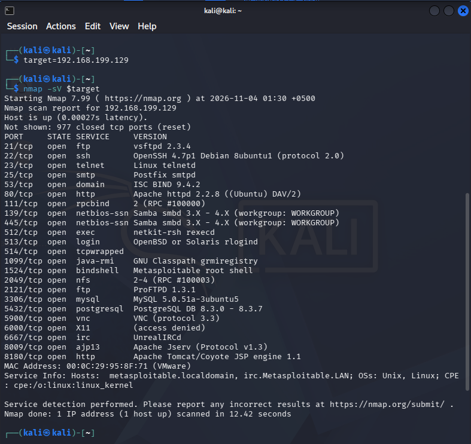
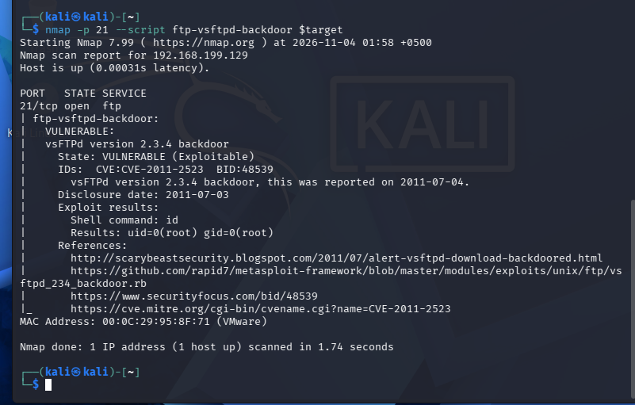
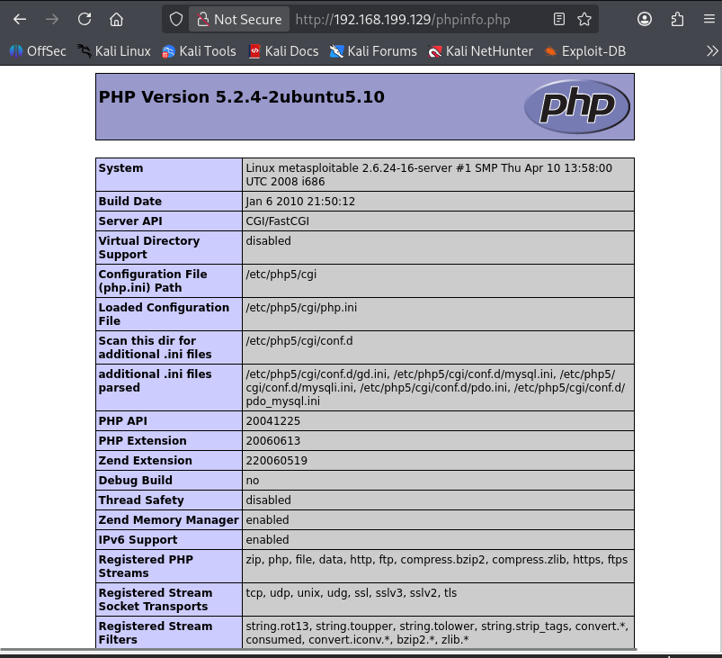
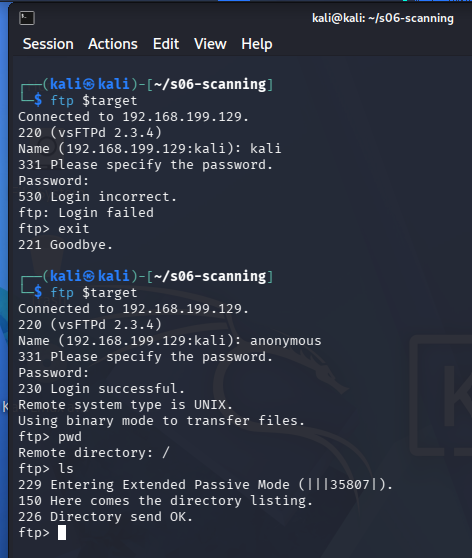

# SC-500 | Pakistan Software Export Board (PSEB)


<p align="center">

  

  

  

  

</p>


<p align="center">

  <strong>Cybersecurity Training, Practical Labs, Technical Reports & Projects</strong>

</p>


<p align="center">

  <a href="https://github.com/hckr-zahid/pseb-deploy-bootcamp">PSEB DEPLOY BootCamp Repository</a>

  &nbsp;|&nbsp;

  <a href="https://nvd.nist.gov/">National Vulnerability Database</a>

  &nbsp;|&nbsp;

  <a href="https://www.first.org/cvss/">CVSS Documentation</a>

</p>


---


## About This Repository


This repository documents my three-month training journey under the **SC-500 program**, conducted through the **Pakistan Software Export Board (PSEB) DEPLOY AI BootCamps Initiative**.


It serves as a centralized technical record of the knowledge, practical exercises, security assessments, research activities, and projects completed throughout the training program.


The repository is intended to demonstrate practical learning through structured documentation, reproducible lab work, technical analysis, and supporting evidence.


The primary focus is to strengthen cybersecurity knowledge, develop hands-on technical skills, and apply security concepts through practical exercises and projects.


---


## Program Overview


<table>

  <tr>

    <td><strong>Program</strong></td>

    <td>PSEB DEPLOY AI BootCamps Initiative</td>

  </tr>

  <tr>

    <td><strong>Organization</strong></td>

    <td>Pakistan Software Export Board (PSEB)</td>

  </tr>

  <tr>

    <td><strong>Training Track</strong></td>

    <td>SC-500</td>

  </tr>

  <tr>

    <td><strong>Duration</strong></td>

    <td>Three Months</td>

  </tr>

  <tr>

    <td><strong>Repository Type</strong></td>

    <td>Technical Learning & Practical Documentation</td>

  </tr>

  <tr>

    <td><strong>Primary Domain</strong></td>

    <td>Cybersecurity</td>

  </tr>

  <tr>

    <td><strong>Current Status</strong></td>

    <td>In Progress</td>

  </tr>

</table>


---


## Learning Objectives


Throughout this program, the focus is on developing practical capabilities in cybersecurity through structured learning and hands-on implementation.


Key objectives include:


- Understand cybersecurity principles, concepts, and security practices.

- Perform network discovery, scanning, enumeration, and vulnerability assessments.

- Identify security weaknesses and evaluate their potential impact.

- Work with industry-relevant cybersecurity tools and technologies.

- Understand vulnerability classification, CVSS scoring, and risk assessment.

- Analyze security configurations and common vulnerabilities.

- Develop technical documentation and professional security reports.

- Perform practical exercises in controlled and authorized lab environments.

- Build projects that demonstrate the application of learned concepts.


---


## Training Progress


The repository is organized by individual training sessions. Each session has its own documentation, scripts, and supporting evidence.


<table>

  <thead>

    <tr>

      <th>Session</th>

      <th>Topic</th>

      <th>Status</th>

      <th>Documentation</th>

    </tr>

  </thead>

  <tbody>

    <tr>

      <td>S01</td>

      <td>To be updated</td>

      <td>Pending</td>

      <td>—</td>

    </tr>

    <tr>

      <td>S02</td>

      <td>To be updated</td>

      <td>Pending</td>

      <td>—</td>

    </tr>

    <tr>

      <td>S03</td>

      <td>To be updated</td>

      <td>Pending</td>

      <td>—</td>

    </tr>

    <tr>

      <td>S04</td>

      <td>To be updated</td>

      <td>Pending</td>

      <td>—</td>

    </tr>

    <tr>

      <td>S05</td>

      <td>To be updated</td>

      <td>Pending</td>

      <td>—</td>

    </tr>

    <tr>

      <td>S06</td>

      <td>Network Scanning and Vulnerability Assessment</td>

      <td><strong>Completed</strong></td>

      <td><a href="s06-scanning/README.md">View Session</a></td>

    </tr>

    <tr>

      <td>S07</td>

      <td>From Vulnerability Scanning to Exploitation and Reporting</td>

      <td><strong>Completed</strong></td>

      <td><a href="s07-VAPT_Report/README.md">View Session</a></td>

    </tr>

        <tr>
      <td>S08</td>
      <td>Client-Side Attacks, Payloads & Post-Exploitation Analysis</td>
      <td><strong>Completed</strong></td>
      <td><a href="s08-client-side/README.md">View Session</a></td>
    </tr>
    <tr>
      <td>S09 (Day 5)</td>
      <td>Web Application Pentesting & Reconnaissance</td>
      <td><strong>Completed</strong></td>
      <td><a href="s09-web-pentest/README.md">View Session</a></td>
    </tr>
    <tr>
      <td>S09 (Day 6)</td>
      <td>Recon Workflow and File Upload Exploitation</td>
      <td><strong>Completed</strong></td>
      <td><a href="s09-recon-and-upload/README.md">View Session</a></td>
    </tr>
    <tr>
      <td>S10 onwards</td>
      <td>To be updated</td>
      <td>Upcoming</td>
      <td>—</td>
    </tr>

  </tbody>

</table>


*Session topics and progress will be updated as the training continues.*


---


## Completed Practical Work


### S06 — Network Scanning and Vulnerability Assessment


<p>

  

  

</p>


The S06 practical lab focused on network discovery, service enumeration, vulnerability identification, and security assessment using Kali Linux and Metasploitable 2.


#### Lab Environment


| Machine | IP Address | Role |

|---|---|---|

| Kali Linux | `192.168.199.128` | Assessment Machine |

| Metasploitable 2 | `192.168.199.129` | Vulnerable Target |


#### Tools Used


- Kali Linux

- Nmap

- FTP Client

- cURL

- Linux Terminal Utilities


#### Key Activities


1. Verified connectivity between the lab machines.

2. Performed network scanning using Nmap.

3. Identified running services and service versions.

4. Investigated the vsftpd 2.3.4 backdoor vulnerability.

5. Examined PHP information disclosure.

6. Tested anonymous FTP authentication.

7. Collected screenshots, logs, and scan outputs.

8. Researched CVSS scoring and the historical vsftpd supply-chain incident.


#### Security Findings


| Finding | Description | Preliminary Assessment |

|---|---|---|

| vsftpd 2.3.4 Backdoor | Detection of the known backdoor vulnerability, CVE-2011-2523 | Critical |

| PHP Information Disclosure | Publicly accessible PHP information page exposing configuration details | Medium |

| Anonymous FTP Access | Anonymous FTP authentication accepted by the target | Security Misconfiguration |


*Severity labels are preliminary lab assessments. Actual risk depends on system exposure, business context, and the security impact.*


#### Evidence


**Initial Network Scan**


<p align="center">

  

</p>


**vsftpd Backdoor Detection**


<p align="center">

  

</p>


**PHP Information Disclosure**


<p align="center">

  

</p>


**Anonymous FTP Authentication**


<p align="center">

  

</p>


#### Additional Documentation


| Evidence File | Description |

|---|---|

| [Initial Nmap Results](s06-scanning/evidence/initial-nmap.nmap) | Human-readable scan results |

| [Nmap XML Output](s06-scanning/evidence/initial-nmap.xml) | Structured scan output |

| [Nmap Grepable Output](s06-scanning/evidence/initial-nmap.gnmap) | Grepable scan output |

| [vsftpd Backdoor Check](s06-scanning/evidence/vsftpd-backdoor-check.txt) | Vulnerability detection output |

| [PHP Response Headers](s06-scanning/evidence/phpinfo-headers.txt) | HTTP response headers |

| [PHP Information Page](s06-scanning/evidence/phpinfo.html) | Captured PHP information page |

| [Anonymous FTP Session](s06-scanning/evidence/anonymous-ftp-session.txt) | FTP authentication and session evidence |

| [CVSS Analysis — Task B3](s06-scanning/evidence/task-b3-cvss-notes.md) | Vulnerability severity analysis |

| [vsftpd Supply-Chain Research — Task B6](s06-scanning/evidence/task-b6-vsftpd-supply-chain.md) | Historical supply-chain incident research |


All S06 testing was performed against an intentionally vulnerable Metasploitable 2 machine in an isolated lab environment.


<a href="s06-scanning/README.md"><strong>View Complete S06 Lab Documentation</strong></a>


### S07 — Vulnerability Assessment to Exploitation & Reporting


<p>

  

  

  

</p>


The S07 practical lab focused on transitioning from automated scanning to controlled weaponized exploitation, post-exploitation proof, GVM/OpenVAS analysis, and professional client reporting against Metasploitable 2 in an isolated lab environment.


#### Lab Environment


| Machine | IP Address | Role |

|---|---|---|

| Kali Linux | `10.50.20.10` | Assessment Machine |

| Metasploitable 2 | `10.50.20.30` | Vulnerable Target |


#### Tools Used


- Kali Linux Rolling

- Greenbone Vulnerability Management (GVM / OpenVAS v28.3.0)

- Metasploit Framework (MSF v6.4)

- Nmap Service Scanner

- OpenSSH & Netcat

- Python ReportLab (PDF Compilation)


#### Key Activities


1. Verified host-only laboratory isolation (`internet exit=1`, 0% packet leak).

2. Performed comprehensive TCP service enumeration and OS detection via Nmap.

3. Installed, initialized, and resolved PostgreSQL collation dependencies for GVM/OpenVAS (95,000+ NVTs).

4. Conducted comparative analysis between automated GVM candidate scanning and manual penetration testing.

5. Successfully exploited the vsftpd 2.3.4 backdoor (CVE-2011-2523) to acquire a root Meterpreter shell.

6. Validated weak default credentials (`msfadmin:msfadmin`) and local sudo root escalation (`sudo su`).

7. Confirmed unauthenticated direct root listener on port 1524 (`bindshell`).

8. Weaponized Samba 3.0.20 `usermap_script` (CVE-2007-2447) to obtain a root command shell.

9. Executed post-exploitation demonstration: exfiltrated `/etc/shadow` password hashes, staged a cron persistence backdoor, and verified clean-up discipline.

10. Generated an 8-page, publication-grade VA/PT Client Deliverable Report in PDF format.


#### Security Findings Summary


| Finding | Vulnerability Identifier | CVSS v3.1 | Exploit Mechanism | Root Proof |

|---|---|:---:|---|:---:|

| vsftpd 2.3.4 Backdoor | CVE-2011-2523 | 9.8 (Critical) | Metasploit (`vsftpd_234_backdoor`) | Verified (Meterpreter) |

| Samba 3.0.20 usermap_script | CVE-2007-2447 | 9.8 (Critical) | Metasploit (`usermap_script`) | Verified (Root Shell) |

| Unauthenticated Bindshell | CWE-287 / Insecure Service | 9.8 (Critical) | Raw TCP Socket (`nc 10.50.20.30 1524`) | Verified (Instant Root) |

| Weak Credentials & Sudo Abuse | CWE-1392 / CWE-250 | 8.1 (High) | SSH (`msfadmin`) + `sudo su` | Verified (uid=0) |


<a href="s07-VAPT_Report/README.md"><strong>View Complete S07 Lab Documentation</strong></a> | <a href="s07-VAPT_Report/S07_Vulnerability_Assessment_and_Penetration_Testing_Report.pdf"><strong>Download Formal VA/PT Report (PDF)</strong></a>


---


### S08 — Client-Side Attacks, Payloads & Post-Exploitation Analysis

<p>
  
  
  
</p>

The S08 practical laboratory focused on client-side offensive security, malware taxonomy, staged vs. inline payload engineering, Windows Access Token mechanics, and post-exploitation privilege elevation via Named Pipe Impersonation inside a pfSense-segmented dual-subnet testbed.

#### Lab Environment

| Machine | IP Address | Subnet / Role |
|---|---|---|
| pfSense 2.6.0 Gateway | 10.50.20.1 / 10.50.10.1 | Virtual Firewall & Inter-VLAN Router |
| Kali Linux 2024.x | 10.50.20.10 | VMnet3 (Offensive Zone) / Payload Engineering & Listener |
| Windows 10 Pro Target | 10.50.10.21 | VMnet2 (Enterprise LAN) / Client-Side Target & Token Elevation |

#### Core Objectives & Assessment Areas

1. **Malware Taxonomy Matrix (9 Families):** Detailed classification of Viruses, Worms, Trojans, Ransomware, Spyware, Adware, Rootkits, Botnets, and Fileless Malware with real-world exemplars and mitigations.
2. **User Interaction & LOLBins:** Deep-dive into why user interaction serves as the decisive security bypass and how Living-off-the-Land Binaries (PowerShell, Certutil, MSHTA, BITSAdmin) execute in memory.
3. **Payload Engineering & Delivery:** Generation of staged `windows/meterpreter/reverse_tcp` (355-byte stager), Python HTTP delivery, and handler configuration on port 4433.
4. **Execution Telemetry & Token Elevation:** Active process tracking in Task Manager, Meterpreter session establishment, and elevation to `NT AUTHORITY\SYSTEM` via Named Pipe Impersonation (`getsystem` Technique 1).
5. **Delivery Concepts & Regulatory Governance:** WinRAR SFX archive bundling, WAN ingress tunneling (LocalToNet/Ngrok), and compliance boundaries under Pakistan's Prevention of Electronic Crimes Act (PECA 2016).
6. **Career Statement & 90-Day Roadmap:** Professional pathway targeting SOC Analyst / Junior Penetration Tester roles with CompTIA Security+, BTL1, PNPT, and 3 open-source GitHub projects.

<a href="s08-client-side/README.md"><strong>View Complete S08 Lab Documentation</strong></a> | <a href="s08-client-side/S08_Client_Side_Attacks_Report.pdf"><strong>Download Formal Report (PDF)</strong></a> | <a href="s08-client-side/S08_Client_Side_Attacks_Report.docx"><strong>Download Formal Report (DOCX)</strong></a>

---

### S09 — Web Application Penetration Testing & Reconnaissance

<p>
  
  
  
</p>

The S09 practical assessment executed web application penetration testing and multi-source reconnaissance against the production enterprise surface `nuexus.com` (`*.nuexus.com`), covering the four graded mandates from the Day 5 curriculum.

#### Target & Assessment Environment
| Component | Asset / Domain | Purpose & Role |
|---|---|---|
| Target Production Surface | `*.nuexus.com` | Enterprise target domain (Next.js, Vercel, Cloudflare WAF/CDN) |
| Kali Linux 2026.3 | Offensive Operator | Subdomain recon, Google dorking, HTTP probe resolution, OWASP ZAP |
| Burp Suite Pro / CE | Web Proxy & Scanner | Manual session modeling, HTTP/2 inspection, Repeater verb tampering |
| OWASP ZAP (Checkmarx) | Automated DAST Scanner | Headless Firefox AJAX spidering, DOM taint-flow sink analysis (47 alerts) |

#### Core Objectives & Assessment Areas
1. **Task 1 — Scope & Rules of Engagement (25%):** Legal boundary definition for `*.nuexus.com`, testing windows, emergency contacts, explicit exclusions, and mandatory Break-Glass verification for wildcard assets.
2. **Task 2 — Google Dorking Vulnerability Assessment (25%):** Execution of 6 specialized search queries discovering exposed corporate emails, 5+ indexed proprietary technical playbooks, and subdomain leakage (`app.nuexus.com`).
3. **Task 3 — Multi-Engine Subdomain Reconnaissance (25%):** Triangulated discovery across `subfinder` (24 hosts), `assetfinder` (7 hosts), and `theHarvester` (20 hosts), reconciled and actively resolved with `httpx-toolkit` (identifying HTTP 200, 308, and HTTP 526 origin SSL errors).
4. **Task 4 — Automated Web Scanner Comparative Analysis (25%):** Comprehensive benchmark of Burp Suite (12 passive issues, API routing, CORS wildcard `*`) vs. OWASP ZAP (47 alerts, 6 High DOM XSS via headless browser crawling).

<a href="s09-web-pentest/README.md"><strong>View Complete S09 Lab Documentation</strong></a> | <a href="s09-web-pentest/S09_Web_Pentest_Recon_Report.pdf"><strong>Download Formal Report (PDF)</strong></a> | <a href="s09-web-pentest/S09_Web_Pentest_Recon_Report.docx"><strong>Download Formal Report (DOCX)</strong></a>

---

## Repository Structure


Each training session follows a consistent directory structure to keep documentation, scripts, and evidence organized.


```text

pseb-deploy-bootcamp/

│

├── README.md

│

├── s01/

│   ├── Scripts/

│   ├── README.md

│   └── evidence/

│

├── s02/

│   ├── Scripts/

│   ├── README.md

│   └── evidence/

│

├── s03/

│   ├── Scripts/

│   ├── README.md

│   └── evidence/

│

├── s04/

│   ├── Scripts/

│   ├── README.md

│   └── evidence/

│

├── s05/

│   ├── Scripts/

│   ├── README.md

│   └── evidence/

│

├── s06/

│   ├── Scripts/

│   ├── README.md

│   └── evidence/

│

└── ...

```


### Directory Guidelines


| Directory / File | Purpose |

|---|---|

| `Scripts/` | Scripts, commands, configuration files, and automation developed during the session |

| `README.md` | Session overview, objectives, methodology, findings, and conclusion |

| `evidence/` | Screenshots, logs, scan outputs, reports, and supporting evidence |


This structure will be repeated for each session throughout the training program.


---


## Tools & Technologies


The following tools and technologies are used or may be introduced during practical exercises, depending on the course content.


<table>

  <thead>

    <tr>

      <th>Category</th>

      <th>Tools & Technologies</th>

    </tr>

  </thead>

  <tbody>

    <tr>

      <td>Operating Systems</td>

      <td>Kali Linux, Linux</td>

    </tr>

    <tr>

      <td>Network Scanning</td>

      <td>Nmap</td>

    </tr>

    <tr>

      <td>Network Utilities</td>

      <td>Ping, FTP, cURL</td>

    </tr>

    <tr>

      <td>Vulnerability Assessment</td>

      <td>Nmap NSE and related assessment tools</td>

    </tr>

    <tr>

      <td>Virtualization</td>

      <td>VirtualBox, VMware</td>

    </tr>

    <tr>

      <td>Documentation & Version Control</td>

      <td>Markdown, Git, GitHub</td>

    </tr>

    <tr>

      <td>Security Research</td>

      <td>CVE, CVSS, NVD</td>

    </tr>

  </tbody>

</table>


The tools list will be expanded as additional technologies are introduced and used.


---


## Documentation Standards


Each session will follow a consistent documentation approach to ensure clarity, reproducibility, and professional presentation.


Where applicable, session documentation will include:


- **Objectives:** Purpose and expected learning outcomes.

- **Environment:** Systems, tools, and configurations used.

- **Methodology:** Steps and procedures followed.

- **Scripts and Commands:** Relevant commands, scripts, and configurations.

- **Findings:** Observed results and identified security issues.

- **Evidence:** Screenshots, logs, and supporting files.

- **Analysis:** Technical explanations and risk assessments.

- **Recommendations:** Suggested mitigation and remediation measures.

- **References:** Official documentation and reliable technical sources.


---


## Responsible Use & Disclaimer


All security testing and practical exercises documented in this repository are conducted for educational purposes in authorized environments.


- Testing is limited to systems owned by me or systems for which explicit authorization has been granted.

- Vulnerable machines are used in isolated laboratory environments.

- No unauthorized access or testing against third-party systems is intended.

- Security findings are documented for educational analysis and defensive improvement.


The information and techniques documented here must not be used against systems without proper authorization.


---


## Learning Journey


This repository will be continuously updated throughout the three-month training program.


Each session will contribute to a growing collection of practical exercises, scripts, technical reports, security research, and projects.


The objective is to build a structured record of practical cybersecurity experience and demonstrate the ability to understand, investigate, document, and analyze security challenges.


---


## References & Learning Resources


- [PSEB DEPLOY BootCamp Repository](https://github.com/hckr-zahid/pseb-deploy-bootcamp)

- [Pakistan Software Export Board](https://pseb.org.pk/)

- [National Vulnerability Database](https://nvd.nist.gov/)

- [Nmap Official Documentation](https://nmap.org/book/man.html)

- [FIRST CVSS Documentation](https://www.first.org/cvss/)

- [GitHub Markdown Documentation](https://docs.github.com/en/get-started/writing-on-github)


---


<p align="center">

  <strong>SC-500 | Pakistan Software Export Board</strong>

  <br>

  <span>Cybersecurity Training & Practical Documentation</span>

  <br><br>

  <sub>Learning through practice. Building through projects. Improving through documentation.</sub>

</p>

