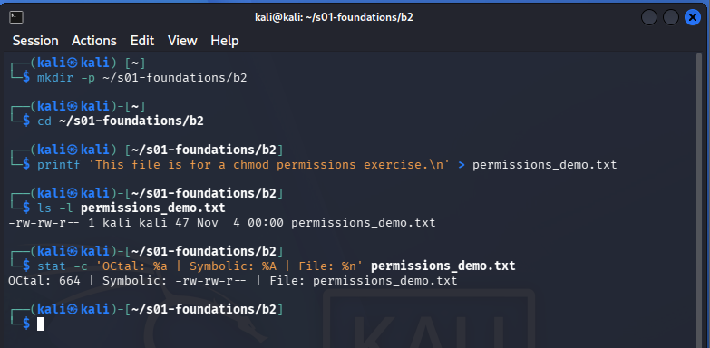
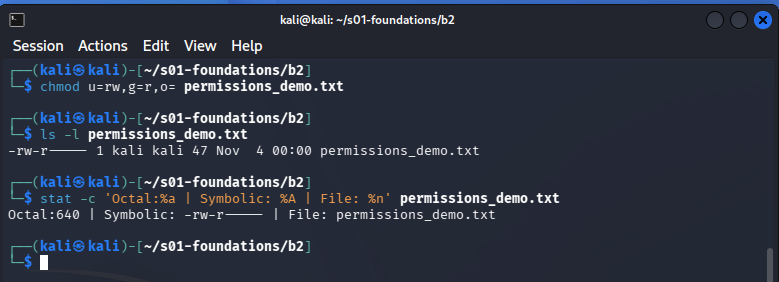
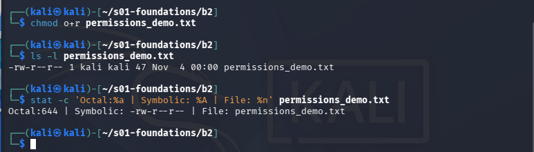
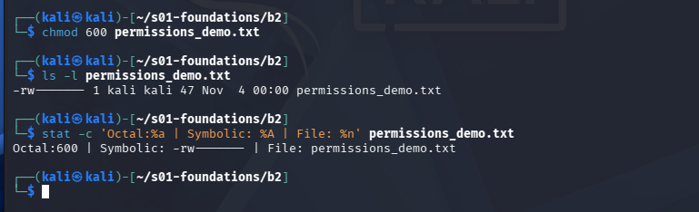
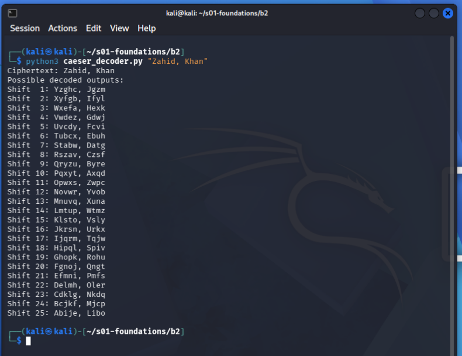

<div align="center">

# S01 Foundations
## Malware Research and Linux Practical Work

**Zahid Ullah**  
**Cohort:** 02-Weekend-ISB

**Tasks completed:** Task A, B2, B3  
**Environment:** Kali Linux / Linux terminal; Python 3

</div>

**Repository path:** [s01-foundations/README.md](https://github.com/hckr-zahid/pseb-deploy-bootcamp/tree/main/s01-foundations/README.md)

---

## Table of Contents

- [Task A — Malware Types and Real-World Examples](#task-a)
- [Task B2 — Linux File Permissions](#task-b2)
- [Task B3 — Caesar Cipher Decoder in Python](#task-b3)
- [GitHub Repository Structure](#github-repository-structure)
- [References](#references)

---

<a id="task-a"></a>
# TASK A
## MALWARE TYPES AND REAL-WORLD EXAMPLES

The word malware describes software or code used to perform unwanted or harmful actions. The categories below describe different properties: some describe how code spreads (for example, a worm), while others describe its purpose or concealment method (for example, spyware or a rootkit). A single malware family can therefore fit more than one category.

| Malware type | Definition | Example + year | How it spread / reached victims | Primary impact |
|---|---|---|---|---|
| **Virus** | A virus inserts its code into a host file, document, or boot area. It normally needs that infected host to be run or accessed before it can infect further items. | Brain (1986) | The boot-sector virus was carried on infected 5.25-inch floppy disks. When an infected disk was used on an IBM PC-compatible computer, Brain could copy itself to other floppy disks accessed by that machine. | It replaced the floppy disk's boot sector with its own code and moved the original boot sector elsewhere. It was designed primarily to replicate and identify itself, not to destroy user files. Brain was written by two brothers in Lahore, Pakistan. [1][2] |
| **Worm** | A worm is malware that can make and distribute copies of itself to other systems without needing to attach itself to a separate host program. | Morris worm (1988) | It spread among networked Unix systems on the early Internet by exploiting weaknesses in services such as `sendmail` and `finger`, and by guessing accounts with weak passwords. | Repeated infections and self-replication consumed system resources and disrupted thousands of networked computers. The FBI describes it as the first major attack on the Internet. [3][4] |
| **Trojan** | A Trojan presents itself as useful or legitimate software, or arrives disguised as an expected file, but performs hidden malicious actions after execution. It does not need to self-replicate. | Zeus / Zbot (first observed 2007) | Criminals distributed Zeus through phishing and drive-by downloads that exploited vulnerable browsers or applications. | It stole online-banking credentials and other sensitive information, enabling criminals to access accounts and redirect financial transfers. Zeus also provided a platform for building botnets. [5][6] |
| **Ransomware** | Ransomware denies access to data or systems—usually by encrypting files—and demands payment for restoring access. Some families also steal data or destroy it. | WannaCry (2017) | It exploited the Windows SMB vulnerability associated with EternalBlue to spread between vulnerable, reachable computers. The NHS warned that the campaign affected organisations internationally and was not aimed only at the NHS. | It encrypted commonly used files and displayed a ransom demand. Healthcare and other organisations experienced disruption because affected computers and services became unavailable. [7][8] |
| **Spyware** | Spyware covertly monitors a person's device or activity and sends the collected information to an operator. | Pegasus (documented targeting in 2016) | In the 2016 case involving UAE human-rights defender Ahmed Mansoor, suspicious SMS messages contained links to NSO exploit infrastructure. Clicking could trigger an exploit chain that installed Pegasus on the phone. Later Pegasus campaigns also used zero-click techniques, so not every infection required a click. | Pegasus enabled highly intrusive surveillance, including access to messages, calls, location, microphone, and camera functions. Citizen Lab documented the targeting of Mansoor and other civil-society figures. [9][10] |
| **Adware** | Adware is software that displays or injects advertising. Malicious adware goes further by hijacking browser settings, redirecting searches, or collecting browsing information without meaningful consent. | Fireball (2017) | Check Point reported that Fireball was commonly bundled with software users wanted to install, including freeware and browser-related downloads. | It hijacked browsers and manipulated web traffic to generate advertising revenue. Researchers said its capabilities also allowed it to execute code and download additional malware. [11] |
| **Rootkit** | A rootkit changes or abuses low-level system components so that an attacker or unwanted program can hide files, processes, registry entries, or other evidence of its presence. | Sony BMG XCP rootkit (2005) | The XCP component was installed on some Windows computers when users played certain Sony BMG music CDs and accepted the installation prompt / licence terms. | It concealed files and registry objects associated with its copy-protection software. Its hidden behaviour created security and privacy risks and could also hide other malicious activity. This is an example of rootkit technology being used in commercial copy protection, not a conventional criminal malware campaign. [12][13] |
| **Keylogger** | A keylogger records keys typed by a user. It may be a standalone tool or one feature inside a larger information-stealing Trojan. | Agent Tesla (active since 2014) | Agent Tesla has commonly been delivered in phishing emails with malicious attachments, including Office documents disguised as business correspondence. | It records keystrokes and can steal saved credentials, clipboard contents, and screenshots. This can expose email, VPN, browser, and other account credentials to an attacker. [14][15] |
| **Botnet agent** | A botnet agent is malware that turns an infected device into a remotely controlled member of a larger group of compromised devices (a botnet). | GameOver Zeus (emerged 2011) | It infected computers through the Zeus malware ecosystem, including phishing and malicious downloads. Infected machines communicated with the criminal botnet using a decentralised peer-to-peer design. | The botnet silently collected banking credentials and helped criminals initiate or redirect fraudulent wire transfers. The US Department of Justice reported estimates of 500,000 to one million infected computers and more than US$100 million in losses. [16] |
| **Fileless / living-off-the-land** | Fileless attacks execute or persist malicious instructions without relying on a conventional malicious executable saved to disk. Living-off-the-land (LOTL) attacks abuse legitimate tools already present on a system, such as PowerShell or WMI. The terms overlap but are not identical. | Misfox (documented by Microsoft in 2018) | Microsoft documented a campaign in which a backdoor was deployed and a subtler channel used registry-stored, obfuscated PowerShell code. The initial access vector can vary; “fileless” describes how later stages execute or persist, not necessarily how the attacker first gets in. | The PowerShell payload ran without dropping a conventional executable file and used a registry Run key for persistence, making ordinary file-based scanning less effective. [17][18] |
| **Logic bomb** | A logic bomb is code planted in a system that stays inactive until a specified condition occurs, such as a date, event, or change in a user account. | UBS PaineWebber logic bomb (2002) | A systems administrator with privileged access allegedly planted the code on company computers before leaving the company. It did not spread itself; the insider placed it on the network. | The program activated on 4 March 2002 and deleted files on more than 1,000 computers. The US Department of Justice said the damage assessment and repair cost exceeded US$3 million. [19] |
| **Bootkit** | A bootkit infects the boot process, such as the Master Boot Record (MBR), so malicious code can run before the operating system has fully started. | TDL-4 (2011) | TDL-4 was installed by the TDSS/TDL Trojan family. Its delivery methods varied; the important distinction is that the bootkit component modified the MBR after reaching the machine. | It modified the MBR so its code could gain control before the operating-system loader. This early execution point made the malware harder to detect and remove using tools that operate only after the OS starts. [20][21] |

### Which type is most dangerous for a Pakistani SME?

For a typical Pakistani small or medium-sized business, I consider ransomware the most dangerous single malware type because one successful incident can make accounting records, customer files, invoices, and shared business data unavailable at the same time. SMEs may have limited IT staff, weak patch management, and backups that are connected to the same network, so recovery can be expensive and prolonged; WannaCry demonstrates how an unpatched SMB service can turn one vulnerable computer into a wider incident. A practical defence is to patch internet-facing and networked systems promptly, restrict unnecessary SMB exposure, use tested offline or immutable backups, enable endpoint protection, and train staff to recognise phishing.

---

<a id="task-b2"></a>
# TASK B2
## LINUX FILE PERMISSIONS

### Objective

Create a text file and demonstrate three permission changes using both symbolic and octal chmod notation. The `ls -l` output shows the human-readable permission string, while `stat` prints the numeric octal mode. GNU Coreutils documents both symbolic modes and numeric modes for chmod. [22][23]

### Permission notation

Linux permissions are assigned separately to:

| Symbol | Meaning |
|---|---|
| `u` | the file owner (user) |
| `g` | users in the file's group |
| `o` | everyone else (other) |
| `r` | read (value 4) |
| `w` | write (value 2) |
| `x` | execute (value 1) |

For an ordinary file, the three octal digits represent owner, group, and other permissions. The values in each digit are added: `rwx = 4 + 2 + 1 = 7`, `rw- = 4 + 2 = 6`, `r-- = 4`, and `--- = 0`.

### 1. Initial file permissions

The initial permissions depend on the current `umask`. The terminal screenshot records the initial file permissions and command output.



### 2. Change 1: symbolic assignment (`u=`, `g=`, `o=`)

The command assigns read and write permission to the owner, read permission to the group, and no permissions to other users:

```bash
chmod u=rw,g=r,o= permissions_demo.txt
```

**Explanation:** the owner can read and write; the group can read; other users receive no permissions. The `=` operator sets the selected permission bits rather than merely adding or removing one permission.



### 3. Change 2: symbolic addition (`+`)

The command adds read permission for other users:

```bash
chmod o+r permissions_demo.txt
```

`o+r` adds read permission for other users while retaining the existing owner and group permissions.



### 4. Change 3: octal assignment

The command sets the file mode to `600`:

```bash
chmod 600 permissions_demo.txt
```

6 for the owner means read + write (4 + 2); 0 for the group and 0 for others means no permissions for either. This is a common restrictive setting for a private file.



### B2 results summary

| Stage | Command / mode | Expected `ls -l` permissions | Meaning |
|---|---|---|---|
| Initial | Created under current `umask` | Depends on VM | Record actual output |
| Change 1 | `chmod u=rw,g=r,o=` — 640 | `-rw-r-----` | Owner read/write; group read; others none |
| Change 2 | `chmod o+r` — 644 | `-rw-r--r--` | Adds read permission for others |
| Change 3 | `chmod 600` — 600 | `-rw-------` | Owner read/write only |

---

<a id="task-b3"></a>
# TASK B3
## CAESAR CIPHER DECODER IN PYTHON

### Objective

Write a Python program that accepts a Caesar-shifted string and prints all 25 non-zero possible shifts. The program preserves spaces, punctuation, and letter case.

A Caesar cipher shifts each alphabetic character by a fixed number of positions. To decode, the program tries every possible non-zero shift from 1 through 25 and prints each candidate plaintext.

### Python script

Save file as `caesar_decoder.py`:

```python
#!/usr/bin/env python3
import argparse
import string

def caesar_decode(text: str, shift: int) -> str:
    """Decode text by shifting letters backwards; preserve case and punctuation."""
    result = []

    for char in text:
        if char in string.ascii_lowercase:
            index = (ord(char) - ord("a") - shift) % 26
            result.append(chr(ord("a") + index))
        elif char in string.ascii_uppercase:
            index = (ord(char) - ord("A") - shift) % 26
            result.append(chr(ord("A") + index))
        else:
            result.append(char)

    return "".join(result)

def main() -> None:
    parser = argparse.ArgumentParser(
        description="Try all 25 non-zero Caesar cipher shifts."
    )
    parser.add_argument(
        "text",
        help='The shifted text, for example: "Khoor, Zruog!"'
    )
    args = parser.parse_args()
    print(f"Ciphertext: {args.text}")
    print("Possible decoded outputs:")

    for shift in range(1, 26):
        print(f"Shift {shift:2}: {caesar_decode(args.text, shift)}")

if __name__ == "__main__":
    main()
```

### Example

From the directory where the script is saved:

```bash
python3 caesar_decoder.py "Zahid, Khan"
```



```bash
python3 caesar_decoder.py "Pakistan, Zindabad"
```

### Why 25 tries is not security

A Caesar cipher has only 25 meaningful non-zero shifts for English letters, so a computer can test every possible key almost instantly. It also preserves letter-frequency patterns, making it vulnerable to simple frequency analysis. It is useful for learning substitution ciphers, but it must not be used to protect real passwords, files, or communications.

---

<a id="github-repository-structure"></a>
## GitHub Repository structure

```text
pseb-deploy-bootcamp/
└── s01-foundations/
    ├── README.md
    ├── caesar_decoder.py
    └── Figures/
        ├── b2-1-initial.png
        ├── b2-2-symbolic-640.png
        ├── b2-3-symbolic-644.png
        ├── b2-4-octal-600.png
        └── b3-caesar-run.png
```

---

<a id="references"></a>
## References

1. Computing History, “Brain, the first PC virus, is released” (19 January 1986). https://www.computinghistory.org.uk/det/6303/Brain%2C%20the%20first%20PC%20virus%2C%20is%20released
2. IBM, “The History of Malware” (background on Brain, Morris, ILOVEYOU, CryptoLocker and other malware). https://www.ibm.com/think/topics/malware-history
3. FBI, “Morris Worm”, Major Cases. https://www.fbi.gov/investigate/cyber/major-cases
4. IBM, “The History of Malware” (Morris worm propagation and impact). https://www.ibm.com/think/topics/malware-history
5. IBM X-Force, 2011 Trend and Risk Report (Zeus identified in 2007; phishing and drive-by-download infection vectors). https://www.fbiic.gov/public/2012/mar/2011IBMReport-March2012.pdf
6. NHS England Digital, “Zeus Trojan” (first observed in 2007; banking credential theft). https://digital.nhs.uk/cyber-alerts/2017/cc-1138
7. NHS England Digital, “WannaCry Ransomware Using SMB Vulnerability” (2017). https://digital.nhs.uk/cyber-alerts/2017/cc-1411
8. CERT-EU, “WannaCry Ransomware Campaign Exploiting SMB Vulnerability” (Security Advisory 2017-012). https://cert.europa.eu/publications/security-advisories/2017-012/
9. Citizen Lab, “The Million Dollar Dissident” (2016), and related Pegasus research. https://citizenlab.ca/research/million-dollar-dissident-iphone-zero-day-nso-group-uae/
10. Amnesty International Security Lab, “The Pegasus Project” (forensic findings on Pegasus targeting and zero-click attacks). https://securitylab.amnesty.org/case-study-the-pegasus-project/
11. Check Point Research, “Fireball — The Chinese Malware of 250 Million Computers Infected” (1 June 2017). https://blog.checkpoint.com/research/fireball-chinese-malware-250-million-infection/
12. Electronic Frontier Foundation, Sony BMG Litigation (XCP and MediaMax CD copy-protection software). https://w2.eff.org/IP/DRM/Sony-BMG/
13. Mark Russinovich, “Inside Sony’s rootkit”, Virus Bulletin (December 2005). https://www.virusbulletin.com/virusbulletin/2005/12/inside-sony-s-rootkit/
14. Fortinet FortiGuard Labs, “Phishing Campaign Targeting Korean to Deliver Agent Tesla New Variant” (10 December 2021). https://www.fortinet.com/blog/threat-research/phishing-campaign-targeting-korean-to-deliver-agent-tesla-new-variant
15. Netskope Threat Labs, Agent Tesla malware profile. https://threatlabs.netskope.com/library/malware/agent-tesla
16. US Department of Justice, “U.S. Leads Multi-National Action Against ‘Gameover Zeus’ Botnet and ‘Cryptolocker’ Ransomware” (2 June 2014). https://www.justice.gov/archives/opa/pr/us-leads-multi-national-action-against-gameover-zeus-botnet-and-cryptolocker-ransomware
17. Microsoft Security Blog, “Now you see me: Exposing fileless malware” (24 January 2018). https://www.microsoft.com/en-us/security/blog/2018/01/24/now-you-see-me-exposing-fileless-malware/
18. Microsoft Learn, “Fileless threats” (fileless threat categories and Poshspy / Kovter examples). https://learn.microsoft.com/en-us/defender-endpoint/malware/fileless-threats
19. US Department of Justice, “Disgruntled UBS PaineWebber Employee Charged with Allegedly Unleashing ‘Logic Bomb’ on Company Computers” (17 December 2002). https://www.justice.gov/archive/criminal/cybercrime/press-releases/2002/duronioIndict.htm
20. ESET, “When I'm x64: Bootkit threat evolution” (TDL-4, 2011). https://www.eset.com/fileadmin/eset/US/resources/docs/white-papers/white-papers-when-im-x64-bootkit-threat-evolution-2011.pdf
21. Check Point, “Rootkit: TDLv4” (4 July 2011). https://advisories.checkpoint.com/defense/advisories/public/2011/cpai-2011-323.html
22. GNU Project, GNU Coreutils Manual — `chmod` invocation. https://www.gnu.org/software/coreutils/manual/html_node/chmod-invocation.html
23. GNU Project, GNU Coreutils Manual — File permissions / Numeric modes / Symbolic modes. https://www.gnu.org/software/coreutils/manual/html_node/File-permissions.html
