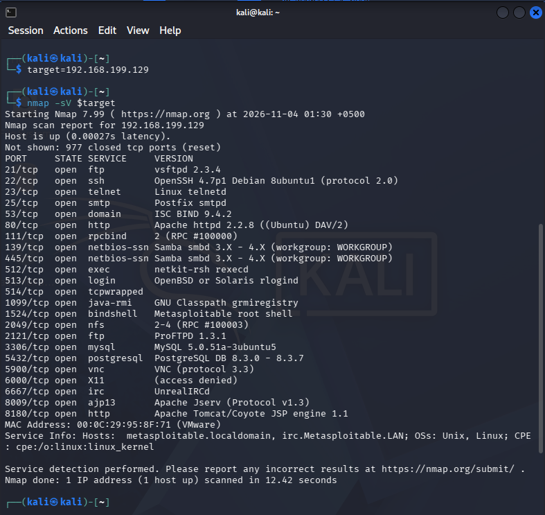
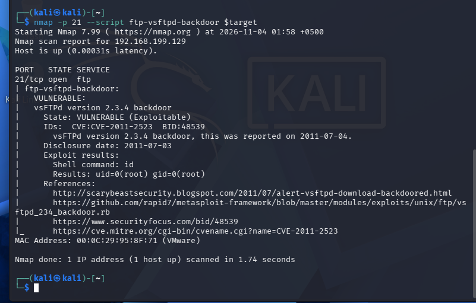
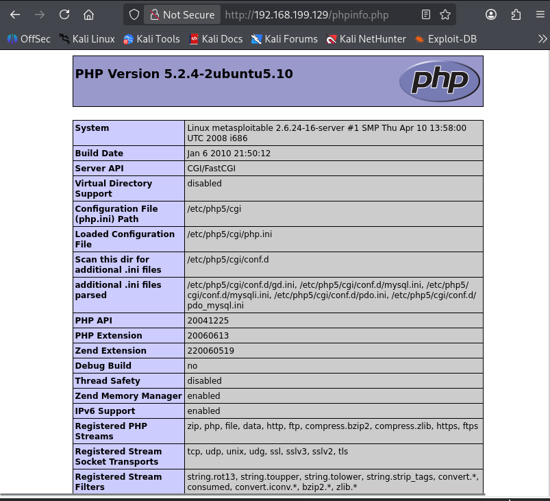
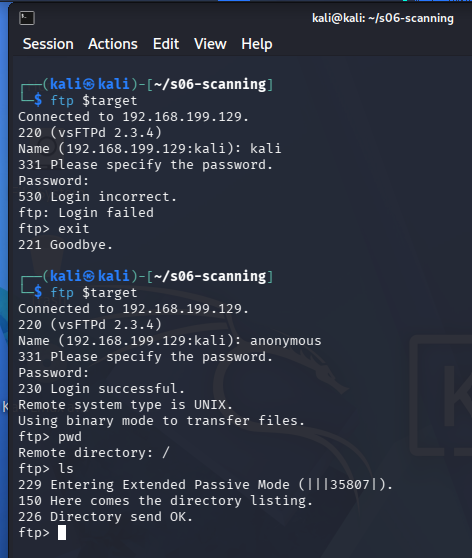

# 🔍 S06 — Network Scanning & Vulnerability Assessment

<p align="center">
  
  
  
  
</p>

<p align="center">
  <b>Practical Cybersecurity Lab | Network Reconnaissance | Service Enumeration | Vulnerability Assessment</b>
</p>

---

## 📌 Table of Contents

1. [Project Overview](#-project-overview)
2. [Lab Environment](#-lab-environment)
3. [Host Discovery and Connectivity](#1-host-discovery-and-connectivity)
4. [Initial Nmap Scan](#2-initial-nmap-scan-and-service-enumeration)
5. [Task A — Vulnerability Findings](#3-task-a--vulnerability-findings)
   - [Finding 01 — vsftpd Backdoor](#finding-01--vsftpd-234-backdoor)
   - [Finding 02 — PHP Information Disclosure](#finding-02--php-information-disclosure)
   - [Finding 03 — Anonymous FTP Access](#finding-03--anonymous-ftp-access)
6. [Task B3 — CVSS Metric Decoding](#4-task-b3--cvss-metric-decoding)
7. [Task B6 — Supply-Chain Compromise](#5-task-b6--vsftpd-supply-chain-compromise)
8. [Conclusion](#-conclusion)
9. [Evidence Repository](#-evidence-repository)
10. [Repository Structure](#-repository-structure)

---

## 📖 Project Overview

This project documents a practical network scanning and vulnerability assessment exercise performed using **Kali Linux** against an intentionally vulnerable **Metasploitable 2** virtual machine.

The purpose of this lab was to understand how attackers and security professionals perform network reconnaissance, identify open ports, enumerate running services, and investigate potential security weaknesses.

### 🎯 Lab Objectives

- Verify connectivity between the attacker and target machines.
- Discover open ports and running services using Nmap.
- Identify vulnerable services and security misconfigurations.
- Investigate and document three vulnerability findings.
- Understand CVSS vulnerability scoring metrics.
- Research the historical vsftpd software supply-chain compromise.
- Preserve screenshots and command outputs as technical evidence.

---

## 🖥️ Lab Environment

| Component | Configuration |
|---|---|
| Attacker Machine | Kali Linux |
| Target Machine | Metasploitable 2 |
| Kali IP Address | `192.168.199.128` |
| Target IP Address | `192.168.199.129` |
| Scanning Tool | Nmap 7.99 |
| Additional Tools | curl, FTP client |
| Working Directory | `~/s06-scanning` |
| Network | Isolated virtual lab network |

> **Authorization and scope:** All testing documented in this project was performed against the intentionally vulnerable Metasploitable 2 virtual machine in the lab environment.

---

## 1. Host Discovery and Connectivity

Before scanning, I verified that the target machine was reachable from Kali Linux.

**Command executed:**

```bash
ping -c 4 192.168.199.129
```

**Observed result:**

- Packets transmitted: 4
- Packets received: 4
- Packet loss: 0%

<details>
<summary><b>📸 Host connectivity evidence (optional screenshot)</b></summary>

If you saved a ping screenshot, add it here:

``

</details>

The successful response confirmed network connectivity between the two virtual machines.

---

## 2. Initial Nmap Scan and Service Enumeration

I performed an Nmap scan using default scripts and service-version detection.

**Command executed:**

```bash
cd ~/s06-scanning

sudo nmap -sC -sV -oA evidence/initial-nmap 192.168.199.129
```

The scan identified multiple exposed services on the target machine.

### 🔎 Important Scan Results

| Port | State | Service | Detected Version / Information |
|---|---|---|---|
| 21/tcp | Open | FTP | vsftpd 2.3.4 |
| 22/tcp | Open | SSH | OpenSSH 4.7p1 |
| 23/tcp | Open | Telnet | Linux telnetd |
| 25/tcp | Open | SMTP | Postfix |
| 53/tcp | Open | DNS | BIND 9.4.2 |
| 80/tcp | Open | HTTP | Apache 2.2.8 |
| 111/tcp | Open | RPC | rpcbind |
| 139/tcp | Open | SMB | Samba |
| 445/tcp | Open | SMB | Samba |
| 3306/tcp | Open | MySQL | MySQL 5.0.51a |
| 5432/tcp | Open | PostgreSQL | PostgreSQL 8.3 |
| 5900/tcp | Open | VNC | VNC |
| 6667/tcp | Open | IRC | UnrealIRCd |
| 8180/tcp | Open | HTTP | Apache Tomcat 5.5 |

Additional services were also identified during the scan.

### 📸 Initial Nmap Scan Evidence



*Figure 1: Initial Nmap scan showing open ports and detected services.*

### 📂 Saved Nmap Outputs

The scan results were saved in three formats:

- [Nmap normal output](evidence/initial-nmap.nmap)
- [Nmap XML output](evidence/initial-nmap.xml)
- [Nmap greppable output](evidence/initial-nmap.gnmap)

---

# 3. Task A — Vulnerability Findings

Three security findings were investigated using the initial scan results and additional service checks.

---

## Finding 01 — vsftpd 2.3.4 Backdoor

<kbd>CRITICAL</kbd> `CVE-2011-2523`

| Attribute | Details |
|---|---|
| Affected Service | FTP |
| Port | TCP 21 |
| Detected Version | vsftpd 2.3.4 |
| Vulnerability | Backdoor / Remote Command Execution |
| Severity Assessment | Critical |

### Investigation

The initial Nmap scan identified vsftpd 2.3.4 running on TCP port 21.

I used the Nmap `ftp-vsftpd-backdoor` script to check whether the service was affected by the known backdoor.

**Command executed:**

```bash
nmap -p 21 --script ftp-vsftpd-backdoor \
-oN evidence/vsftpd-backdoor-check.txt \
192.168.199.129
```

### Observed Result

Nmap reported:

```text
VULNERABLE:
vsFTPd version 2.3.4 backdoor

State: VULNERABLE (Exploitable)

CVE: CVE-2011-2523

Shell command: id
Results: uid=0(root) gid=0(root)
```

This result demonstrates that the backdoor check obtained root-level command execution on the Metasploitable 2 target.

### Potential Impact

If present on a real system, unauthenticated remote command execution with root privileges could allow an attacker to:

- Access sensitive information.
- Modify system files and data.
- Disrupt services.
- Obtain control over the affected machine.

### Recommended Mitigation

- Remove the affected software.
- Install a trusted and supported version.
- Verify software signatures and checksums.
- Restrict FTP exposure where it is not required.
- Monitor exposed services for suspicious activity.

### 📸 vsftpd Backdoor Evidence



*Figure 2: Nmap identifies the vsftpd backdoor and demonstrates root-level command execution.*

**Technical evidence:** [vsftpd-backdoor-check.txt](evidence/vsftpd-backdoor-check.txt)

---

## Finding 02 — PHP Information Disclosure

<kbd>MEDIUM</kbd> Publicly Accessible Configuration Information

| Attribute | Details |
|---|---|
| Affected Service | HTTP |
| Port | TCP 80 |
| Page | `/phpinfo.php` |
| Vulnerability | Information Disclosure |
| Severity Assessment | Medium |

### Investigation

I checked the HTTP response headers of the PHP information page.

**Command executed:**

```bash
curl -I http://192.168.199.129/phpinfo.php
```

### Observed Result

The server returned:

```text
HTTP/1.1 200 OK
Server: Apache/2.2.8 (Ubuntu) DAV/2
X-Powered-By: PHP/5.2.4-2ubuntu5.10
```

The publicly accessible PHP information page exposed additional environment and configuration details, including:

- PHP version information.
- Operating-system information.
- PHP configuration paths.
- Server environment details.

### Potential Impact

Exposing PHP and server configuration information can help attackers identify software versions and plan further attacks.

This test confirms information disclosure; it does not, by itself, demonstrate compromise of the web server.

### Recommended Mitigation

- Remove `phpinfo.php` from publicly accessible directories.
- Restrict configuration information to authorized administrators.
- Avoid exposing unnecessary server details.
- Keep server software updated.

### 📸 PHP Information Disclosure Evidence



*Figure 3: PHP information page showing server and PHP configuration details.*

**Supporting evidence:**

- [HTTP response headers](evidence/phpinfo-headers.txt)
- [Saved PHP information page](evidence/phpinfo.html)
- [PHP screenshot](evidence/phpinfo-page.png)

---

## Finding 03 — Anonymous FTP Access

<kbd>MEDIUM</kbd> Anonymous Authentication Enabled

| Attribute | Details |
|---|---|
| Affected Service | FTP |
| Port | TCP 21 |
| Observed Behaviour | Anonymous login accepted |
| Vulnerability | Anonymous Access / Access Control Weakness |
| Severity Assessment | Medium; depends on accessible data and permissions |

### Investigation

I connected to the FTP service and attempted to authenticate using two usernames.

**Command executed:**

```bash
ftp 192.168.199.129
```

First, I attempted to log in using the username `kali`. This attempt failed.

I then attempted to log in using the username `anonymous`.

### Observed Result

The FTP server accepted anonymous authentication:

```text
Name: anonymous

230 Login successful.
Remote system type is UNIX.
Using binary mode to transfer files.
```

I then checked the working directory and attempted to list its contents.

```text
ftp> pwd
Remote directory: /

ftp> ls

150 Here comes the directory listing.
226 Directory send OK.
```

The directory listing completed successfully, but no filenames were displayed.

Therefore, this test confirms that anonymous authentication was accepted and a listing operation succeeded. It does not establish that files were exposed.

### Potential Impact

Anonymous FTP access can expose files if they are present in accessible directories and readable by anonymous users.

### Recommended Mitigation

- Disable anonymous FTP access unless explicitly required.
- Restrict anonymous users to a dedicated directory.
- Apply least-privilege permissions.
- Monitor FTP access and activity.

### 📸 Anonymous FTP Evidence



*Figure 4: Anonymous FTP login successfully accepted by the target server.*

**Technical evidence:** [anonymous-ftp-session.txt](evidence/anonymous-ftp-session.txt)

---

# 4. Task B3 — CVSS Metric Decoding

**Vulnerability:** vsftpd 2.3.4 Backdoor  
**CVE:** CVE-2011-2523

This task explains the CVSS metric values in plain English.

## CVSS 3.1 Vector

```text
CVSS:3.1/AV:N/AC:L/PR:N/UI:N/S:U/C:H/I:H/A:H
```

| Metric | Value | My Interpretation |
|---|---|---|
| Attack Vector (AV) | N | The attacker can reach the vulnerable FTP service over a network. |
| Attack Complexity (AC) | L | The attack does not require unusual conditions or complicated preparation. |
| Privileges Required (PR) | N | The attacker does not need an existing account or prior privileges. |
| User Interaction (UI) | N | No action by another user is needed for the attack. |
| Scope (S) | U | The consequences remain within the security authority of the affected system. |
| Confidentiality (C) | H | Successful exploitation can expose sensitive information. |
| Integrity (I) | H | Successful exploitation can allow unauthorized modification of system data. |
| Availability (A) | H | Successful exploitation can interrupt services or make the system unavailable. |

## CVSS 2.0 Vector

```text
AV:N/AC:L/Au:N/C:C/I:C/A:C
```

| Metric | Value | My Interpretation |
|---|---|---|
| Access Vector (AV) | N | The attack can be launched over a network. |
| Access Complexity (AC) | L | The attack requires relatively few special conditions. |
| Authentication (Au) | N | No authentication is required before attempting the attack. |
| Confidentiality (C) | C | The attack can expose all information protected by the affected system. |
| Integrity (I) | C | The attack can allow extensive unauthorized changes. |
| Availability (A) | C | The attack can cause complete loss of service availability. |

### My Assessment

The vectors describe a remotely reachable vulnerability that does not require prior authentication. Its potential consequences affect confidentiality, integrity, and availability.

In my practical assessment, Nmap detected the vsftpd 2.3.4 backdoor and successfully executed the `id` command, returning:

```text
uid=0(root) gid=0(root)
```

This demonstrates root-level command execution on the Metasploitable 2 target.

The published base scores are:

- **CVSS 3.1:** 9.8
- **CVSS 2.0:** 10.0

The two versions use different metric systems, so their scores should not be treated as directly interchangeable.

### Supporting Notes

[📄 View Task B3 CVSS Notes](evidence/task-b3-cvss-notes.md)

### References

- [NIST National Vulnerability Database — CVE-2011-2523](https://nvd.nist.gov/vuln/detail/CVE-2011-2523)
- [FIRST — CVSS v3.1 Specification](https://www.first.org/cvss/v3.1/specification-document)
- [FIRST — CVSS v2 Guide](https://www.first.org/cvss/v2/guide)

---

# 5. Task B6 — vsftpd Supply-Chain Compromise

## What Happened?

In 2011, the official vsftpd download site was compromised and the `vsftpd-2.3.4.tar.gz` source archive was replaced with a modified version containing a malicious backdoor.

The compromised archive was available for approximately three days around the end of June and beginning of July 2011.

This was a supply-chain attack because the attacker tampered with the software distribution process rather than exploiting an ordinary programming flaw in the legitimate release.

The backdoor was designed to activate when an FTP login username contained the characters `:)`. After activation, it opened a shell on TCP port 6200, potentially allowing an attacker to execute commands on the affected machine.

The issue is associated with **CVE-2011-2523**.

## How Was It Discovered?

Contemporary reporting credited Mathias Kresin with noticing the suspicious archive.

Chris Evans, the author of vsftpd, investigated and publicly warned users that the download had been compromised.

A failed detached GPG signature verification was an important indication that the archive could not be authenticated as an unmodified release.

## Why Is It Relevant Today?

This incident demonstrates that trusting a software name or download location is not enough.

An attacker who compromises a software project's distribution site can potentially affect users who download and install malicious packages.

Modern software projects depend on external packages, repositories, build systems, and distribution services. Therefore, supply-chain risks remain relevant.

### Risk Reduction Measures

- Verify digital signatures and checksums.
- Download software from trusted sources.
- Keep software and dependencies updated.
- Monitor unexpected network services.
- Maintain an inventory of installed software.
- Follow secure software supply-chain practices.

### References

- Chris Evans — [Alert: vsftpd download backdoored](https://scarybeastsecurity.blogspot.com/2011/07/alert-vsftpd-download-backdoored.html)
- The Register — [Popular FTP package download tarball poisoned](https://www.theregister.com/security/2011/07/05/popular_ftp_package_download_tarball_poisoned/)
- NIST NVD — [CVE-2011-2523](https://nvd.nist.gov/vuln/detail/CVE-2011-2523)

### Supporting Notes

[📄 View Task B6 Supply-Chain Research](evidence/task-b6-vsftpd-supply-chain.md)

---

# 🏁 Conclusion

This lab demonstrated how host connectivity checks, port scanning, service enumeration, and focused vulnerability checks can identify security weaknesses in a target environment.

Three Task A findings were investigated:

1. **vsftpd 2.3.4 Backdoor** — CVE-2011-2523.
2. **PHP Information Disclosure** — publicly accessible `/phpinfo.php`.
3. **Anonymous FTP Access** — anonymous authentication accepted.

Two additional tasks were completed:

- **Task B3:** CVSS metric decoding for CVE-2011-2523.
- **Task B6:** Research into the historical vsftpd supply-chain compromise.

The practical results highlight the importance of reducing exposed services, restricting anonymous access, protecting configuration information, and verifying software authenticity.

---

## 📂 Evidence Repository

All screenshots, scan outputs, command results, and supporting research notes are stored in the `evidence/` directory.

| Evidence File | Description |
|---|---|
| [initial-nmap.nmap](evidence/initial-nmap.nmap) | Normal Nmap scan output |
| [initial-nmap.xml](evidence/initial-nmap.xml) | XML scan output |
| [initial-nmap.gnmap](evidence/initial-nmap.gnmap) | Greppable scan output |
| [initial-nmap-scan.png](evidence/initial-nmap-scan.png) | Initial scan screenshot |
| [vsftpd-backdoor-check.txt](evidence/vsftpd-backdoor-check.txt) | Backdoor detection output |
| [vsftpd-backdoor.png](evidence/vsftpd-backdoor.png) | Backdoor detection screenshot |
| [phpinfo-headers.txt](evidence/phpinfo-headers.txt) | HTTP response headers |
| [phpinfo.html](evidence/phpinfo.html) | Saved PHP information page |
| [phpinfo-page.png](evidence/phpinfo-page.png) | PHP information screenshot |
| [anonymous-ftp-session.txt](evidence/anonymous-ftp-session.txt) | Recorded FTP session |
| [anonymous-ftp.png](evidence/anonymous-ftp.png) | Anonymous FTP screenshot |
| [task-b3-cvss-notes.md](evidence/task-b3-cvss-notes.md) | CVSS decoding notes |
| [task-b6-vsftpd-supply-chain.md](evidence/task-b6-vsftpd-supply-chain.md) | Supply-chain research notes |

---

## 🗂️ Repository Structure

```text
pseb-deploy-bootcamp/
└── s06-scanning/
    ├── README.md
    └── evidence/
        ├── initial-nmap.nmap
        ├── initial-nmap.xml
        ├── initial-nmap.gnmap
        ├── initial-nmap-scan.png
        ├── vsftpd-backdoor-check.txt
        ├── vsftpd-backdoor.png
        ├── phpinfo-headers.txt
        ├── phpinfo.html
        ├── phpinfo-page.png
        ├── anonymous-ftp-session.txt
        ├── anonymous-ftp.png
        ├── task-b3-cvss-notes.md
        └── task-b6-vsftpd-supply-chain.md
```


<p align="center">
  <b>S06 — Network Scanning & Vulnerability Assessment</b><br>
  <sub>Cybersecurity Lab | Kali Linux | Metasploitable 2 | Nmap</sub>
</p>
