# Module S09: Web Application Penetration Testing & Reconnaissance

**Digital Forensics & Cyber Security Bootcamp  (Weekend 3, Day 5)**  
**Trainer:** Waseem Abbas Khan: Senior Cybersecurity Specialist, CEI Master Trainer  
**Target Enterprise Domain:** `nuexus.com` (`*.nuexus.com`)  
**Authorized Testing Operator:** `Zahid Ullah` (Security Analyst / Operator)  
**Deliverable Standard:** Comprehensive Technical Pentest & OSINT Report  

---

## Executive Summary

Web application penetration testing departs fundamentally from network infrastructure scanning. While infrastructure targets expose numbered ports bound to discrete services, modern web applications present a unified surface typically over TCP 443 (HTTPS) behind which lie hundreds of dynamic endpoints, client-side routing routines, database queries, and complex authorization logic. As established in the training curriculum, scanning a web port reveals almost nothing; operational security insight emerges from dissecting client-server HTTP transactions, enumerating dynamic attack surfaces, and interrogating edge routing.

This assessment executes the four mandatory graded deliverables defined in the Day 5 curriculum against the production domain `nuexus.com`:

1. **Task 1:  Scope Definition & Rules of Engagement (RoE):** A legally binding, enterprise-grade scope specification defining bounded testing boundaries for `*.nuexus.com`, rigorous exclusions, explicit prohibition of denial-of-service/social engineering, authorization protocols, emergency abort channels, and a mandatory break-glass wildcard clause.
2. **Task 2: Google Dorking Vulnerability Assessment:** Execution and documentation of six specialized search engine operators interrogating exposed corporate assets, indexing leakage, unauthenticated internal documentation (PDF playbooks), administrative interfaces, and hidden subdomains, complete with threat impact analysis and actionable fixes.
3. **Task 3: Multi-Engine Subdomain Reconnaissance & Reconciliation:** Triangulated enumeration using three independent OSINT engines (`subfinder`, `assetfinder`, and `theHarvester`), comparative divergence analysis, deduplication into a unified target inventory, and live active HTTP resolution via `httpx-toolkit` cataloging status codes, origin infrastructure, and technology stacks.
4. **Task 4:  Automated Web Scanner Comparative Analysis:** Empirical benchmark comparing **Burp Suite Professional/Community** and **OWASP ZAP** against the live production surface. The comparative evaluation contrasts Burp's manual proxy modeling, header inspection, and verb tampering with ZAP's headless browser AJAX spidering and deep DOM taint-flow sink analysis (revealing 47 ZAP alerts vs. 12 Burp passive issues).

---

## Evidence Inventory

The following 17 visual evidence captures document each operational phase of the assessment without manual fabrication:

| Figure # | Evidence Identifier | Phase / Task | Description |
|:---|:---|:---|:---|
| **Figure 2.1** | `01_dork_site_baseline.jpg` | Task 2: Dorking | Google Dork `site:nuexus.com` baseline query exposing contact emails and phone metadata |
| **Figure 2.2** | `02_dork_filetype_pdf.jpg` | Task 2: Dorking | Google Dork `site:nuexus.com filetype:pdf` discovering 5+ indexed proprietary technical playbooks |
| **Figure 2.3** | `03_dork_intitle_index_of.png` | Task 2: Dorking | Google Dork `site:nuexus.com intitle:"index of"` verifying absence of open directory listings |
| **Figure 2.4** | `04_dork_inurl_admin_login.png` | Task 2: Dorking | Google Dork `site:nuexus.com inurl:admin OR inurl:login` confirming suppression of administrative portals |
| **Figure 2.5** | `05_dork_ext_config_logs.png` | Task 2: Dorking | Google Dork `site:nuexus.com ext:env OR ext:xml OR ext:conf` verifying protection of sensitive configs |
| **Figure 2.6** | `06_dork_subdomain_app.png` | Task 2: Dorking | Google Dork `site:nuexus.com -www` uncovering indexed production application portal `app.nuexus.com` |
| **Figure 3.1** | `07_recon_subfinder_enumeration.png` | Task 3: Subdomains | Passive DNS and certificate transparency enumeration via `subfinder` discovering 24 subdomains |
| **Figure 3.2** | `08_recon_assetfinder_enumeration.png` | Task 3: Subdomains | Fast passive asset discovery via `assetfinder` harvesting 7 core subdomains |
| **Figure 3.3** | `09_recon_amass_enumeration.png` | Task 3: Subdomains | Unauthenticated OWASP Amass passive sweep demonstrating baseline OSINT limits |
| **Figure 3.4** | `10_recon_httpx_resolution.jpg` | Task 3: Subdomains | Active probe resolution via `httpx-toolkit` resolving IPs, HTTP status codes, and tech stacks |
| **Figure 4.1** | `11_burp_http_history_client_server.jpg`| Task 4: Burp Suite | Burp Proxy HTTP history cataloging Next.js chunks, `/api/nexi/session`, and CSP headers |
| **Figure 4.2** | `12_burp_target_sitemap_endpoints.jpg` | Task 4: Burp Suite | Burp Target Site Map displaying populated application model, Next.js routing, and Vercel hosting |
| **Figure 4.3** | `13_burp_repeater_get_request_response.png`| Task 4: Burp Suite | Burp Repeater testing baseline `GET / HTTP/2` request and response headers side-by-side |
| **Figure 4.4** | `14_burp_repeater_options_verb_cors.png` | Task 4: Burp Suite | Burp Repeater verb tampering (`OPTIONS /`) uncovering permissive wildcard CORS `Access-Control-Allow-Origin: *` |
| **Figure 4.5** | `15_burp_dashboard_issue_activity.jpg` | Task 4: Burp Suite | Burp Dashboard audit log detailing 12 passive issues (CSP script/style, emails, HSTS) |
| **Figure 4.6** | `16_zap_client_spider_crawling.jpg` | Task 4: OWASP ZAP | OWASP ZAP automated scan utilizing headless Firefox AJAX spider crawling 195 URLs |
| **Figure 4.7** | `17_zap_alerts_vulnerability_tree.jpg` | Task 4: OWASP ZAP | OWASP ZAP Alerts tree displaying 47 total vulnerabilities (DOM XSS, taint flows, prototype pollution) |

---

## Task 1: Scope Definition & Rules of Engagement (Weight: 25%)

### 1.1 Scope Architecture & Boundary Demarcation

A penetration testing scope document establishes the definitive legal and technical boundary between authorized defensive security evaluation and unlawful computer intrusion under relevant statutes (such as the Prevention of Electronic Crimes Act [PECA] in Pakistan, the Computer Fraud and Abuse Act [CFAA] in the United States, and international equivalents). The engagement boundaries for `*.nuexus.com` are structured as follows:

```
+---------------------------------------------------------------------------------------+
|                              TARGET SCOPE BOUNDARIES                                  |
+------------------------------------+--------------------------------------------------+
| IN-SCOPE ASSETS                    | OUT-OF-SCOPE EXCLUSIONS (STRICT)                 |
+------------------------------------+--------------------------------------------------+
| • https://www.nuexus.com           | • Third-party cloud providers: *.cloudflare.com  |
| • https://app.nuexus.com           | • Third-party script endpoints: *.emailjs.com    |
| • https://api.nuexus.com           | • Third-party CDNs: *.cloudinary.com, *.jitsi.net|
| • https://assessments.nuexus.com   | • Dedicated HR portals: career.nuexus.com        |
| • https://recruit.nuexus.com       | • Corporate email infrastructure: mail.nuexus.com|
| • https://dev.nuexus.com           | • Production payment/billing processing gates    |
| • https://test.nuexus.com          | • Physical company facilities & office networks  |
| • Subnets: 104.21.85.21,           | • Employee personal devices & home networks      |
|   172.67.201.8, 188.114.96.0/23    |                                                  |
+------------------------------------+--------------------------------------------------+
```

### 1.2 The Wildcard Scope & Break-Glass Protocol

A wildcard declaration (`*.nuexus.com`) introduces substantial legal and operational exposure. Modern enterprise DNS zones frequently point subdomains to shared cloud hosting, legacy testing buckets, or abandoned SaaS platforms.

> [!WARNING]
> Testing an unverified subdomain discovered under `*.nuexus.com` without confirming ownership can result in attacking third-party multi-tenant infrastructure without authorization.

**Mandatory Break-Glass Protocol:**
1. Whenever a previously undocumented host is discovered during passive enumeration, the lead tester must halt automated traffic to that host.
2. The operator submits a *Host Verification Request* containing the FQDN, resolved CNAME, target IP, and DNS registrar record to the designated Technical Authority.
3. Testing on the newly identified host may commence **only** upon receiving cryptographically signed or counter-signed written authorization from the Technical Authority.
4. If testing indicates the target host is hosted in a shared environment where collateral impact to neighboring tenants is possible, active scanning is immediately frozen.

### 1.3 Rules of Engagement (RoE) Matrix

| Engagement Dimension | Operational Rule / Constraint | Rationale & Legal Justification |
|:---|:---|:---|
| **Prior Authorization** | Signed Letter of Attestation (LoA) received prior to first packet transmission. | Without explicit written consent, packet transmission constitutes unauthorized access under PECA 2016. |
| **Prohibited Actions** | **Zero Denial of Service (DoS/DDoS)**; no rate-limit exhaustion; no resource saturation attacks. | Preserves business availability for customers and avoids triggering upstream Cloudflare DDoS throttling. |
| **Social Engineering** | Strictly prohibited. No phishing, credential harvesting, vishing, or pretexting targeting employees. | Keeps engagement strictly within technical boundaries of web endpoints and server infrastructure. |
| **Data Minimization** | Extraction limited to proof-of-concept indicators (e.g., first row of database, username hash prefix). | Accessing or storing full customer PII/databases constitutes unnecessary data breach liability. |
| **Non-Destructive Testing**| Write/Update/Delete operations restricted to designated test accounts (`test_analyst_01`). | Prevents corruption or loss of production database tables and configuration records. |
| **Testing Window** | **Off-Peak Operations:** 22:00 PKT to 06:00 PKT (Monday through Friday); 24-hour weekend access. | Mitigates performance degradation during peak business hours for corporate users. |
| **Emergency Abort Procedure**| Immediate execution of `killall -9 zaproxy burpsuite` upon notice of service degradation. | Guarantees instant cessation of all automated scans in the event of an operational incident. |

### 1.4 Emergency Escalation Roster

In the event of an unplanned service disruption, suspected data leak, or critical vulnerability discovery:

- **Primary Escalation Contact:** Zahid Ullah (Lead Security Analyst)   ``hkr.zahid@proton.me`
- **Technical Authority Contact:** Waseem Abbas Khan (Lead Instructor / Senior Specialist)   `waseem@nuexus.com`
- **Emergency Halt Code:** `"ABORT-NUEXUS-ALPHA-STOP"` (sent via SMS/Signal to immediately terminate all running scanning tasks).

---

## Task 2: Google Dorking Vulnerability Assessment

Google Dorking (Advanced Search Operator Reconnaissance) leverages public search engine indices to identify misconfigurations, exposed credentials, leaked documentation, and unlinked endpoints without transmitting a single network packet to the target organization's web servers.

### 2.1 Evaluated Dorks and Findings Table

| Dork # | Query Executed | Category | Finding Status | Severity | Recommended Remediation |
|:---|:---|:---|:---|:---|:---|
| **Dork 1** | `site:nuexus.com` | Baseline & OSINT | **EXPOSURE:** Corporate emails (`info@nuexus.com`), direct phone numbers, and policy links exposed. | Informational | Maintain centralized email aliases; sanitize direct personal contact details where possible. |
| **Dork 2** | `site:nuexus.com filetype:pdf` | Document Leakage | **EXPOSURE:** 5+ technical playbooks indexed under `/playbooks/` ("What AI Won't Build", "100-Point Audit"). | Medium | Implement `X-Robots-Tag: noindex, nofollow` HTTP headers on internal playbooks or require authentication. |
| **Dork 3** | `site:nuexus.com intitle:"index of"` | Directory Traversal | **CLEAN:** Zero open directory listings indexed across the public domain. | Secure (Pass) | Ensure web server configuration retains `Options -Indexes` across all static assets. |
| **Dork 4** | `site:nuexus.com inurl:admin OR inurl:login` | Administrative Surface | **CLEAN:** No unauthenticated administrative or administrative login panels indexed by search engines. | Secure (Pass) | Retain zero-index policies for management endpoints; enforce SSO and IP restrictions. |
| **Dork 5** | `site:nuexus.com ext:env OR ext:xml OR ext:conf` | Sensitive Configurations | **CLEAN:** Zero environment variables, XML configurations, or database logs indexed. | Secure (Pass) | Verify `.gitignore` rules prevent staging config files into public deployment roots. |
| **Dork 6** | `site:nuexus.com -www` | Subdomain Discovery | **EXPOSURE:** Discovered production application portal `app.nuexus.com` indexed by Google. | Low | Verify whether application portals should be publicly indexable; add disallow rules in `robots.txt`. |

### 2.2 Visual Evidence of Dorking Operations

#### Figure 2.1: Baseline Domain Indexation (`site:nuexus.com`)
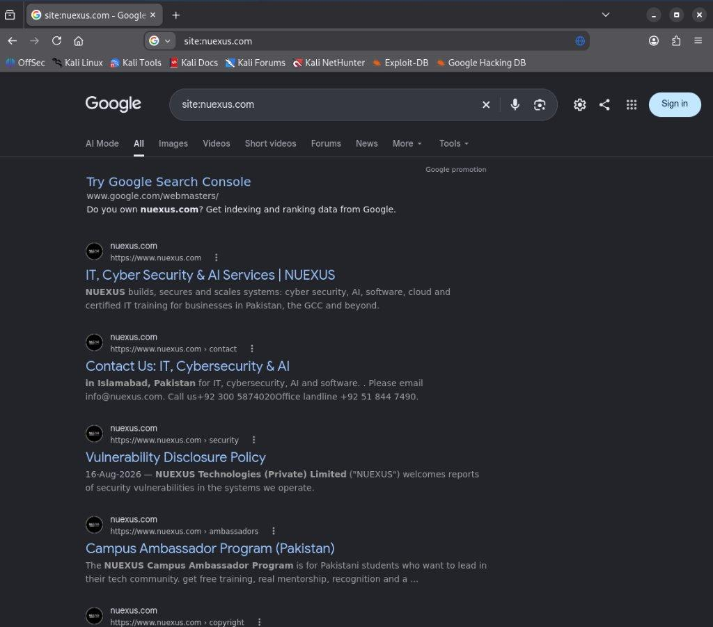
*Figure 2.1: Baseline search results highlighting corporate contact information, security policy links, and public service descriptions indexed by Google.*

#### Figure 2.2: Proprietary Technical Playbooks Disclosed (`site:nuexus.com filetype:pdf`)
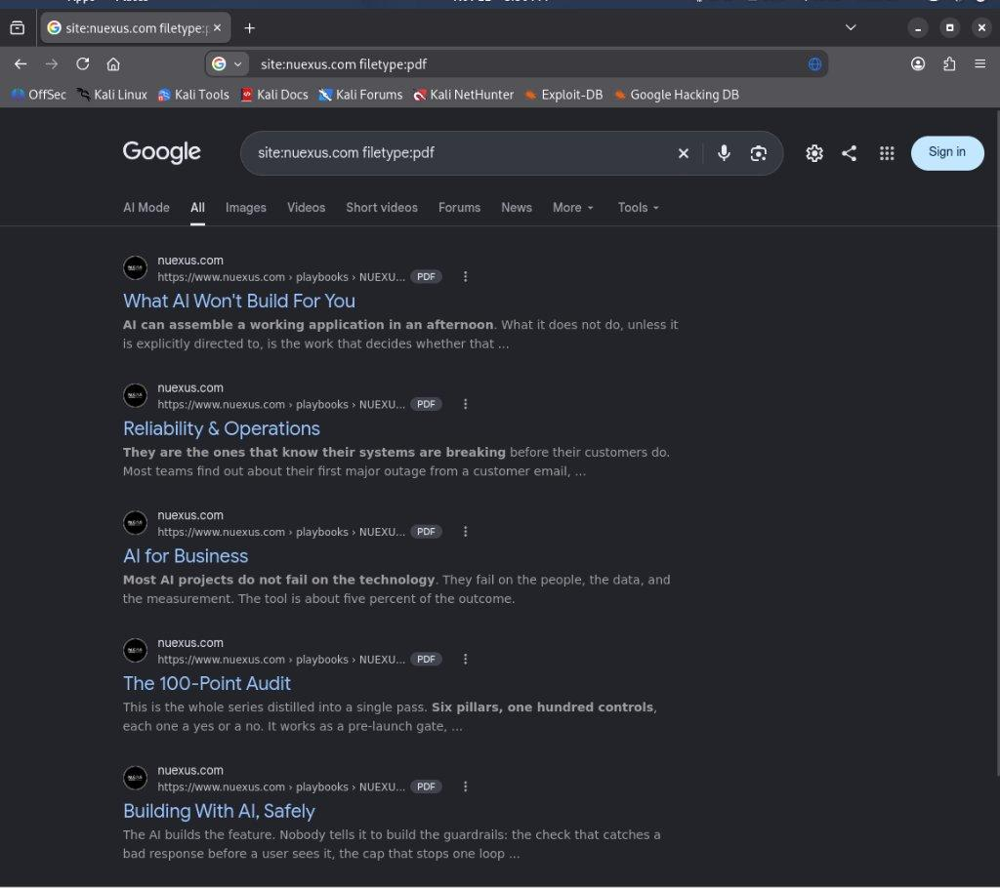
*Figure 2.2: Public search results revealing direct PDF download paths for internal technical playbooks hosted under `/playbooks/`.*

#### Figure 2.3: Verification of Directory Browsing Protection (`site:nuexus.com intitle:"index of"`)
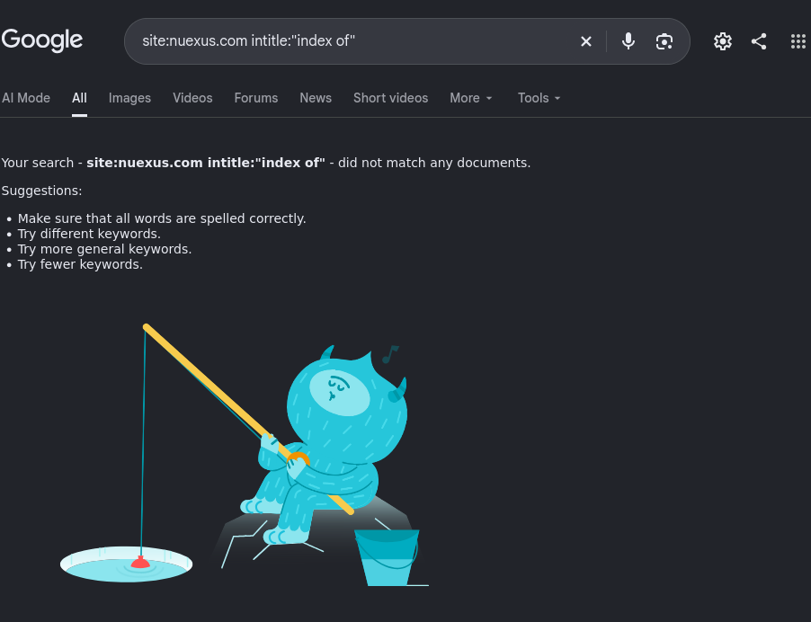
*Figure 2.3: Search confirmation demonstrating that server directory indexing is disabled, yielding zero matches.*

#### Figure 2.4: Administrative Surface Exposure Check (`site:nuexus.com inurl:admin OR inurl:login`)
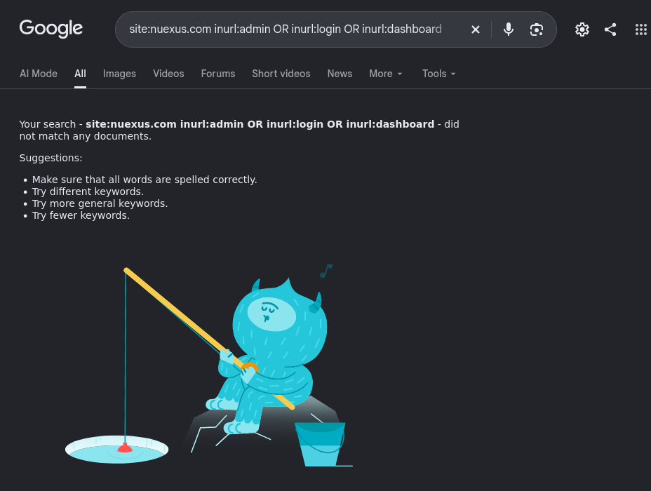
*Figure 2.4: Absence of exposed administrative and backend dashboards in the search index.*

#### Figure 2.5: Configuration & Credential Exposure Check (`site:nuexus.com ext:env OR ext:xml OR ext:conf`)
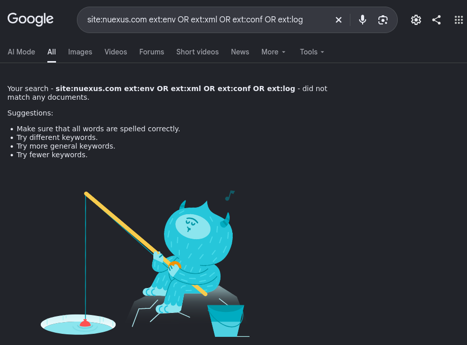
*Figure 2.5: Search engine audit verifying that `.env`, `.xml`, and `.conf` files are strictly isolated from public indexing.*

#### Figure 2.6: Subdomain Enumeration via Operator Exclusion (`site:nuexus.com -www`)
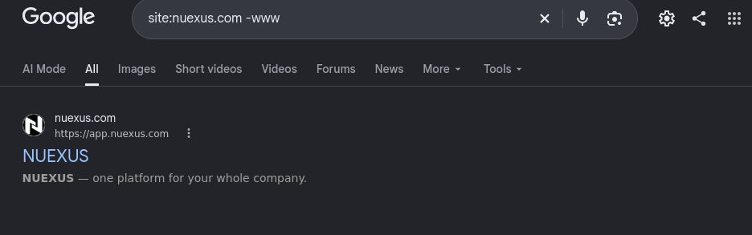
*Figure 2.6: Exclusion dork isolating the active web application endpoint `https://app.nuexus.com`.*

---

## Task 3: Subdomain Reconnaissance & Multi-Tool Reconciliation

Subdomain enumeration identifies forgotten test environments, staging branches, and internal administrative utilities that frequently lack the security hardening applied to the primary web presence. Because no single OSINT engine provides total visibility, professional reconnaissance mandates triangulating across multiple passive datasets.

### 3.1 Multi-Tool Execution & Comparative Performance

Three independent tools were executed against `nuexus.com` on the Kali Linux platform:

1. **Tool 1: `subfinder` (ProjectDiscovery):** Queries certificate transparency logs (crt.sh, Censys), passive DNS databases, and security aggregators.
   - *Command:* `subfinder -d nuexus.com -all -silent`
   - *Yield:* **24 hostnames** discovered.
2. **Tool 2: `assetfinder` (TomNomNom):** Scrapes archive records, search engines, and TLS certificate subjects rapidly.
   - *Command:* `assetfinder --subs-only nuexus.com`
   - *Yield:* **7 core hostnames** discovered.
3. **Tool 3: `theHarvester` (Christian Martorella):** Multi-source OSINT aggregation framework scanning PGP key servers, search engines, HackerTarget, and Shodan.
   - *Command:* `theHarvester -d nuexus.com -b all -l 500`
   - *Yield:* **20 hostnames** discovered + 10 IP address mappings.

#### Divergence Analysis: Why Tool Outputs Differ
- **Why `subfinder` found the largest set:** `subfinder` aggregates over 30 public passive sources and specialized certificate transparency (CT) log monitors. It identified developer-specific subdomains (`waseem.nuexus.com`, `areeba.nuexus.com`, `mehwish.nuexus.com`) and testing endpoints (`wa.waseem.nuexus.com`) that other scrapers missed because these subdomains were issued short-lived SSL certificates that were never linked from public web pages.
- **Why `assetfinder` had a conservative yield:** `assetfinder` operates without API dependencies and focuses strictly on high-confidence certificate subject alternative names (SANs) and direct HTML scraping. It successfully captured core production hosts (`api`, `app`, `assessments`, `recruit`, `mta-sts`, `www`) while ignoring ephemeral developer sub-zones.
- **Why `theHarvester` was valuable:** Beyond raw subdomains, `theHarvester` performed passive reverse IP lookups, identifying active Cloudflare Anycast front-end IPs (`104.21.85.21`, `172.67.201.8`, `188.114.96.0/23`) and IPv6 endpoints (`2a06:98c1:3120::6`).

### 3.2 Deduplicated Master Inventory & Live Resolution via `httpx-toolkit`

All candidate subdomains were consolidated into `subs.txt`, deduplicated, and resolved using ProjectDiscovery's `httpx-toolkit` to assess live HTTP status codes, edge IP addresses, and underlying technology stacks.

```
cat subs.txt | httpx-toolkit -ip -td -sc -title
```

#### Resolved Host Status Table:

| Hostname | Resolved IP | Status Code | Technology Stack Detected | Security Observation |
|:---|:---|:---|:---|:---|
| `https://nuexus.com` | `172.67.201.8` | `308 Permanent Redirect` | Cloudflare, HSTS, HTTP/3, Vercel | Seamless edge redirect to `https://www.nuexus.com` |
| `https://www.nuexus.com` | `188.114.97.6` | `200 OK` | Cloudflare, Vercel, HSTS, HTTP/3, Browser Insights | Main corporate production frontend |
| `https://app.nuexus.com` | `104.21.85.21` | `200 OK` | Bootstrap, Cloudflare, Google Sign-in, HSTS, Vercel | Production application portal with OAuth authentication |
| `https://autoconfig.nuexus.com` | `188.114.97.6` | `200 OK` | Cloudflare, Google Cloud, Google Cloud CDN, HSTS | Email/M365 client autoconfiguration service |
| `https://autodiscover.nuexus.com` | `104.21.85.21` | `200 OK` | Cloudflare, Google Cloud, Google Cloud CDN, HSTS | Mail client autodiscovery endpoint |
| `https://mta-sts.nuexus.com` | `76.76.21.61` | `200 OK` | Vercel Edge, HSTS | Mail Transfer Agent Strict Transport Security policy |
| `https://recruit.nuexus.com` | `104.21.85.21` | **`526 Invalid SSL`** | Cloudflare, HTTP/3 | Origin SSL handshake failed behind Cloudflare proxy |
| `https://assessments.nuexus.com`| `188.114.97.6` | **`526 Invalid SSL`** | Cloudflare, HTTP/3 | Origin SSL certificate expired or untrusted |
| `https://api.nuexus.com` | `188.114.97.6` | **`526 Invalid SSL`** | Cloudflare, HTTP/3 | Backend API origin unreachable or SSL misconfigured |

> [!NOTE]
> The **HTTP 526** errors on `api`, `assessments`, and `recruit` reveal that while Cloudflare protects the front-end DNS, the origin server's backend certificate is invalid or self-signed. In Cloudflare "Full (Strict)" SSL mode, this severs client connections until origin certificates are renewed.

### 3.3 Visual Evidence of Subdomain Enumeration & Resolution

#### Figure 3.1: Subdomain Discovery via `subfinder`
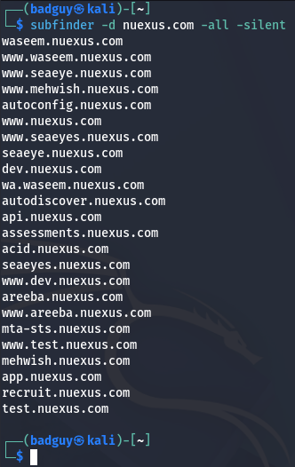
*Figure 3.1: subfinder output discovering 24 distinct subdomains across production, testing, and developer environments.*

#### Figure 3.2: Asset Discovery via `assetfinder`
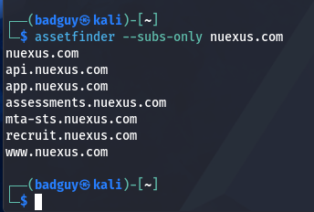
*Figure 3.2: assetfinder rapid discovery enumerating primary active corporate endpoints.*

#### Figure 3.3: Amass OSINT Passive Scan Baseline
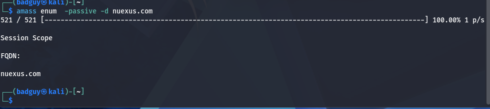
*Figure 3.3: amass passive query demonstrating that without external API credentials, graph discovery is constrained.*

#### Figure 3.4: Live Host Resolution & Stack Fingerprinting via `httpx-toolkit`
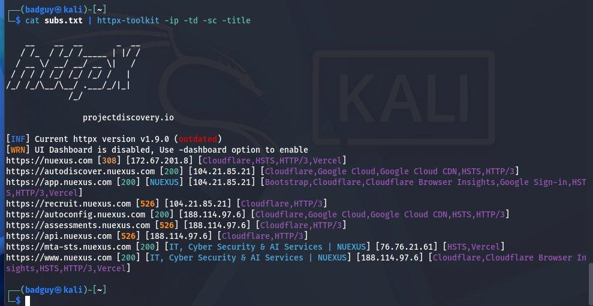
*Figure 3.4: Comprehensive resolution of deduplicated subdomains confirming live HTTP 200 services, Cloudflare edge proxying, and HTTP 526 origin SSL errors.*

---

## Task 4: Automated Web Scanner Comparative Analysis

Automated web application security scanners accelerate vulnerability identification by evaluating routine technical flaws (missing security headers, outdated software, reflection patterns, and insecure defaults). However, scanner architectures differ substantially in how they model web applications.

### 4.1 Scanner Architectural Comparison: Burp Suite vs. OWASP ZAP

| Technical Metric | Burp Suite (Professional / Community) | OWASP ZAP (ZAP by Checkmarx) |
|:---|:---|:---|
| **Primary Architecture** | Intercepting proxy with manual session modeling and integrated active/passive auditor | Multi-faceted automated scanner with built-in AJAX spider, daemon mode, and rule marketplace |
| **Crawling Engine** | Link-following HTTP parser + embedded Chromium crawler | Traditional link spider **plus** Client Spider driven by **Headless Firefox** |
| **Handling of Modern SPA** | Relies on user manual navigation or Chromium DOM crawler | Native headless browser executes client-side JavaScript, rendering virtual DOM links |
| **Analysis Depth** | Heuristic regex matching, reflection testing, and active insertion point fuzzing | Active DOM taint analysis (tracing untrusted sources into hazardous sinks in real time) |
| **Execution Speed** | Ultra-fast passive proxy inspection; active auditor throttled in Community edition | Fast passive spider; active scanner subject to Cloudflare network throttling |
| **Total Alerts Found** | **12 Issues** (0 High, 0 Medium, 1 Low, 11 Informational) | **47 Alerts** (6 High, 9 Medium, 5 Low, 27 Informational) |

### 4.2 Detailed Findings Analysis: What Each Found and Why

#### What OWASP ZAP Found that Burp Missed:
OWASP ZAP uncovered **6 High-Severity DOM-based vulnerabilities** that were entirely undetected by Burp's passive inspection:
1. **DOM XSS via `Element.innerHTML` (2 instances):** ZAP's headless Firefox execution detected unescaped JavaScript variables flowing directly into the DOM sink `innerHTML`.
2. **DOM-based Taint Flow Vulnerabilities (11 instances):** ZAP traced user-controllable input from `window.location` and URL parameters through client-side JavaScript execution paths.
3. **DOM-based Cookie & Link Manipulation:** Dynamic generation of `href` and `document.cookie` based on untrusted DOM data.
4. **Template Injection in Client-Side Strings (4 instances):** Detection of unescaped interpolation patterns resembling client-side template engines.

*Technical Justification:* Burp was operated in passive proxy capture mode during manual navigation, inspecting raw HTTP headers and static response bodies. It did not execute dynamic client-side taint-tracking. ZAP, utilizing its **Client Spider with Firefox Headless**, dynamically executed the Next.js JavaScript bundles, triggering runtime DOM mutations and evaluating taint flows that static parsers cannot observe.

#### What Burp Suite Found that ZAP Missed:
Burp Suite provided granular, contextual intelligence regarding application internals that ZAP aggregated into generic alerts:
1. **Internal Next.js Chunk Mapping:** Cataloged exact chunk IDs (`/1528-ac6650523567dc72.js`, `/2039.624ebebc21367548.js`), enabling precise source code reconstruction.
2. **Backend API Route Mapping:** Burp cleanly isolated hidden backend endpoints (`/api/nexi/verify/config`, `/api/nexi/session`) invoked asynchronously by the application frontend.
3. **Email Disclosure Locations:** Burp accurately cataloged all 7 individual script chunks where corporate email addresses were hardcoded.
4. **HSTS Absence on Third-Party Dependencies:** Burp specifically isolated that `static.cloudflareinsights.com` was missing strict transport security.

### 4.3 Manual Verification via Burp Repeater (Outcome #1 & Verb Tampering)

To validate the findings uncovered by both scanners, manual verification was conducted using Burp Suite Repeater:

#### Baseline Inspection (`GET / HTTP/2`)
- **Status:** `200 OK` (Content-Length: 367,752 bytes)
- **Content-Security-Policy (CSP) Flaw Identified:**
  ```http
  script-src 'self' 'unsafe-inline' 'unsafe-eval' https:;
  ```
  Both scanners correctly flagged this configuration. The inclusion of `'unsafe-inline'` permits inline script execution, while `'unsafe-eval'` enables string-to-code execution (`eval()`), significantly undermining the browser's ability to prevent cross-site scripting (XSS).

#### Verb Tampering Inspection (`OPTIONS / HTTP/2`)
Sending an `OPTIONS` request exposed the server's preflight handling:
- **Status:** `HTTP/2 204 No Content`
- **Allowed Methods:** `Access-Control-Allow-Methods: OPTIONS, GET, HEAD` (confirms state-modifying verbs like `POST` and `DELETE` are disallowed at the root).
- **Overly Permissive CORS Configuration:**
  ```http
  Access-Control-Allow-Origin: *
  ```
  The server advertises a wildcard origin on root preflight responses. While safe for public content, if replicated on authenticated endpoints (`/api/nexi/*`), this allows arbitrary external web applications to perform cross-origin data extraction.

### 4.4 Visual Evidence of Scanner Operations

#### Figure 4.1: Client-Server Model Inspection in Burp Proxy HTTP History
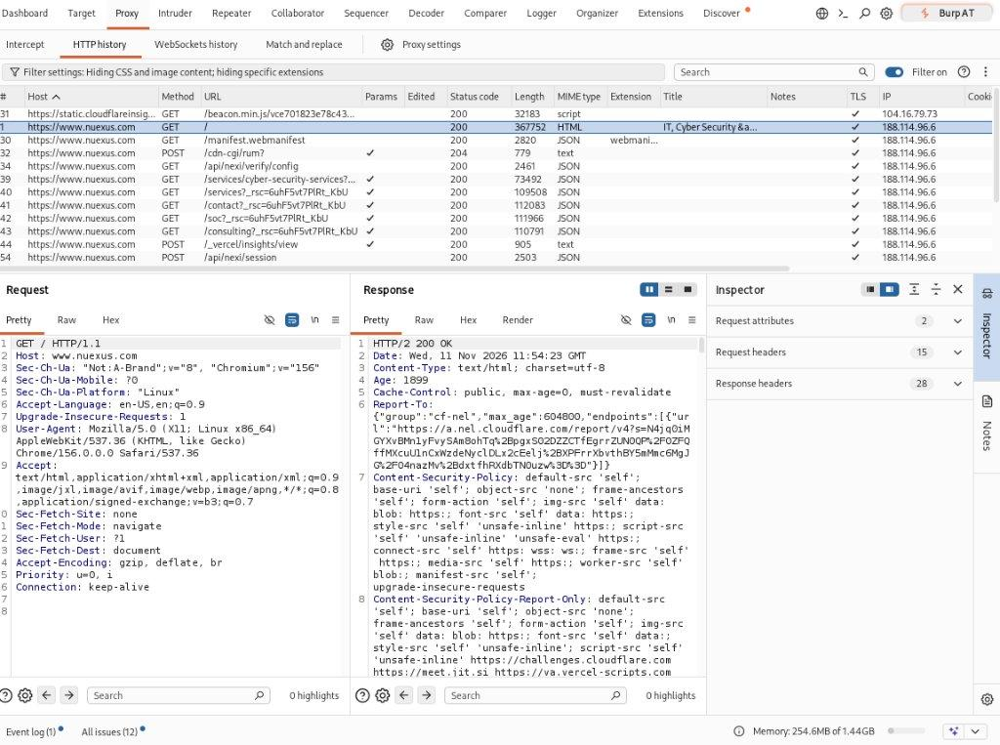
*Figure 4.1: Raw HTTP request and response inspection fulfilling Outcome #1, displaying headers, MIME types, and Next.js routing.*

#### Figure 4.2: Application Endpoints Mapped in Burp Site Map
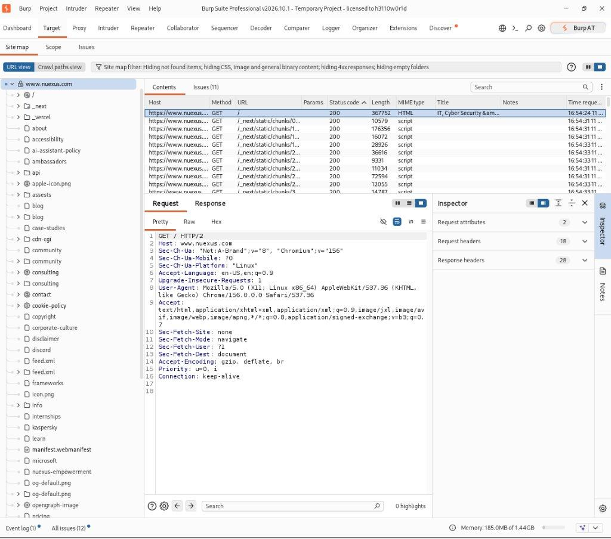
*Figure 4.2: Hierarchical tree model of the application showing Next.js static chunks, Vercel routing, and API structures.*

#### Figure 4.3: Baseline Request and Response in Burp Repeater
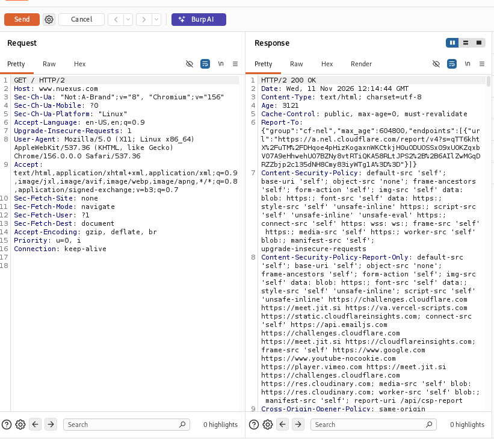
*Figure 4.3: Manual evaluation of headers and security policies in Burp Suite Repeater.*

#### Figure 4.4: Verb Tampering & Permissive CORS in Burp Repeater (`OPTIONS /`)
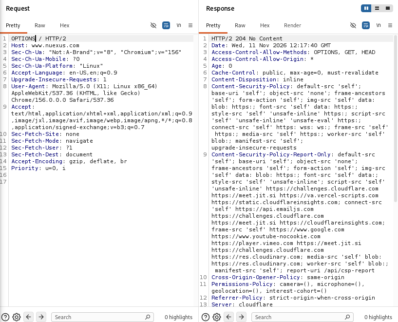
*Figure 4.4: Verb tampering demonstrating allowed methods and the wildcard Access-Control-Allow-Origin header.*

#### Figure 4.5: Burp Suite Dashboard & Passive Issue Activity
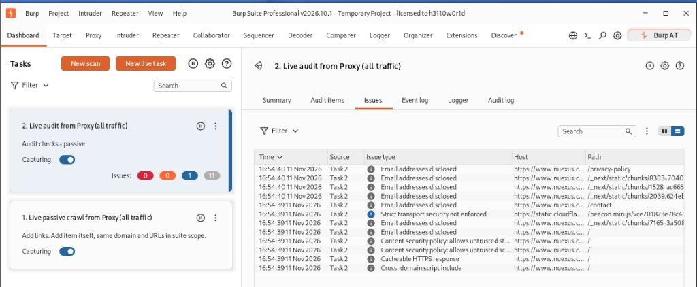
*Figure 4.5: Burp Dashboard cataloging 12 issues across CSP directives, email disclosures, and HTTPS configurations.*

#### Figure 4.6: OWASP ZAP Client Spider Execution (Headless Firefox)
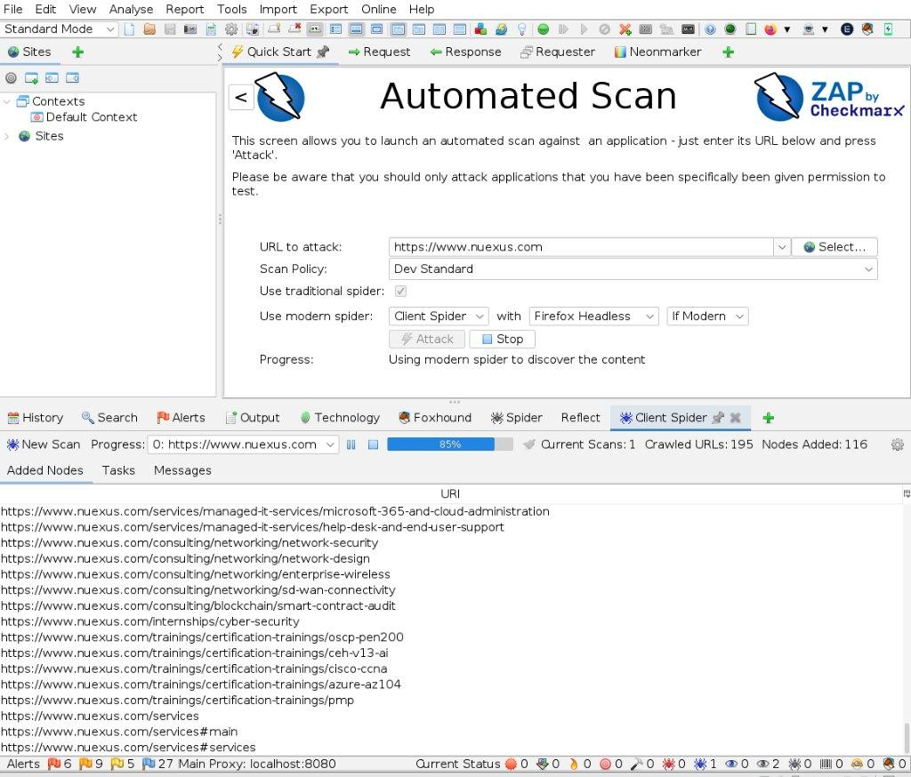
*Figure 4.6: OWASP ZAP Automated Scan utilizing headless browser crawling across 195 URLs.*

#### Figure 4.7: OWASP ZAP Full Vulnerability Alerts Tree
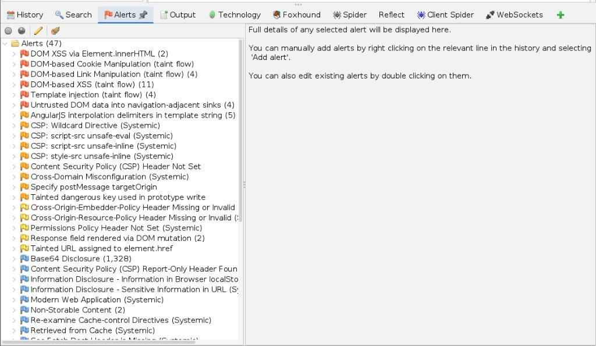
*Figure 4.7: Hierarchical vulnerability tree in ZAP showing 47 alerts, including DOM XSS, taint flows, and prototype pollution risks.*

---

## Conclusion & Strategic Recommendations

The combined passive reconnaissance, multi-tool subdomain discovery, and dual-scanner automated evaluation of `nuexus.com` demonstrates that while the enterprise maintains robust edge protection via Cloudflare and Modern Jamstack architectures (Vercel / Next.js), actionable remediation is required to harden the attack surface:

1. **Harden Content Security Policy (CSP):** Eliminate `'unsafe-inline'` and `'unsafe-eval'` directives from `Content-Security-Policy`. Adopt nonces or SHA-256 hashes for authorized inline scripts.
2. **Restrict CORS Headers:** Replace `Access-Control-Allow-Origin: *` with an explicit whitelist of trusted frontend domains to prevent unauthorized cross-origin access.
3. **Sanitize DOM Manipulation Sinks:** Review Next.js client-side components flagged by ZAP for `Element.innerHTML` usage. Refactor components to use safe text assignment (`textContent` or sanitized React JSX nodes).
4. **Remediate Origin SSL Certificates:** Resolve the HTTP 526 errors on `api.nuexus.com`, `assessments.nuexus.com`, and `recruit.nuexus.com` by installing valid origin CA certificates to restore backend routing.
5. **Enforce Robots Noindex on Playbooks:** Apply `X-Robots-Tag: noindex` to `/playbooks/` to prevent public search indexing of internal technical documentation.
